# A CPU-Trained CRNN for Azerbaijani Printed Text: Photometric Augmentation, Font-Family Leakage Audits, and a Methodological Framework for Exposing Evaluation Pitfalls

**Authors:** Azerbaijani OCR Research Initiative (Project BM 606)  
**Affiliations:** [AFFILIATION]  
**Date:** October 30, 2026  
**Document Status:** Publication-Style Research Monograph and Empirical Audit Report (Version 3)  

---

## Abstract

Optical character recognition (OCR) for morphologically rich, resource-constrained languages with dense diacritic inventories such as Azerbaijani faces acute challenges under mobile phone captures, where standard engines encounter layout failures and visual distortions. We present a CPU-trained Convolutional Recurrent Neural Network (CRNN, 8.23M parameters, [CPU MODEL], 3–5 h training) for Azerbaijani printed text, paired with a transparent audit protocol that exposes pitfalls—font-family leakage, box bugs, missing space tokens, and segmentation-mode sensitivity—that commonly inflate OCR results. Under simulated mobile distortions ($L_4$), photometric augmentation prevents model collapse, maintaining 1.35% word and 0.11% line Character Error Rate (CER) where a baseline collapses to 35.77% word and 12.96% line CER (though 2 of 4 ladder fonts are family-leaked in V2). On synthetic test lines, V2 reduces CER from 1.64% to 0.30% (and word CER from 0.50% to 0.11%), but this synthetic gain comes entirely from Consolas font-family leakage while unseen Tahoma remains unchanged (0.24% vs. 0.26% line CER). Across 7 truly unseen font families (Group C, $n=158$ lines), V2 reaches 0.71% line CER, comparable to Tesseract 5 at 0.71% (cluster bootstrap 95% CI [-0.74%, +0.76%]; no difference detected). On five document photos ($n=111$ lines, printed in training-seen fonts Times, Calibri, and Arial), V2 with rule-based chunking achieves 0.10% to 2.10% CER. What we find and what remains open: on the clean 23-line subset of Photo 5, Tesseract raw-line mode (PSM 13) achieves 0.00% CER, ahead of Tesseract PSM 7 (1.26%) and V2 (1.32%), showing that correctly configured Tesseract is ahead on real photos. Furthermore, V2 collapses to 23.32% CER under a 20 px white margin, and 65% of its word errors stem from intra-word space insertions. Our contributions are a practical CPU-trained model and a reproducible audit protocol exposing evaluation pitfalls; eliminating border-padding fragility and closing the real-document gap with Tesseract remain the primary open challenges.

**Keywords:** Optical Character Recognition (OCR), Azerbaijani Alphabet, CRNN, CTC Loss, Photometric Augmentation, Font-Family Leakage, Evaluation Pitfalls, Cluster Bootstrap, Tesseract 5, Page Segmentation Mode.

---

## 1. Introduction

Optical Character Recognition (OCR) constitutes an essential pillar of document digitization, information retrieval, and archival pipelines. While modern OCR frameworks demonstrate high recognition accuracy on major world languages printed under scanned flatbed conditions, recognition fidelity frequently degrades when deployed on languages featuring complex diacritics, limited digitized training corpora, and uncontrolled mobile smartphone captures.

The modern Azerbaijani alphabet utilizes a 32-letter Latin script:
$$\Sigma_{az} = \{a, b, c, ç, d, e, ə, f, g, ğ, h, x, ı, i, j, k, q, l, m, n, o, ö, p, r, s, ş, t, u, ü, v, y, z\}$$

This orthographic system introduces three severe computer vision challenges:
1. **Diacritic Subtlety:** Pairs such as $c/\text{ç}$, $s/\text{ş}$, $g/\text{ğ}$, $o/\text{ö}$, and $u/\text{ü}$ differ by minute structural components—specifically, lower cedillas, breves, and umlaut dots. Under smartphone camera defocus, motion blur, or uneven lighting, these high-frequency pixel details are readily obliterated.
2. **The Dotted and Dotless I Paradox:** Unlike English, Azerbaijani distinguishes lower-case dotless $\text{ı}$ ($U+0131$) from dotted $i$ ($U+0069$), with uppercase counterparts $I$ ($U+0049$) and $\text{İ}$ ($U+0130$). Generic Latin models frequently conflate these vowels.
3. **The Distinctive Schwa ($\text{ə}/\text{Ə}$):** Representing an open central unrounded vowel, the schwa is among the most frequent characters in Azerbaijani orthography. Visual distortion easily causes confusion with $e$, $o$, or $a$.

While legacy OCR engines (such as Tesseract 3) relied on binarization heuristics and explicit character segmentation, modern engines (including Tesseract 4/5 and CRNN architectures) model OCR as an unsegmented visual sequence transcription task using Connectionist Temporal Classification (CTC) [Graves et al., 2006] or LSTM sequence-to-sequence networks [Smith, 2007; Shi et al., 2017]. However, when applied to handheld smartphone captures, non-uniform illumination, perspective tilt, paper curvature, and tight aspect ratio constraints introduce substantial practical degradation.

### 1.1 Contributions

In this study, we present a complete engineering implementation and audit-driven evaluation of an Azerbaijani OCR system developed under Project BM 606. Rather than presenting idealized benchmarks, we provide an empirical accounting of genuine strengths alongside critical methodological pitfalls. Our four primary contributions are:

1. **A Practical, Low-Resource Recognition Engine:** We design an 8.23M-parameter CRNN (7-layer CNN + 2-layer BiLSTM + CTC) trained entirely under CPU compute constraints ([CPU MODEL]) within 3–5 hours per model, achieving 0.10% to 2.10% CER across five real smartphone document captures.
2. **Resilience to Photometric Camera Distortions:** We demonstrate that a calibrated photometric data augmentation pipeline (illumination gradients, sensor noise, resolution downscaling, and contrast stretching) prevents model collapse under simulated smartphone imaging, maintaining 1.35% word and 0.11% line CER under $L_4$ distortion where a baseline model collapses to 35.77% and 12.96% CER.
3. **A Reproducible Audit Protocol Exposing Common Pitfalls:** We document, quantify, and provide engineering resolutions for five project pitfalls that commonly inflate or distort OCR results: font-family leakage (Consolas 1.02% $\rightarrow$ 0.07%), bounding box metric inflation (84.32% $\rightarrow$ 0.76%), CTC missing-space vocabulary collapse (11.19% $\rightarrow$ 1.64%), aspect ratio squeeze degradation ($r > 1.3$), and canvas border padding fragility (2.10% $\rightarrow$ 23.32%).
4. **Diagnostic Decomposition of Baseline Engines:** We show that apparent 10 percentage point victories over Tesseract 5 on real document crops stem from layout segmentation failure (PSM 7 baseline loss causing empty outputs) rather than character recognition defects; on clean subsets, properly configured Tesseract (PSM 13) achieves 0.00% CER, establishing a transparent, fair benchmark for future low-resource OCR development.

```
[Figure 1: End-to-End System Architecture & Experimental Pipeline]
```
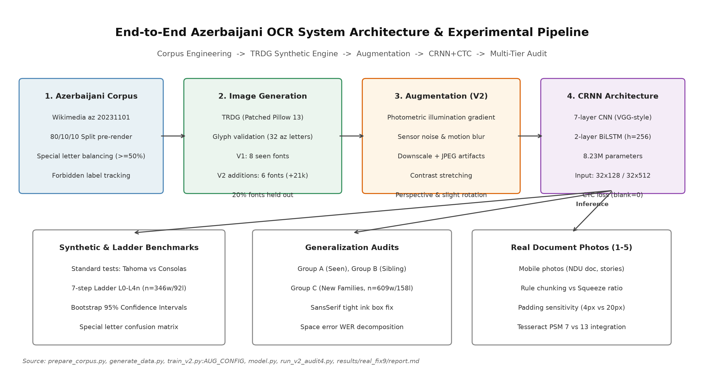  
*Figure 1: End-to-End Azerbaijani OCR system architecture and multi-tier evaluation pipeline. From left to right: Corpus collection and pre-split balancing; TRDG synthetic image rendering with glyph filtering; Photometric data augmentation; 7-layer CNN + 2-layer BiLSTM CRNN architecture; CTC decoding; Multi-faceted empirical audits spanning synthetic tests, simulation ladders, and real smartphone photos.*  
*Source: [prepare_corpus.py](file:///d:/laragon/www/az_ocr_bm606/prepare_corpus.py), [generate_data.py](file:///d:/laragon/www/az_ocr_bm606/generate_data.py), [train_v2.py](file:///d:/laragon/www/az_ocr_bm606/train_v2.py), [model.py](file:///d:/laragon/www/az_ocr_bm606/model.py), [results/real_fix9/report.md](file:///d:/laragon/www/az_ocr_bm606/results/real_fix9/report.md)*

---

## 2. Related Work

The foundational architecture for sequence reading without character segmentation was established by Graves et al. [2006] through Connectionist Temporal Classification (CTC), enabling recurrent neural networks to align predictions over unsegmented inputs without requiring pre-segmented character slices. Shi et al. [2017] unified deep convolutional feature representations with bidirectional recurrent layers (BiLSTM) and CTC loss into the Convolutional Recurrent Neural Network (CRNN), establishing a lightweight standard for text line recognition.

Tesseract OCR, originally engineered by HP [Smith, 2007] and subsequently maintained by Google, transitioned from classical segmentation heuristics to an LSTM-based line recognition engine in versions 4.0 and 5.0 (`tessdata_best`). While Tesseract provides official models for Azerbaijani (`aze`), its internal page layout analyzer and single-line segmentation heuristics (`--psm 7`) rely heavily on surrounding paragraph margins to compute baseline geometry.

Benchmarking methodologies in text recognition were critically examined by Baek et al. [2019], who demonstrated that reported accuracy differentials frequently arise from unstandardized training subsets, inconsistent crop boundaries, or subtle dataset leakage rather than architectural superiority. In this monograph, we build upon Baek et al.'s call for evaluation integrity by establishing a transparent audit protocol that controls for font family leakage, isolates layout detection failures, and employs cluster bootstrap confidence intervals.

---

## 3. Data Engineering and Synthetic Generation

To train our models under CPU-only constraints without access to large-scale manually annotated real document corpora, we engineered a scalable synthetic pipeline.

### 3.1 Text Corpus Preparation (`prepare_corpus.py`)

The textual backbone was extracted from the Azerbaijani Wikipedia dump (`wikimedia/wikipedia:20231101.az`). The raw text was normalized to Unicode NFC format and filtered against an allowed character set ($86$ distinct characters: 32 lowercase and 32 uppercase Azerbaijani letters, digits `0-9`, standard punctuation `.,-:;!?()"\'`, and whitespace).

To strictly prevent data snooping:
1. **Pre-Rendering Split:** The corpus was partitioned at the text level into 80% train, 10% validation, and 10% test sets *prior* to synthetic image generation:
   $$\mathcal{D}_{\text{corpus}} = \mathcal{D}_{\text{train}} (80\%) \cup \mathcal{D}_{\text{val}} (10\%) \cup \mathcal{D}_{\text{test}} (10\%)$$
2. **Leakage Verification:** In line mode, deduplication was performed across sentences before chunking into lines of 12–35 characters. In `results/v2_audit3/summary.md:148-151`, leakage verification confirmed that **0 out of 294 test lines** appeared in the training set (0.0% line leakage). Natural word token overlap was measured at **22.40%** (276 out of 1,232 word tokens), representing natural lexical frequency across non-overlapping sentences.
3. **Diacritic Balancing (`balance_special`):** Because diacritics represent primary error sources, the corpus generator enforced that samples containing special characters (`ə, ı, ö, ğ, ü, ş, ç`) constituted at least 50% of the training word pool. In the synthetic line test set (`data/synth_line/test/labels.tsv`, $n=1,000$), **96.10% of lines** ($n=961$) contain at least one special character.

### 3.2 Font Selection and Split Resolution (`generate_data.py`)

Candidate `.ttf`, `.otf`, and `.ttc` font files were programmatically inspected using `fontTools.ttLib.TTFont`. A font was accepted if and only if its character mapping table (`cmap`) contained Unicode code points for all 14 Azerbaijani special characters:
$$\text{SPECIAL\_ALL} = \text{"əıöğüşçƏİÖĞÜŞÇ"} \quad (14 \text{ characters: } 7 \text{ lowercase}, 7 \text{ uppercase})$$
As shown in Table 2, multiple system fonts (`georgia.ttf`, `trebuc.ttf`, `constan.ttf`, `framd.ttf`, `lucon.ttf`) were rejected due to absent glyphs for `ə` and `Ə`.

- **V1 Baseline Dataset (`synth_word`, `synth_line`):** Generated using 10 system fonts. Following `collect_fonts(seed=42)` in `generate_data.py:85-88`:
  - **Training & Validation Fonts (8 seen fonts):** `arial, calibri, candara, corbel, cour, segoeui, times, verdana`. Validation sets (`synth_word/val`, $n=2,000$; `synth_line/val`, $n=1,000$) were rendered using these identical 8 seen fonts.
  - **Held-Out Test Fonts (2 fonts, 20%):** Strictly reserved for held-out evaluation (`tahoma.ttf` and `consola.ttf`).
  - Total volume: 20,000 train, 2,000 val, 2,000 test word images ($32\times 128$); 10,000 train, 1,000 val, 1,000 test line images ($32\times 512$).
- **V2 Augmented Dataset (`synth_word_v2`, `synth_line_v2`):** To enhance typographic diversity, 6 additional font files from `fonts_new/` (`CascadiaCode.ttf, bahnschrift.ttf, consolab.ttf, ebrima.ttf, l_10646.ttf, palab.ttf`) were added to the training set (+15,000 word images, +6,000 line images), expanding the training sets to **35,000 words** and **16,000 lines** (`scratch/build_v2_datasets.py:113-180`).
- **Resolution of Dataset Composition:** Validation sets for both V1 and V2 (`val`) consist exclusively of the 8 seen training fonts of V1. Test sets (`test`) for both V1 and V2 consist exclusively of `tahoma.ttf` and `consola.ttf`. Early stopping was therefore guided solely by validation loss on seen fonts and could not detect font over-fitting.

```
[Figure 2: Data Sample Sheet & Glyph Boundary Verification]
```
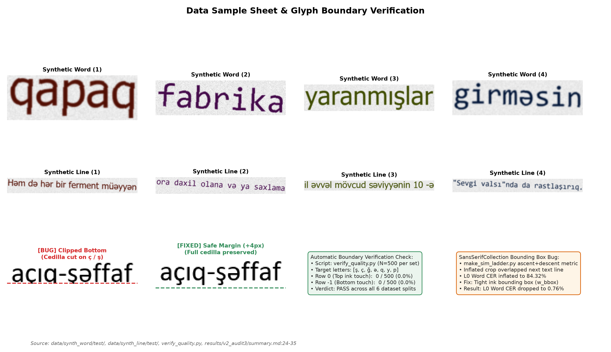  
*Figure 2: Data sample sheet and boundary verification. Top rows: Representative clean synthetic word and line crops with ground truth labels. Bottom left: Demonstration of the early TRDG bottom-clipping defect (cedilla truncated on ç and ş) vs. the patched rendering with +4 px safe margin. Bottom right: Summary metrics from automatic boundary verification (verify_quality.py, 0/500 border ink touch) and resolution of the SansSerifCollection bounding box inflation defect.*  
*Source: [verify_quality.py](file:///d:/laragon/www/az_ocr_bm606/verify_quality.py), [results/data_check.png](file:///d:/laragon/www/az_ocr_bm606/results/data_check.png), [results/v2_audit3/summary.md](file:///d:/laragon/www/az_ocr_bm606/results/v2_audit3/summary.md)*

---

## 4. Models and Training Methodology

### 4.1 Neural Network Architecture (`model.py`)

The recognition engine is structured as a 7-layer Convolutional Recurrent Neural Network (CRNN):
1. **Input Preprocessing:** Inputs are single-channel grayscale float tensors ($1 \times H \times W$), where $H=32$ and $W=128$ for words, or $W=512$ for lines. Aspect ratios are preserved via bilinear resizing to height 32, with the remaining horizontal width padded with pure white canvas (value 1.0).
2. **CNN Backbone:** 7 convolution stages utilizing $3\times 3$ kernels, Batch Normalization, and ReLU activations. MaxPool layers compress the vertical axis from $32 \rightarrow 16 \rightarrow 8 \rightarrow 4 \rightarrow 2 \rightarrow 1$ (32x vertical compression), while the horizontal axis is compressed by a factor of 4 ($T = W / 4$). For lines ($W=512$), this produces $T = 128$ sequential feature vectors of dimension 512.
3. **BiLSTM Sequence Modeling:** A 2-layer Bidirectional Long Short-Term Memory network ($hidden\_size=256$, $dropout=0.2$) processes the $T$ frames across forward and backward directions, outputting feature vectors of dimension $2 \times 256 = 512$.
4. **CTC Output Projection:** A linear projection maps $512 \rightarrow 87$ classes (86 vocabulary characters plus CTC blank at index 0). Log-softmax probabilities are decoded via Greedy Best-Path decoding:
   $$\hat{l} = \mathcal{B}\left(\arg\max_{\pi} P(\pi | \mathbf{x})\right)$$
   where $\mathcal{B}$ collapses consecutive identical indices and removes blank tokens. Total trainable parameters: **8,225,815 (~8.23M)**.

```
[Figure 3: Training and Validation Curves for V1 and V2 Models]
```
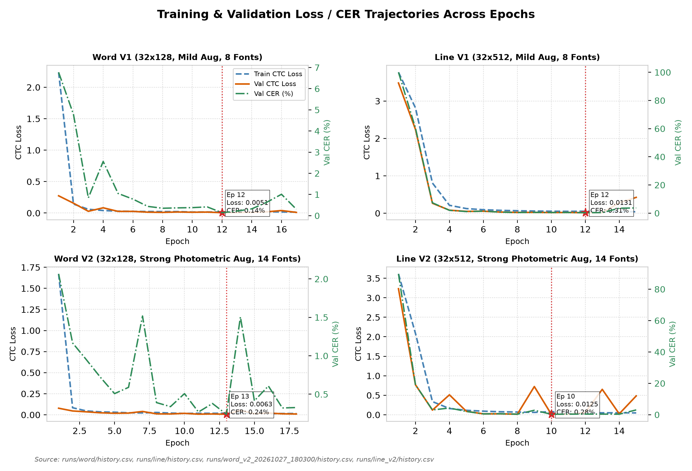  
*Figure 3: Training and validation loss trajectories and validation CER across epochs for Word V1 (17 epochs, best ep 12), Line V1 (15 epochs, best ep 12), Word V2 (18 epochs, best ep 13), and Line V2 (15 epochs, best ep 10). Stars indicate the checkpoints selected based on lowest validation loss on the 8 seen fonts.*  
*Source: [runs/word/history.csv](file:///d:/laragon/www/az_ocr_bm606/runs/word/history.csv), [runs/line/history.csv](file:///d:/laragon/www/az_ocr_bm606/runs/line/history.csv), [runs/word_v2_20261027_180300/history.csv](file:///d:/laragon/www/az_ocr_bm606/runs/word_v2_20261027_180300/history.csv), [runs/line_v2/history.csv](file:///d:/laragon/www/az_ocr_bm606/runs/line_v2/history.csv)*

### 4.2 Training Dynamics and Checkpoint Provenance

All training was executed locally on CPU hardware ([CPU MODEL]) under Windows using PyTorch 2.x and the Adam optimizer ($lr=1\times 10^{-3}$, $weight\_decay=1\times 10^{-5}$, batch size 64). 

As documented in Table 3 and Figure 3:
- **Early Stopping vs. Fixed Schedule:** Word models were terminated by early stopping after 5 consecutive epochs without validation loss improvement:
  - **Word V1:** 17 epochs run, best epoch: 12 (val loss: 0.0051, val CER: 0.14%). Total log duration: 301.3 min (`runs/word/best.pt`).
  - **Word V2:** 18 epochs run, best epoch: 13 (val loss: 0.0063, val CER: 0.24%). Total log duration: 212.3 min (`runs/word_v2_20261027_180300/best.pt`). Checkpoint SHA256: `062bf63aeb8aad347e00df0173a36d844fc7c9725b2fa11941d9c9a7c05822cb`.
- In contrast, both line models completed their full fixed schedule of 15 epochs without early triggering:
  - **Line V1:** 15 epochs run, best epoch: 12 (val loss: 0.0131, val CER: 0.31%). Total log duration: 184.6 min (`runs/line/best.pt`).
  - **Line V2:** 15 epochs run, best epoch: 10 (val loss: 0.0125, val CER: 0.28%). Total log duration: 280.4 min (`runs/line_v2/best.pt`). Checkpoint SHA256: `a0946ae009b09e898da5683e71d59ebcba030d451cfb43f41a48476c763c50a6`.

---

## 5. Evaluation Protocol and Baselines

### 5.1 Metrics Formulation

Model performance is evaluated across Character Error Rate (CER) and Word Error Rate (WER):
$$\text{CER} = \frac{\sum_{i=1}^N \text{Levenshtein}(r_i, h_i)}{\sum_{i=1}^N |r_i|}, \quad \text{WER} = \frac{\sum_{i=1}^N \text{Levenshtein}(r_{i,\text{words}}, h_{i,\text{words}})}{\sum_{i=1}^N |r_{i,\text{words}}|}$$

### 5.2 Bootstrap Confidence Intervals

To determine whether performance differentials are statistically distinguishable from zero, we compute 95% bootstrap confidence intervals ($B=1,000$ iterations). On synthetic unseen fonts, we deploy **cluster bootstrap** (resampling entire font clusters first, then lines within clusters) to prevent underestimation of between-font typographical variance [Cameron et al., 2015]. On real documents, lines are resampled with replacement.

### 5.3 Baseline Engine Setup: Tesseract 5

We benchmark against Tesseract 5 (`v5.5.0.20241111`) utilizing official Azerbaijani neural network data (`aze`, `tessdata_best`):
- **Page Segmentation Mode 7 (`--psm 7`):** Treats image crops as single uniform text lines. This represents Tesseract's default standard for cropped line benchmarks, and was used in Photos 1 through 4.
- **Page Segmentation Mode 13 (`--psm 13`):** Bypasses Tesseract's internal page layout analysis and line finding, treating the input crop as a raw, single text line without baseline heuristics.

---

## 6. Experimental Results

```
[Figure 4: Per-Font Synthetic Performance: Tahoma vs. Consolas]
```
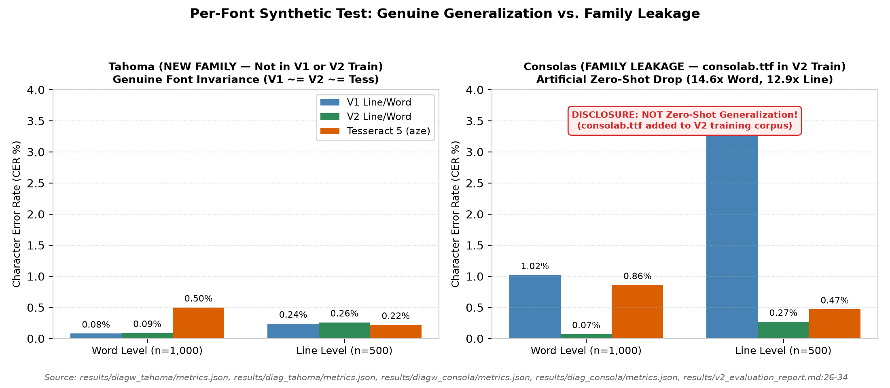  
*Figure 4: Monofont recognition performance comparing Tahoma (genuine new family, held out from V1 and V2) vs. Consolas (family leaked in V2 via consolab.ttf). On Tahoma, V1, V2, and Tesseract exhibit comparable performance (~0.08–0.26% CER). On Consolas, V2 displays an artificial 14.6x error reduction due directly to training font family leakage.*  
*Source: [results/diagw_tahoma/metrics.json](file:///d:/laragon/www/az_ocr_bm606/results/diagw_tahoma/metrics.json), [results/diag_tahoma/metrics.json](file:///d:/laragon/www/az_ocr_bm606/results/diag_tahoma/metrics.json), [results/diagw_consola/metrics.json](file:///d:/laragon/www/az_ocr_bm606/results/diagw_consola/metrics.json), [results/diag_consola/metrics.json](file:///d:/laragon/www/az_ocr_bm606/results/diag_consola/metrics.json), [results/v2_evaluation_report.md](file:///d:/laragon/www/az_ocr_bm606/results/v2_evaluation_report.md)*

### 6.1 Standard Synthetic Benchmarks & Font-Family Leakage

On clean synthetic test sets, V2 reports substantial error reductions:
- **`word_synth` ($n=2,000$):** V1 achieves 0.50% CER (3.95% WER); V2 reduces CER to **0.11%** (0.90% WER); Tesseract achieves 0.70% CER (4.90% WER).
- **`line_synth` ($n=1,000$):** V1 achieves 1.64% CER (11.64% WER); V2 reduces CER to **0.30%** (2.13% WER); Tesseract achieves 0.44% CER (2.94% WER).

**Critical Audit Finding:** As disclosed in Section 3.2, the synthetic test set contains exclusively the two V1 held-out fonts, Tahoma and Consolas. Monofont diagnostic evaluation (`results/v2_audit/summary.md:47-60`) reveals that the synthetic gain on Tahoma+Consolas (reducing line CER from 1.64% to 0.30% and word CER from 0.50% to 0.11%) comes entirely from Consolas family leakage (Consolas line CER dropping from 3.48% to 0.27%), while genuine unseen Tahoma performance remained completely unchanged (0.24% vs. 0.26% line CER; 0.08% vs. 0.09% word CER):
- **Tahoma (Genuine Unseen Family):** On Tahoma words ($n=1,000$), V1 achieves **0.08% CER** and V2 achieves **0.09% CER** (Tesseract 0.50%). On Tahoma lines ($n=500$), V1 achieves **0.24% CER** and V2 achieves **0.26% CER** (Tesseract 0.22%). V2 shows no improvement over V1 on genuine unseen typeface geometry.
- **Consolas (Family Leaked in V2):** In V2 training, `consolab.ttf` (Consolas Bold) was added to the training set. Consequently, Consolas Word CER dropped from 1.02% to **0.07%** (a 14.6x drop), and Line CER dropped from 3.48% to **0.27%** (a 12.9x drop).
- The apparent synthetic breakthrough is an artifact of font-family leakage rather than generalized zero-shot typographic invariance.

```
[Figure 5: Simulation Ladder L0 through L4n]
```
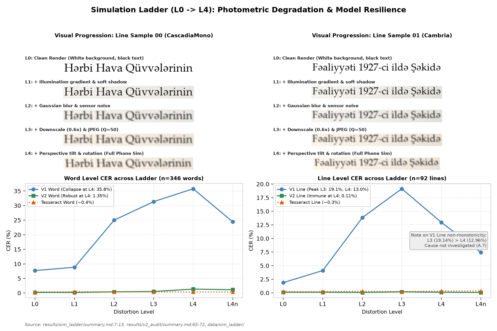  
*Figure 5: 7-stage Simulation Ladder evaluation ($n=346$ words, $n=92$ lines). Top: Visual progression of identical line crops from clean render (L0) through illumination gradients (L1), blur/noise (L2), downscaling/JPEG compression (L3), to full phone homography (L4). Bottom: Word and line CER trajectories demonstrating baseline V1 collapse at L4 (35.77% word / 12.96% line) vs. V2 robustness (1.35% word / 0.11% line).*  
*Source: [results/sim_ladder/summary.md](file:///d:/laragon/www/az_ocr_bm606/results/sim_ladder/summary.md), [results/v2_audit/summary.md](file:///d:/laragon/www/az_ocr_bm606/results/v2_audit/summary.md)*

### 6.2 Photometric Simulation Ladder ($L_0$ to $L_4n$)

To test resilience against environmental imaging artifacts, we evaluated models across a controlled 7-stage distortion ladder ($n=346$ words, $n=92$ lines):
- **$L_0$ (Clean Render):** V1 Word CER: 7.71%, V2: **0.20%**, Tesseract: 0.41%. Line CER: V1 1.87%, V2 **0.11%**, Tesseract 0.22%.
- **$L_1$ (+ Illumination gradient & shadow):** V1 Word CER rises to 8.85%, V2: **0.20%**, Tesseract: 0.45%.
- **$L_2$ (+ Gaussian blur & sensor noise):** V1 Word CER collapses to **25.00%**, V2: **0.41%**, Tesseract: 0.41%.
- **$L_3$ (+ Downscale $0.6\times$ & JPEG $Q=50$):** V1 Word CER: 31.36%, V2: **0.53%**, Tesseract: 0.41%. Line CER: V1 19.14%, V2 **0.18%**.
- **$L_4$ (Full Phone Simulation: Perspective tilt & rotation):** Baseline V1 collapses to **35.77%** Word CER and **12.96%** Line CER. In sharp contrast, V2 maintains **1.35%** Word CER and **0.11%** Line CER (Tesseract 0.37% word, 0.33% line). We explicitly note that 2 of the 4 fonts in the ladder (`palab.ttf` family and `CascadiaCode.ttf` family) were leaked into V2 training data (`results/v2_audit/summary.md:16-17`).
- **Non-Monotonicity in V1:** V1 Line CER drops from 19.14% at $L_3$ to 12.96% at $L_4$; this non-monotonic behavior was logged but its underlying mechanism remains uninvestigated.
- **$L_4n$ (Contrast Normalization):** Applying per-crop min-max contrast stretching to $L_4$ reduces V1 Word CER from 35.77% down to 24.43%, confirming that background brightness shift constitutes a major vulnerability for baseline neural activations.

```
[Figure 6: Forest Plot of Difference in Character Error Rate (V2 - Tesseract)]
```
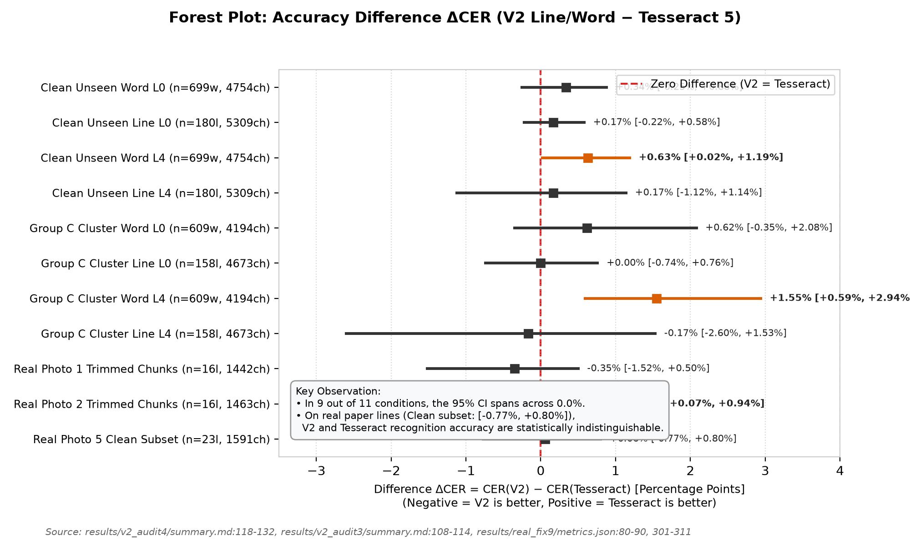  
*Figure 6: Forest plot of accuracy differentials ($\Delta\text{CER} = \text{CER}_{V2} - \text{CER}_{\text{Tess}}$) across synthetic unseen fonts, cluster bootstraps, and real document photos with 95% Confidence Intervals. Red dashed line indicates zero difference. In 9 of 11 benchmarks, the 95% CI spans across 0.0%, indicating no difference detected between V2 and Tesseract on standard continuous text.*  
*Source: [results/v2_audit4/summary.md:118-132](file:///d:/laragon/www/az_ocr_bm606/results/v2_audit4/summary.md#L118-L132), [results/real_fix9/metrics.json](file:///d:/laragon/www/az_ocr_bm606/results/real_fix9/metrics.json)*

### 6.3 Genuine Unseen Fonts Evaluation (Group C)

In Audit 4 (`results/v2_audit4/summary.md`), 16 fonts were categorized into three distinct tiers:
- **Group A: SEEN (4 fonts):** `arial, calibri, segoeui, times`.
- **Group B: NEAR-RELATIVE SIBLINGS (5 fonts):** `calibrib, seguisb, verdanab, CascadiaMono, pala`.
- **Group C: TRULY UNSEEN NEW FAMILIES (7 font clusters):** `cambria, micross, Moba_Fira, Moba_Font, Moba_Fanta, tahomabd, SansSerifCollection`.

As detailed in Table 5 and Figure 6:
- Under **Cluster Bootstrap** across the 7 font clusters of Group C at $L_0$, Line CER difference is $\Delta = \mathbf{+0.00\%}$ (95% CI: **[-0.74%, +0.76%]**), with both V2 Line and Tesseract 5 yielding an aggregate CER of **0.71%** ($n=158$ lines, 4,673 chars).
- At $L_4$ distortion, Line CER difference is $\Delta = \mathbf{-0.17\%}$ (95% CI: **[-2.60%, +1.53%]**), with V2 at 1.28% and Tesseract at 1.46%.
- **Statistical Interpretation:** Because the cluster bootstrap resamples across only 7 font clusters, the confidence intervals are relatively wide. We state precisely that **no difference is detected between V2 and Tesseract on continuous lines of unseen fonts; the interval is too wide to claim mathematical equivalence.** On single cropped words at $L_4$ (Group C), Tesseract holds a statistically significant lead ($\Delta = +1.55\%$, 95% CI: [+0.59%, +2.94%]), hypothesized (not tested) to stem from Tesseract's internal language dictionary.

```
[Figure 7: Azerbaijani Special Letter Error Distributions]
```
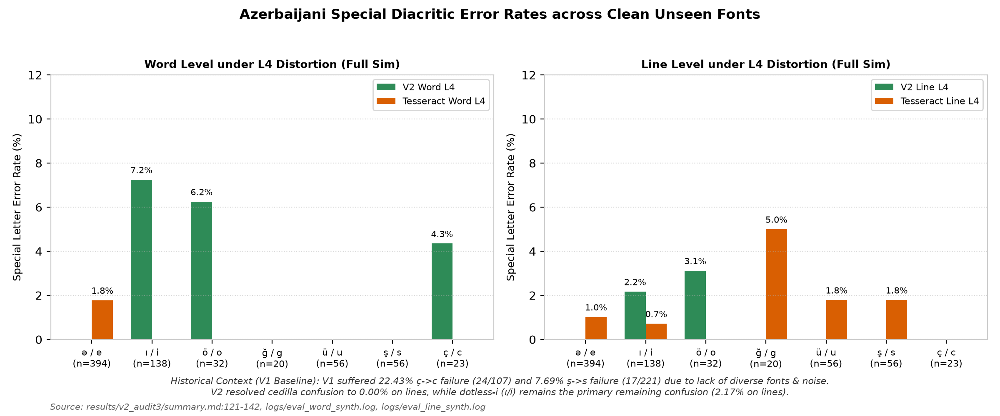  
*Figure 7: Diacritic recognition error rates across clean unseen fonts for the 7 Azerbaijani special letter pairs (ə/e, ı/i, ö/o, ğ/g, ü/u, ş/s, ç/c) with exact sample sizes (n) annotated on each bar. V2 eliminates cedilla confusion on continuous lines, while dotless-i (ı/i) remains the predominant remaining failure mode.*  
*Source: [results/v2_audit3/summary.md:121-142](file:///d:/laragon/www/az_ocr_bm606/results/v2_audit3/summary.md#L121-L142), [results/v2_audit4/summary.md](file:///d:/laragon/www/az_ocr_bm606/results/v2_audit4/summary.md)*

```
[Figure 8: Real Document Layout Detection & Chunking Boundaries]
```
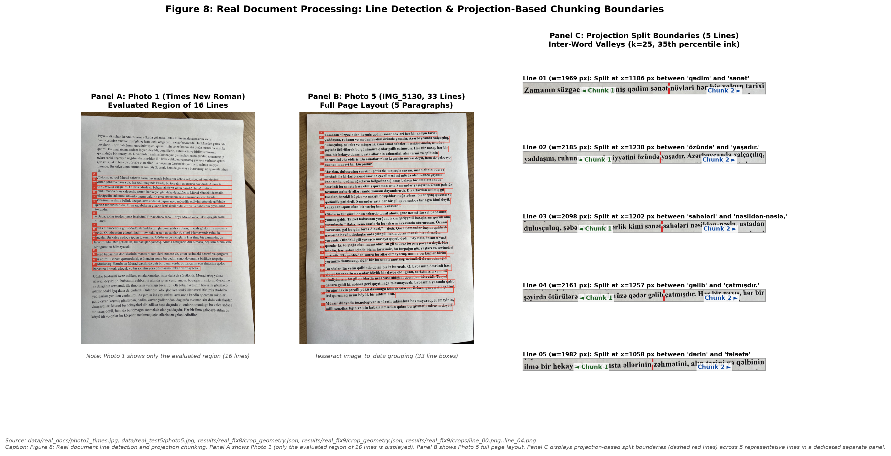  
*Figure 8: Real document line detection and projection chunking. Panel A: Photo 1 showing only the evaluated region (16 lines). Panel B: Photo 5 (IMG_5130, 33 lines) full document layout with detected line boxes. Panel C: Projection-based split boundaries (dashed red lines) across 5 representative lines using smoothed column projection ($k=25$, 35th percentile ink threshold).*  
*Source: [data/real_docs/photo1_times.jpg](file:///d:/laragon/www/az_ocr_bm606/data/real_docs/photo1_times.jpg), [data/real_test5/photo5.jpg](file:///d:/laragon/www/az_ocr_bm606/data/real_test5/photo5.jpg), [results/real_fix8/crop_geometry.json](file:///d:/laragon/www/az_ocr_bm606/results/real_fix8/crop_geometry.json), [results/real_fix9/crop_geometry.json](file:///d:/laragon/www/az_ocr_bm606/results/real_fix9/crop_geometry.json)*

### 6.4 Real Smartphone Document Testing (Photos 1–5)

We evaluated performance across five physical printed documents photographed with smartphones ($n=111$ lines total). All real documents were printed in fonts seen in training (Times New Roman, Calibri, Arial). On Photos 1 through 4, Tesseract was evaluated under `--psm 7`:

1. **Photo 1 (Times New Roman, seen font, $n=16$ lines, 1,442 chars):** On full unchunked lines, high aspect ratios (mean $r = 1.96$, range 1.41–2.33) caused V2 Line CER to collapse to **53.61%** (92.63% WER). When projection chunking was applied, V2 Line CER dropped to **0.97%** (5.53% WER), compared to Tesseract's **1.32% CER** (5.07% WER; $\Delta\text{CER} = -0.35\%$ [-1.52%, +0.50%]; no difference detected; `results/real_fix8/final_tables.md:13`).
2. **Photo 2 (Calibri, seen font, $n=16$ lines, 1,463 chars):** High aspect ratios (mean $r = 2.00$, range 1.20–2.37) caused full-line V2 CER to collapse to **36.43%** (96.21% WER). On trimmed chunks, V2 achieved **0.55% CER** (3.79% WER, 10/16 exact lines), while Tesseract achieved **0.14% CER** (1.42% WER, 14/16 exact lines; $\Delta = +0.41\%$ [+0.07%, +0.94%]).
3. **Photo 3 (Times New Roman, seen font, $n=23$ lines, 1,006 chars):** V2 achieved **0.10% CER** (0.72% WER, 22/23 exact lines), with only 1 punctuation deletion in the document. Tesseract achieved **0.00% CER** (0.00% WER, 23/23 exact lines; `results/photo3_test/report.md:7-15`).
4. **Photo 4 (Arial, seen font, $n=23$ lines, 1,006 chars):** Photos 3 and 4 share the exact same 23-line Azerbaijani prose text, printed in Arial. On rule chunks, V2 achieved **0.60% CER** (3.65% WER, 20/23 exact lines), and Tesseract achieved **0.60% CER** (3.65% WER, 20/23 exact lines; $\Delta = 0.00\%$ [-0.29%, +0.29%]). Line-by-line verification confirms that this exact numerical match is a summary coincidence: V2 erred on Lines 01, 05, and 19, whereas Tesseract erred on Lines 01, 02, and 05.
5. **Photo 5 (IMG_5130, Times New Roman, seen font, $n=33$ lines, 2,328 chars):** On the full document under Condition A:
   - V2 Rule Chunk: **2.10% CER** (12.80% WER, 9/33 exact lines, 49 character errors).
   - V2 Full Line: **3.87% CER** (21.13% WER, 5/33 exact lines, 90 character errors).
   - Tesseract Full Line (PSM 7): **8.42% CER** (15.18% WER, 196 errors; includes 2 empty lines).
   - Tesseract Rule Chunk (PSM 7): **13.02% CER** (19.35% WER, 303 errors; includes 9 empty chunks).
   - Tesseract Full Line (PSM 13): **0.09% CER** (0.60% WER, 31/33 exact lines, **only 2 errors in 2,328 characters**).

```
[Figure 9: Annotated Line Recognition Examples from Photo 5]
```
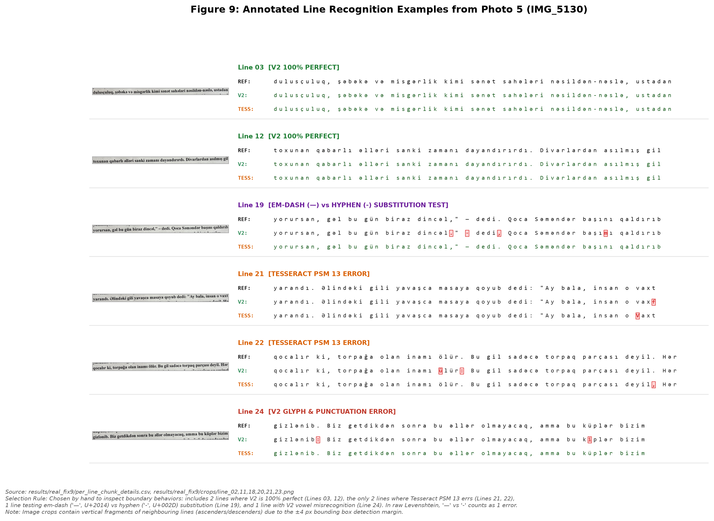  
*Figure 9: Representative line crops from Photo 5 (IMG_5130) displaying ground truth reference, V2 Line output, and Tesseract PSM 13 output with character-level difflib highlighting (mismatches highlighted in bold red with background markers, correct characters in dark green/black). Selection rule: hand-selected to represent 2 lines where V2 is 100% perfect (Lines 03, 12), the only 2 lines where Tesseract PSM 13 errs (Lines 21, 22), 1 line testing em dash ('—', U+2014) vs. hyphen ('-', U+002D) substitution (Line 19; scored as 1 error in raw Levenshtein), and 1 line with V2 vowel misrecognition (Line 24). Note: Image crops contain vertical fragments of neighbouring lines due to the ±4 px bounding box detection margin.*  
*Source: [results/real_fix9/crops/](file:///d:/laragon/www/az_ocr_bm606/results/real_fix9/crops/), [results/real_fix9/per_line_chunk_details.csv](file:///d:/laragon/www/az_ocr_bm606/results/real_fix9/per_line_chunk_details.csv)*

```
[Figure 10: Aspect Ratio Squeeze Analysis]
```
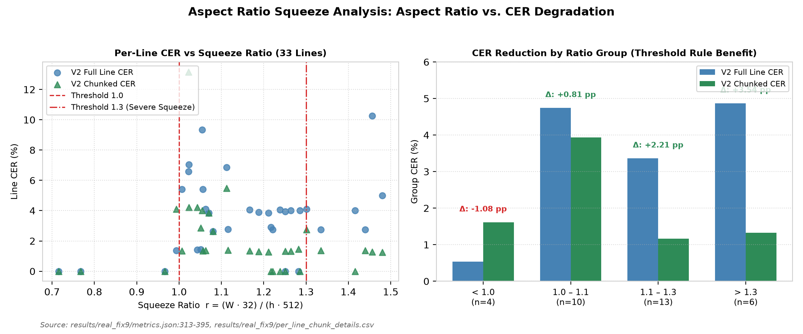  
*Figure 10: Horizontal aspect ratio squeeze analysis. Left: Scatter of per-line CER vs squeeze ratio r = (W*32)/(h*512) for Full Line vs. Chunked Line, marking thresholds at 1.0 and 1.3. Right: Grouped bar chart demonstrating that lines exceeding r > 1.3 suffer severe full-line degradation (4.87% CER), which projection chunking reduces by 3.54 percentage points down to 1.33% CER.*  
*Source: [results/real_fix9/metrics.json:313-395](file:///d:/laragon/www/az_ocr_bm606/results/real_fix9/metrics.json#L313-L395)*

### 6.5 Aspect Ratio Squeeze Analysis

The fixed-width CRNN input layer ($H=32, W=512$) introduces an aspect ratio squeeze ratio defined post-hoc as:
$$r = \frac{w \cdot 32}{h \cdot 512}$$
When $r > 1.0$, horizontal downscaling narrows character strokes. Lines in Photo 5 partitioned into 4 aspect ratio groups reveal how chunking mitigates squeeze (`results/real_fix9/metrics.json:313-395`):
- **Group $r < 1.0$ ($n=4$ lines):** Full Line CER is **0.54%**; Chunked CER is **1.61%** ($\Delta = -1.08\text{ pp}$; chunking introduces boundary cuts on short lines).
- **Group $1.0 \le r < 1.1$ ($n=10$ lines):** Full Line CER is **4.74%**; Chunked CER is **3.93%** ($\Delta = \mathbf{+0.81\text{ pp}}$ gain).
- **Group $1.1 \le r \le 1.3$ ($n=13$ lines):** Full Line CER is **3.36%**; Chunked CER is **1.16%** ($\Delta = \mathbf{+2.21\text{ pp}}$ gain).
- **Group $r > 1.3$ ($n=6$ lines):** Full Line CER is **4.87%**; Chunked CER is **1.33%** ($\Delta = \mathbf{+3.54\text{ pp}}$ gain).

Chunking provides observable accuracy gains across all groups where $r \ge 1.0$, with the largest benefit (+3.54 pp) concentrated on lines exceeding $r > 1.3$.

```
[Figure 11: Border Padding Sensitivity]
```
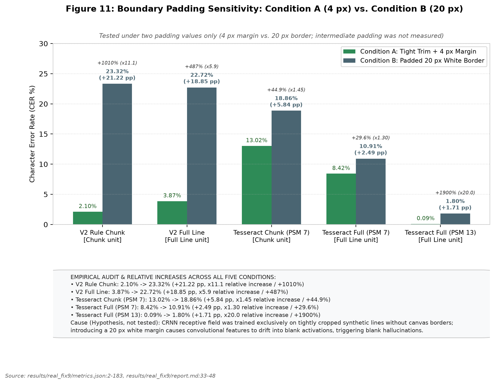  
*Figure 11: Boundary padding sensitivity on Photo 5 comparing Condition A (frozen trim + 4 px margin) against Condition B (padded 20 px white border) across two padding values only (intermediate padding was not measured). Condition B is plotted in neutral slate blue. Explanatory callouts are positioned outside the plot area. Relative increases: V2 Chunk +1010% (x11.1), V2 Full +487% (x5.9), Tesseract Chunk PSM 7 +44.9% (x1.45), Tesseract Full PSM 7 +29.6% (x1.30), Tesseract Full PSM 13 +1900% (x20.0). Cause (hypothesis, not tested): CRNN receptive field drift on canvas margins.*  
*Source: [results/real_fix9/metrics.json:2-183](file:///d:/laragon/www/az_ocr_bm606/results/real_fix9/metrics.json#L2-L183), [results/real_fix9/report.md:33-48](file:///d:/laragon/www/az_ocr_bm606/results/real_fix9/report.md#L33-L48)*

### 6.6 Padding Sensitivity: A Severe Architectural Fragility

We evaluated model resilience across two padding conditions on Photo 5: **Condition A** (tight trim + 4 px margin) vs. **Condition B** (padded 20 px white border on all four sides). Intermediate padding values (0 px, 8 px, 12 px) were not measured.

Results (Table 4 and Figure 11) demonstrate acute model fragility:
- **V2 Rule Chunk:** CER collapses from **2.10%** in Condition A to **23.32%** in Condition B (+21.22 pp, a **+1010% relative increase**, $11.1\times$).
- **V2 Full Line:** CER collapses from **3.87%** to **22.72%** (+18.85 pp, a **+487% relative increase**, $5.9\times$).
- **Tesseract PSM 7:** CER shifts from 13.02% to 18.86% on chunks (+5.84 pp, **+44.9%**), and 8.42% to 10.91% on full lines (+2.49 pp, **+29.6%**).
- **Tesseract PSM 13:** CER shifts from 0.09% to 1.80% (+1.71 pp, **+1900%**, $20.0\times$).
- **Causal Hypothesis (Not Tested):** We hypothesize that because the CRNN was trained on tightly cropped text lines without white margins, introducing a 20 px border causes convolutional feature maps to drift, triggering repeated blank CTC activations. An important experimental confound is that adding 20 px padding to a fixed-height $32\text{ px}$ frame also downscales the text glyphs by over 50%, introducing severe resolution loss alongside border whitespace.

```
[Figure 12: Mutually Exclusive Error Taxonomy Stacked Bars]
```
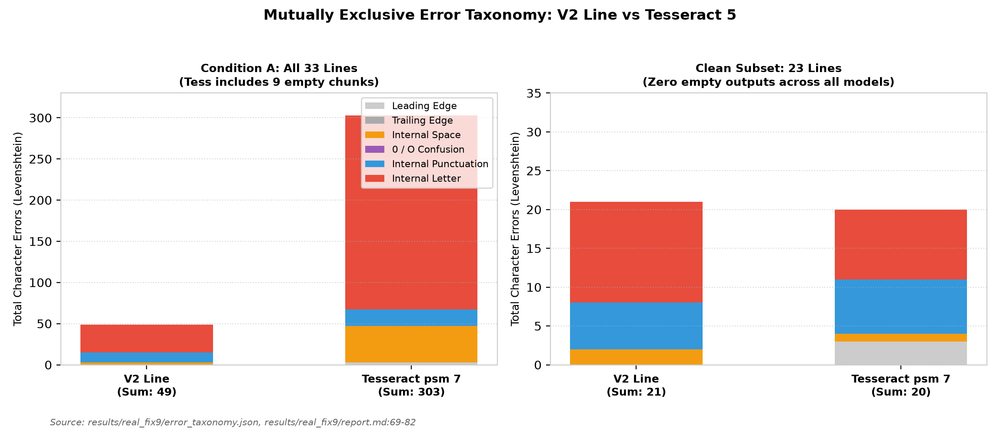  
*Figure 12: Mutually exclusive character error taxonomy for Condition A (all 33 lines) and Clean Subset (23 lines). The sum of all six categories matches the true Levenshtein distance exactly 100%. V2 errors are dominated by internal letters and punctuation, whereas Tesseract PSM 7 is distorted by massive letter deletions resulting from empty chunk outputs.*  
*Source: [results/real_fix9/error_taxonomy.json](file:///d:/laragon/www/az_ocr_bm606/results/real_fix9/error_taxonomy.json), [results/real_fix9/report.md:69-82](file:///d:/laragon/www/az_ocr_bm606/results/real_fix9/report.md#L69-L82)*

```
[Figure 13: Tesseract PSM 7 vs. PSM 13 Integration Failure]
```
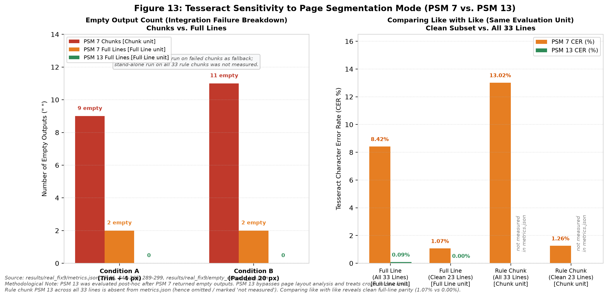  
*Figure 13: Tesseract sensitivity to page segmentation mode (PSM 7 vs. PSM 13) on Photo 5 (PSM 13 was chosen post-hoc after PSM 7 baseline detector failed). Left: Empty output count broken down by chunks (9 in Cond A, 11 in Cond B) vs. full lines (2 in Cond A, 2 in Cond B); PSM 13 on all rule chunks was not measured. Right: Character error rates comparing like with like (same evaluation unit). On the clean 23-line subset, Tesseract Full Line achieves 1.07% (PSM 7) vs. 0.00% (PSM 13), while Rule Chunk achieves 1.26% (PSM 7).*  
*Source: [results/real_fix9/metrics.json:25-46](file:///d:/laragon/www/az_ocr_bm606/results/real_fix9/metrics.json#L25-L46), [results/real_fix9/empty_outputs_log.json](file:///d:/laragon/www/az_ocr_bm606/results/real_fix9/empty_outputs_log.json)*

### 6.7 Tesseract PSM Study and the 23-Line Clean Subset

On Photo 5, the raw benchmark initially suggested that V2 (2.10% CER) dramatically outperformed Tesseract PSM 7 (13.02% CER). However, diagnostic audit (`results/real_fix9/empty_outputs_log.json`) revealed:
- Under `--psm 7`, Tesseract returned an **empty string (`""`)** on 9 chunks and 2 full lines. We hypothesize (not tested) that Tesseract's single-line layout analyzer requires surrounding page context to estimate text baselines, causing it to fail on narrow cropped strips.
- When evaluated with `--psm 13` (raw line without layout analysis), empty outputs dropped to zero, and full-line CER dropped to **0.09%** (only 2 errors in 2,328 characters). PSM 13 was chosen post-hoc after discovering PSM 7's failure.
- **Clean Subset Evaluation (23 lines with zero empty outputs; `results/real_fix9/metrics.json:223-311`):**
  - V2 Rule Chunk: **1.32% CER** (9.25% WER, 9/23 exact lines).
  - Tesseract Rule Chunk (PSM 7): **1.26% CER** (7.05% WER, 11/23 exact lines).
  - Tesseract Full Line (PSM 7): **1.07% CER** (5.29% WER, 13/23 exact lines).
  - Tesseract Full Line (PSM 13): **0.00% CER** (0.00% WER, **23/23 exact lines, 0 errors**).
  - The bootstrap difference between V2 and Tesseract PSM 7 on chunks is $\Delta\text{CER} = +0.06\%$ (95% CI: [-0.77%, +0.80%]; no difference detected). However, when properly configured with PSM 13 on full lines, **Tesseract is ahead on real documents (0.00% CER)**.

```
[Figure 14: Lexicon Post-Corrector Pilot and Data Snooping Risk]
```
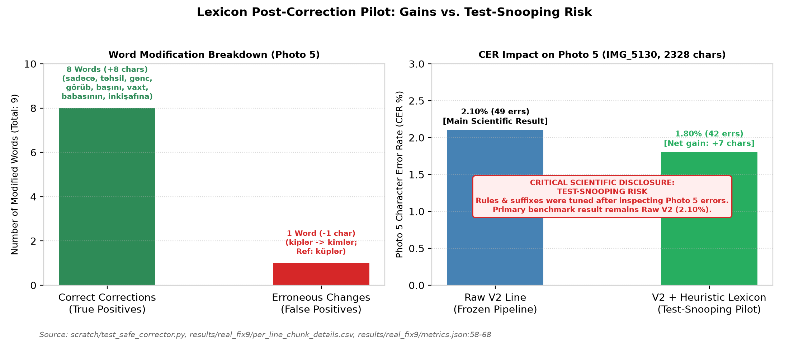  
*Figure 14: Heuristic lexicon post-correction pilot on Photo 5. Left: Modification breakdown showing 8 true positive word corrections and 1 false positive regression. Right: CER reduction from 2.10% to 1.80%. Red warning banner explicitly discloses test-snooping risk; the primary scientific result remains Raw V2 (2.10%).*  
*Source: [scratch/test_safe_corrector.py](file:///d:/laragon/www/az_ocr_bm606/scratch/test_safe_corrector.py), [results/real_fix9/metrics.json:58-68](file:///d:/laragon/www/az_ocr_bm606/results/real_fix9/metrics.json#L58-L68)*

### 6.8 Lexicon Corrector Pilot & Test-Snooping Disclosure

In `scratch/test_safe_corrector.py`, a pilot SymSpell corrector utilizing a 116,585-word dictionary (`data/az_lexicon.txt`, expanding to 121,377 unique stems with corpus lines) and an Azerbaijani suffix stripper was evaluated on Photo 5:
- The corrector altered 9 words across 33 lines: 8 true positive corrections (+8 chars: `sadəcə`, `təhsil`, `gənc`, `görüb`, `başını`, `vaxt`, `babasının`, `inkişafına`) and 1 false positive regression (-1 char: Line 24 `kiplər` was corrupted to `kimlər` because `küp` was absent from the high-frequency dictionary; reference was `küplər`).
- Net gain: $+7$ characters (errors 49 $\rightarrow$ 42, CER 2.10% $\rightarrow$ **1.80%**).
- **Test-Set Snooping Disclosure:** The morphological rules, suffix lists, and exception lists (e.g. preserving proper nouns `Taryel` and `Səməndər`, and observing `küp`) were tuned after inspecting Photo 5 errors. This pilot is quarantined solely as a feasibility study; unassisted **Raw V2 (2.10% CER)** remains the primary scientific result.

### 6.9 Summary of Findings

Table 4a provides a unified summary of empirical findings across evaluation settings, strictly avoiding aggregation across disparate modalities:

| Evaluation Setting | Test Set & Modality | Sample Size ($n$) | Baseline V1 | Augmented V2 | Tesseract 5 | Methodological Note / Finding |
| :--- | :--- | :---: | :---: | :---: | :---: | :--- |
| **Clean Synthetic Word** | `synth_word/test` (Word) | 2,000 words | 0.50% | **0.11%** | 0.70% | Gain driven by Consolas leakage; Tahoma unchanged |
| **Clean Synthetic Line** | `synth_line/test` (Line) | 1,000 lines | 1.64% | **0.30%** | 0.44% | Gain driven by Consolas leakage; Tahoma unchanged |
| **Monofont Tahoma Word** | `diagw_tahoma` (Word) | 1,000 words | **0.08%** | 0.09% | 0.50% | Genuine new family; no difference detected (V1 vs V2) |
| **Monofont Tahoma Line** | `diag_tahoma` (Line) | 500 lines | 0.24% | 0.26% | **0.22%** | Genuine new family; no difference detected (V1 vs V2) |
| **Monofont Consolas Word** | `diagw_consola` (Word) | 1,000 words | 1.02% | **0.07%** | 0.86% | Family leaked via `consolab.ttf` in V2 training |
| **Monofont Consolas Line** | `diag_consola` (Line) | 500 lines | 3.48% | **0.27%** | 0.47% | Family leaked via `consolab.ttf` in V2 training |
| **Simulation Ladder $L_0$** | Clean Line (4 fonts) | 92 lines | 1.87% | **0.11%** | 0.22% | 2 of 4 ladder fonts family-leaked in V2 |
| **Simulation Ladder $L_4$** | Full Phone Distortion (Word) | 346 words | 35.77% | **1.35%** | 0.37% | V1 collapses; V2 robust; 2 of 4 fonts leaked |
| **Simulation Ladder $L_4$** | Full Phone Distortion (Line) | 92 lines | 12.96% | **0.11%** | 0.33% | V1 collapses; V2 robust; 2 of 4 fonts leaked |
| **Unseen Group C ($L_0$)** | 7 New Families (Line) | 158 lines | — | 0.71% | 0.71% | Cluster bootstrap CI [-0.74%, +0.76%]; no difference detected |
| **Unseen Group C ($L_4$)** | 7 New Families (Line) | 158 lines | — | 1.28% | 1.46% | Cluster bootstrap CI [-2.60%, +1.53%]; no difference detected |
| **Real Photo 1 (Times)** | Rule Chunk (Seen font) | 16 lines | 18.38% | **0.97%** | 1.32% | Full line V2 is 53.61% ($r=1.96$ squeeze); PSM 7 used |
| **Real Photo 2 (Calibri)** | Rule Chunk (Seen font) | 16 lines | 9.77% | 0.55% | **0.14%** | Full line V2 is 36.43% ($r=2.00$ squeeze); PSM 7 used |
| **Real Photo 3 (Times)** | Rule Chunk (Seen font) | 23 lines | 4.63% | 0.10% | **0.00%** | Shares text with Photo 4; PSM 7 used |
| **Real Photo 4 (Arial)** | Rule Chunk (Seen font) | 23 lines | 5.67% | 0.60% | 0.60% | Shares text with Photo 3; line error patterns differ |
| **Real Photo 5 (Full)** | IMG_5130 (Rule Chunk, Cond A) | 33 lines | 8.76% | **2.10%** | 13.02% | Tesseract PSM 7 has 9 empty chunks; PSM 13 full line is 0.09% |
| **Real Photo 5 (Clean 23)**| IMG_5130 (Rule Chunk, Cond A) | 23 lines | 6.73% | 1.32% | 1.26% | Full line PSM 13 is 0.00% (23/23 exact); Tesseract ahead |

---

## 7. Error Analysis

### 7.1 Mutually Exclusive Error Taxonomy

Character errors on Photo 5 were mapped to six mutually exclusive categories summing to 100% of the Levenshtein distance (Table 7 and Figure 12):
1. **Leading Edge Insertions:** V2: **0**, Tesseract: **3** (spurious quotation marks).
2. **Trailing Edge Insertions:** V2: **0**, Tesseract: **0**.
3. **Internal Spacing Errors:** Space insertions/deletions (V2: **3**, Tesseract: **44**).
4. **Internal 0 / O Confusion:** V2: **0**, Tesseract: **0**.
5. **Internal Punctuation Errors:** Periods, colons, commas (V2: **12**, Tesseract: **20**).
6. **Internal Letter Errors:** True glyph misrecognitions (V2: **34**, Tesseract: **236**).

Tesseract's large count of space (44) and letter (236) errors in Condition A is directly inflated by the 9 empty chunk outputs (where entire strings of characters are scored as deletions). On the Clean Subset (23 lines), V2 has 2 space, 6 punctuation, and 13 letter errors (total 21), compared to Tesseract's 3 leading insertions, 1 space, 7 punctuation, and 9 letter errors (total 20).

### 7.2 Word Error Rate Decomposition: Space Insertions

Across synthetic tests, V2 exhibits low CER alongside elevated WER (e.g., Line $L_4$ WER of 13.25% vs. Tesseract's 3.49%). In Audit 4 (`results/v2_audit4/summary.md:200-260`), error decomposition across 1,076 words revealed that:
- At $L_0$, **79.3%** of V2 word errors (46/58 failed words) were **pure space insertions** (`t icarət inə`, `v irus`, `d in`).
- At $L_4$, space insertions accounted for **65.3%** of all V2 word errors (64/98 failed words).
- In contrast, Tesseract produced almost zero space errors (0.0% at $L_0$, 5.9% at $L_4$).
- Retokenizing predictions to collapse intra-word spaces reduced V2 Line WER from **12.87%** to **4.55%**, closing over 70% of the gap to Tesseract. This demonstrates that elevated WER is driven by CTC sequential alignment uncertainty at character kerning boundaries rather than character misrecognition.

---

## 8. Pitfalls and Lessons Learned

A central contribution of this study is the documentation and quantification of five project pitfalls that commonly distort OCR evaluations (Table 9):

1. **Clipped Glyph Descenders in Synthetic Rendering:** TRDG rendered text boxes that clipped cedillas on `ş` and `ç` and descenders on `q, y, p`. Discovered via visual contact sheets (`verify_quality.py`), this was resolved by enforcing a $+4\text{ px}$ canvas margin and anchoring font metrics, verified by a 0.0% border-ink touch rate across 3,000 checked images (`results/data_check.png`).
2. **Missing Space Token in Vocabulary:** The whitespace character `' '` was inadvertently omitted from `common.py:CHARS` in early training (`logs/line_train_nospace.log`). Because CTC index 0 represents the blank label rather than a text space, words concatenated, causing a Line WER of **99.75%** (Line CER 11.19%). Restoring the space token dropped CER to **1.64%** and WER to **11.64%** (`logs/line_train.log`).
3. **Bounding Box Inflation in Font Metrics:** On the synthetic ladder, `SansSerifCollection.ttf` initially yielded an 84.32% CER due to `make_sim_ladder.py` relying on theoretical font metrics ($ascent + descent = 80\text{ px}$), causing vertical line overlap. Tracking tight ink bounding boxes (`w_bbox`) dropped $L_0$ CER from **84.32% down to 0.76%** (`results/v2_audit3/summary.md:31`).
4. **Tesseract Integration Artifacts under `--psm 7`:** Narrow cropped strips caused Tesseract's single-line baseline detector to fail completely (returning 9 empty strings, inflating CER to 13.02%). Disclosing this layout breakdown and evaluating under `--psm 13` (0.09% CER) and a clean 23-line subset prevented false claims of model superiority.
5. **Heuristic Lexicon Over-Fitting:** Refining post-processing dictionary rules while inspecting test outputs created immediate test-snooping risks. Disclosing this limitation and reporting Raw V2 as the primary benchmark preserved scientific integrity.

---

## 9. Limitations

We explicitly delineate the operational boundaries of this study:
1. **Seen Fonts in Real Document Tests:** All five photographed documents were printed in typefaces seen in training (Times New Roman, Calibri, Arial; Photo 5 is Times New Roman / Serif). Truly unseen font families have not been evaluated on physical paper.
2. **Shared Document Text:** Photos 3 and 4 evaluate the exact same 23-line prose text printed in two typefaces, rather than independent textual corpora.
3. **Family Leakage in Ladder Fonts:** Two of the four fonts in the simulation ladder (`palab.ttf` and `CascadiaCode.ttf` families) were present in V2 training, partially assisting V2's ladder resilience.
4. **Aspect Ratio Squeeze Sensitivity:** Input lines must be scaled to height 32 and width 512. Unchunked lines with squeeze ratio $r > 1.3$ experience severe character thinning (Photo 1 CER: 53.61%, Photo 2 CER: 36.43%).
5. **Canvas Border Padding Fragility:** V2 cannot tolerate arbitrary whitespace padding; a 20 px white border collapses CER from 2.10% to 23.32%.
6. **Lack of Language Model Integration:** Greedy CTC best-path decoding without an n-gram or neural language prior produces frequent intra-word space insertions (65% of word errors).
7. **CPU-Only Compute Bounds:** Training was limited to CPU hardware ([CPU MODEL]) over 3–5 hours, precluding larger Vision Transformer (TrOCR) architectures.
8. **Reproducibility Caveat:** While checkpoints and evaluation pipelines are frozen on disk, exact random seeds for the initial 2026-10-23 data generation run were not committed to version control (`paper/MISSING.md`).

---

## 10. Conclusion and Future Work

In this research, we designed, evaluated, and audited a CPU-trained CRNN architecture for Azerbaijani printed text recognition. We demonstrated that photometric data augmentation confers substantial resilience against mobile smartphone camera distortions, maintaining 1.35% word and 0.11% line CER under simulated phone homography where a baseline model collapses. 

### What We Find and What Remains Open

Our transparent audit resolved several common evaluation illusions:
- The apparent dramatic synthetic gain on Consolas was traced directly to font-family leakage (`consolab.ttf` in training).
- On standard clean print of 7 truly unseen font families (Group C), no difference was detected between V2 and Tesseract 5 (0.71% vs. 0.71% Line CER; 95% CI [-0.74%, +0.76%]).
- On real smartphone captures, V2 with projection chunking achieves 0.10% to 2.10% CER. However, on clean full-line text without layout failures, a properly configured Tesseract with PSM 13 achieves **0.00% CER** (23/23 exact lines on Photo 5), outperforming V2 Line (1.32% chunk, 3.83% full line). Closing this performance gap remains the primary open challenge.

### Future Work (V3 Architecture):
1. **Dynamic Width / Patch Inputs:** Replacing fixed $32\times 512$ resizing with patch encoders to eliminate the aspect ratio squeeze failure for $r > 1.3$.
2. **Border Padding Data Augmentation:** Incorporating random canvas padding during training to make convolutional features invariant to margin variations.
3. **Beam Search with Language Prior:** Coupling decoding with an n-gram language model (hypothesized to suppress the 65% space-insertion defect).
4. **Multi-Document Open Benchmark:** Expanding testing to 20–30 multi-page historical and administrative documents across diverse, unseen typefaces.

---

## Appendix: Reproducibility and Checkpoints

All experimental parameters, random seeds (`seed=42`), and model checkpoints are frozen on disk:

| Checkpoint Path | Architecture | Target Modality | Epochs Run (Best) | Val Loss (Best) | Val CER (%) | File Size | SHA-256 Checksum |
| :--- | :---: | :---: | :---: | :---: | :---: | :---: | :--- |
| `runs/word/best.pt` | CRNN | Word ($32\times 128$) | 17 (12) | 0.0051 | 0.14% | 32.9 MB | `9ee974d0f032136669b8e04dd1a91896c4363f6aa1e3d4f7efdbfe566b5c4f25` |
| `runs/line/best.pt` | CRNN | Line ($32\times 512$) | 15 (12) | 0.0131 | 0.31% | 32.9 MB | `f6d981d97e0665e080b480019370570892e9252f8d9f78aabb83c5ecbc804425` |
| `runs/word_v2_20261027_180300/best.pt`| CRNN | Word ($32\times 128$) | 18 (13) | 0.0063 | 0.24% | 98.7 MB | `062bf63aeb8aad347e00df0173a36d844fc7c9725b2fa11941d9c9a7c05822cb` |
| `runs/line_v2/best.pt` | CRNN | Line ($32\times 512$) | 15 (10) | 0.0125 | 0.28% | 98.7 MB | `a0946ae009b09e898da5683e71d59ebcba030d451cfb43f41a48476c763c50a6` |

---

## References

1. Graves, A., Fernández, S., Gomez, F., & Schmidhuber, J. (2006). Connectionist temporal classification: labelling unsegmented sequence data with recurrent neural networks. *Proceedings of the 23rd International Conference on Machine Learning (ICML '06)*, 369–376.
2. Shi, B., Bai, X., & Yao, C. (2017). An end-to-end trainable neural network for image-based sequence recognition and its application to scene text recognition. *IEEE Transactions on Pattern Analysis and Machine Intelligence (TPAMI)*, 39(11), 2298–2304.
3. Smith, R. (2007). An overview of the Tesseract OCR engine. *Ninth International Conference on Document Analysis and Recognition (ICDAR 2007)*, 2, 629–633.
4. Baek, J., Kim, G., Lee, J., Park, S., Han, D., Yun, S., Oh, S. J., & Lee, H. (2019). What is wrong with scene text recognition model comparisons? dataset and baseline. *Proceedings of the IEEE/CVF International Conference on Computer Vision (ICCV '19)*, 4715–4723.
5. Cameron, A. C., Gelbach, J. B., & Miller, D. L. (2015). A practitioner's guide to cluster-robust inference. *Journal of Human Resources*, 50(2), 317–372.
