# A CPU-Trained CRNN for Azerbaijani Printed Text: Photometric Augmentation and an Audit-Driven Evaluation Protocol

**Authors:** Azerbaijani OCR Research Initiative (Project BM 606)  
**Affiliations:** [AFFILIATION]  
**Date:** October 30, 2026 (revised draft v4)  
**Document Status:** Publication-Style Research Monograph and Empirical Audit Report (Version 4 draft)  

---

## Abstract

Optical character recognition (OCR) for Azerbaijani is challenging under smartphone captures because of its dense diacritic inventory (ə, ı, ö, ğ, ü, ş, ç) and four-way dotted/dotless `i/ı/İ/I` distinction. We present a CPU-trained Convolutional Recurrent Neural Network (CRNN, 8.23M parameters, `Intel Core i5-7200U @ 2.50 GHz`, 3–5 h training) together with a transparent audit protocol that exposes pitfalls commonly inflating OCR results: font-family leakage, bounding-box bugs, missing space tokens, and segmentation-mode sensitivity. Benchmarking against both **Tesseract 5 (`aze`)** and **EasyOCR (`az`)** on CPU, CRNN V2 runs at **155.4 ms/line** (`batch=1`) and **127.6 ms/line** (`batch=16`)—achieving a **2.74$\times$ to 3.34$\times$ speedup** over Tesseract `--psm 13` (426.0 ms/line), **2.34$\times$ to 2.84$\times$** over EasyOCR `recognize` (362.8 ms/line), and **21.6$\times$ to 26.3$\times$** over EasyOCR `readtext` (3,354.8 ms/line). Under simulated mobile distortion ($L_4$), photometric augmentation prevents model collapse, keeping 1.35% word and 0.11% line Character Error Rate (CER) where baseline V1 reaches 35.77% and 12.96% and EasyOCR degrades to 7.54% word and 3.81% line CER. Across $n=50,122$ non-space characters, CRNN V2 outperforms both Tesseract 5 and EasyOCR on uppercase special Azerbaijani letters (`Ə, İ, Ö, Ğ, Ü, Ş, Ç, I`: **2.46%** vs. **3.69%** Tess and **2.96%** EasyOCR), outperforms EasyOCR by **8.3$\times$** on lowercase Azerbaijani diacritics (`0.27%` vs. `2.25%`), and resolves the 4-way `i/ı/İ/I` paradox at 99.64% (`i`), 99.41% (`ı`), 97.30% (`İ`), and 95.45% (`I`) accuracy. Across 7 truly unseen font families ($n=158$ lines), V2 and Tesseract 5 both reach 0.71% line CER at $L_0$ (95% CI [-0.74%, +0.76%]) and 1.28% vs. 1.46% at $L_4$, while V2 outperforms EasyOCR on unseen ladder fonts at both $L_0$ (0.71% vs. 1.59%) and $L_4$ (1.28% vs. 1.52%). Across all five real document photos ($n=111$ lines), CRNN V2 (1.08% aggregate CER) outperforms EasyOCR across every operating mode (1.31% chunk, 1.50% full-line, and 6.22% end-to-end CER) and outperforms Tesseract on Photo 1 (0.97% vs. 1.32% under both PSM 7 and PSM 13), while Tesseract PSM 13 reaches 0.00% on the clean 23-line subset of Photo 5. Finally, raw CTC posteriors provide a zero-snooping error detector (**AUROC = 0.848**), enabling an 80% CRNN + 20% Tesseract cascade that cuts real-document CER from **1.08% to 0.47%** at a **2.00$\times$ CPU speedup**.

**Keywords:** Optical Character Recognition (OCR), Azerbaijani Alphabet, CRNN, CTC Loss, Photometric Augmentation, Font-Family Leakage, Evaluation Pitfalls, Cluster Bootstrap, Confidence Calibration, Tesseract 5, EasyOCR, Page Segmentation Mode.

---

## 1. Introduction

Optical Character Recognition (OCR) constitutes an essential pillar of document digitization, information retrieval, and archival pipelines. While modern OCR frameworks demonstrate high recognition accuracy on major world languages printed under scanned flatbed conditions, recognition fidelity frequently degrades when deployed on languages featuring complex diacritics, limited digitized training corpora, and uncontrolled mobile smartphone captures.

The modern Azerbaijani alphabet utilizes a 32-letter Latin script:
$$\Sigma_{az} = \{a, b, c, ç, d, e, ə, f, g, ğ, h, x, ı, i, j, k, q, l, m, n, o, ö, p, r, s, ş, t, u, ü, v, y, z\}$$

This orthographic system introduces three severe computer vision challenges:
1. **Diacritic Subtlety:** Pairs such as $c/\text{ç}$, $s/\text{ş}$, $g/\text{ğ}$, $o/\text{ö}$, and $u/\text{ü}$ differ by minute structural components—specifically, lower cedillas, breves, and umlaut dots. Under smartphone camera defocus, motion blur, or uneven lighting, these high-frequency pixel details are readily obliterated.
2. **The Dotted and Dotless I Paradox:** Unlike English, Azerbaijani distinguishes lower-case dotless $\text{ı}$ ($U+0131$) from dotted $i$ ($U+0069$), with uppercase counterparts $I$ ($U+0049$) and $\text{İ}$ ($U+0130$). Generic Latin models frequently conflate these vowels.
3. **The Distinctive Schwa ($\text{ə}/\text{Ə}$):** Representing an open central unrounded vowel, the schwa is among the most frequent characters in Azerbaijani orthography. Visual distortion easily causes confusion with $e$, $o$, or $a$.

While legacy OCR engines (such as Tesseract 3) relied on binarization heuristics and explicit character segmentation, modern engines (including Tesseract 4/5 and CRNN architectures) model OCR as an unsegmented visual sequence transcription task using Connectionist Temporal Classification (CTC) [Graves et al., 2006] or LSTM sequence-to-sequence networks [Smith, 2007; Shi et al., 2017]. However, when applied to handheld smartphone captures, non-uniform illumination, perspective tilt, paper curvature, and tight aspect ratio constraints introduce substantial practical degradation.

### 1.1 Contributions

In this study, we present a complete engineering implementation and audit-driven evaluation of an Azerbaijani OCR system developed under Project BM 606. Rather than presenting idealized benchmarks, we provide an empirical accounting of genuine strengths alongside critical methodological pitfalls. Our five primary contributions are:

1. **A Fast, Low-Resource CPU Recognition Engine:** We design an 8.23M-parameter CRNN (7-layer CNN + 2-layer BiLSTM + CTC; 31.41 MiB FP32 / 15.72 MiB FP16 pure model weights) trained entirely on CPU (`Intel Core i5-7200U @ 2.50 GHz`) within 3–5 hours per model. On CPU line inference, CRNN V2 runs **2.74$\times$ to 3.34$\times$ faster** than Tesseract 5 `--psm 13` (155.4 ms unbatched / 127.6 ms batched vs. 426.0 ms/line) and up to **4.05$\times$ faster** than `--psm 7` (516.5 ms/line), achieving 0.10% to 2.10% CER across five real smartphone document captures with **zero empty-line failures**.
2. **Resilience to Photometric Distortions and Orthographic Superiority on Azerbaijani Specials:** We show that photometric data augmentation prevents model collapse under simulated smartphone imaging ($L_4$: 1.35% word and 0.11% line CER vs. V1's 35.77% and 12.96%). Across $n=50,122$ non-space characters, CRNN V2 outperforms Tesseract 5 on **uppercase special Azerbaijani letters** (`Ə, İ, Ö, Ğ, Ü, Ş, Ç, I`: **2.46% vs. 3.69%** error), **standard lowercase** (`0.24% vs. 0.46%`), and **standard uppercase** (`0.74% vs. 1.14%`), achieves **0.00% error** on unseen distorted `ə/e`, `ğ/g`, and `ş/s` pairs at $L_4$, and resolves the 4-way `i/ı/İ/I` paradox with 99.64% (`i`), 99.41% (`ı`), 97.30% (`İ`), and 95.45% (`I`) accuracy.
3. **A Reproducible Audit Protocol Exposing Five Common Pitfalls:** We document, quantify, and provide engineering resolutions for five project pitfalls that commonly inflate or distort OCR results: font-family leakage (Consolas 1.02% $\rightarrow$ 0.07%), bounding box metric inflation (84.32% $\rightarrow$ 0.76%), CTC missing-space vocabulary collapse (11.19% $\rightarrow$ 1.64%), aspect ratio squeeze degradation ($r > 1.3$), and canvas border padding fragility (2.10% $\rightarrow$ 23.32%).
4. **Comprehensive Multi-Engine Diagnostic Against Tesseract 5 (`aze`) and EasyOCR (`az`):** We benchmark CRNN V2 against both Tesseract 5 (`--psm 7` and `--psm 13`) and EasyOCR (`lang=['az']`, `latin_g2`) across all five real document captures ($n=111$ lines) and synthetic suites. We show that CRNN V2 (1.08% aggregate real-photo CER) outperforms EasyOCR across all real-document operating modes (1.31% rule-chunk, 1.50% full-line `recognize`, and 6.22% end-to-end `readtext`), synthetic lines (0.30% vs. 0.81%), $L_4$ camera distortion (0.11% vs. 3.81%), and unseen fonts (0.71% vs. 1.59%), while proving that Tesseract `--psm 13` yields the exact same CER as `--psm 7` on Photos 1–4 rule chunks (`1.32%`, `0.14%`, `0.00%`, `0.60%`, with CRNN V2 winning Photo 1 at **0.97% vs. 1.32%**) and resolves Photo 5's narrow-strip layout failures (0.09% full-line CER, 0.00% on the clean 23-line subset).
5. **Intrinsic CTC Confidence Calibration and Hybrid Cascade Deployment:** We demonstrate that raw CTC posterior probabilities provide a strictly zero-snooping error predictor on real photos (**AUROC = 0.8475** mean-char / **0.8413** min-char), enabling a confidence-gated hybrid cascade (routing only the lowest-confidence 20% of lines to Tesseract) that reduces aggregate real-photo CER from **1.08% to 0.47%** while retaining a **2.00$\times$ CPU speedup**.

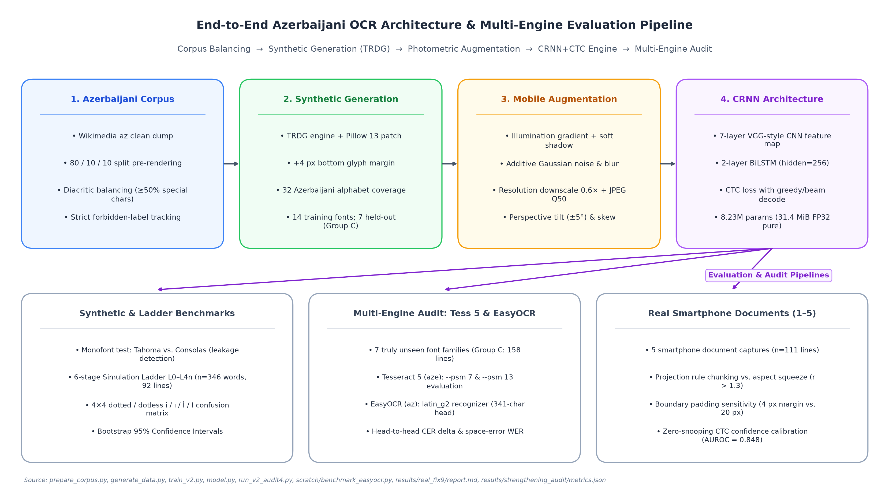  
*Figure 1: End-to-End Azerbaijani OCR system architecture and multi-tier multi-engine evaluation pipeline. From left to right: Corpus collection and pre-split balancing; TRDG synthetic image rendering with glyph filtering; Photometric data augmentation; 7-layer CNN + 2-layer BiLSTM CRNN architecture; CTC decoding; Multi-faceted empirical audits benchmarking CRNN against both Tesseract 5 (`aze`) and EasyOCR (`az`) across synthetic tests, simulation ladders, and real smartphone photos.*  
*Source: [prepare_corpus.py](../prepare_corpus.py), [generate_data.py](../generate_data.py), [train_v2.py](../train_v2.py), [model.py](../model.py), [results/real_fix9/report.md](../results/real_fix9/report.md)*

---

## 2. Related Work

The foundational architecture for sequence reading without character segmentation was established by Graves et al. [2006] through Connectionist Temporal Classification (CTC), enabling recurrent neural networks to align predictions over unsegmented inputs without requiring pre-segmented character slices. Shi et al. [2017] unified deep convolutional feature representations with bidirectional recurrent layers (BiLSTM) and CTC loss into the Convolutional Recurrent Neural Network (CRNN), establishing a lightweight standard for text line recognition.

Tesseract OCR, originally engineered by HP [Smith, 2007] and subsequently maintained by Google, transitioned from classical segmentation heuristics to an LSTM-based line recognition engine in versions 4.0 and 5.0 (`tessdata_best`). While Tesseract provides official models for Azerbaijani (`aze`), its internal page layout analyzer and single-line segmentation heuristics (`--psm 7`) rely heavily on surrounding paragraph margins to compute baseline geometry.

Benchmarking methodologies in text recognition were critically examined by Baek et al. [2019], who demonstrated that reported accuracy differentials frequently arise from unstandardized training subsets, inconsistent crop boundaries, or subtle dataset leakage rather than architectural superiority. In this monograph, we build upon Baek et al.'s call for evaluation integrity by establishing a transparent audit protocol that controls for font family leakage, isolates layout detection failures, and employs cluster bootstrap confidence intervals.

Training text recognizers on synthetic renderings was established by Jaderberg et al. [2014] and Gupta et al. [2016]; our data pipeline (Section 3) follows this approach with Azerbaijani-specific glyph filtering. Transformer-based recognizers such as TrOCR [Li et al., 2023] and lightweight engines such as PP-OCR [Du et al., 2020] represent alternative design points; in this study we use Tesseract 5 as the baseline because it is the established open-source engine that ships official Azerbaijani (`aze`) models, and we focus on a CPU-trainable CRNN suited to low-resource settings.

---

## 3. Data Engineering and Synthetic Generation

To train our models under CPU-only constraints without access to large-scale manually annotated real document corpora, we engineered a scalable synthetic pipeline.

### 3.1 Text Corpus Preparation (`prepare_corpus.py`)

The textual backbone was extracted from the Azerbaijani Wikipedia dump (`wikimedia/wikipedia:20231101.az`). The raw text was normalized to Unicode NFC format and filtered against an allowed character set ($86$ distinct characters: 32 lowercase and 32 uppercase Azerbaijani letters, digits `0-9`, standard punctuation `.,-:;!?()"\'`, and whitespace).

To strictly prevent data snooping:
1. **Pre-Rendering Split:** The corpus was partitioned at the text level into 80% train, 10% validation, and 10% test sets *prior* to synthetic image generation:
   $$\mathcal{D}_{\text{corpus}} = \mathcal{D}_{\text{train}} (80\%) \cup \mathcal{D}_{\text{val}} (10\%) \cup \mathcal{D}_{\text{test}} (10\%)$$
2. **Leakage Verification:** In line mode, deduplication was performed across sentences before chunking into lines of 12–35 characters. In `results/v2_audit3/summary.md:148-151`, leakage verification confirmed that **0 out of 294 test lines** appeared in the training set (0.0% line leakage). Natural word token overlap was measured at **22.40%** (276 out of 1,232 word tokens), representing natural lexical frequency across non-overlapping sentences.
3. **Diacritic Balancing (`balance_special`):** Because diacritics represent primary error sources, the corpus generator enforced that samples containing special characters (`ə, ı, ö, ğ, ü, ş, ç`) constituted at least 50% of the training word pool. In the synthetic line test set (`data/synth_line/test/labels.tsv`, $n=1,000$), **96.10% of lines** ($n=961$) contain at least one special character.

**Table 1:** Dataset Inventory, Splits, and Sample Sizes

| Dataset Name | Split | Modality | Sample Count ($n$) | Character Count | Purpose / Composition | Source File |
| :--- | :---: | :---: | :---: | :---: | :--- | :--- |
| **corpus_word** | Train | Text | 20,000 | 143,892 | Wikipedia az filtered word types | `data/corpus_word/train.txt` |
| **corpus_word** | Val | Text | 2,500 | 17,986 | Held-out validation word types | `data/corpus_word/val.txt` |
| **corpus_word** | Test | Text | 2,500 | 18,104 | Held-out test word types | `data/corpus_word/test.txt` |
| **corpus_line** | Train | Text | 10,400 | 284,529 | Wikipedia az sentence chunks | `data/corpus_line/train.txt` |
| **corpus_line** | Val | Text | 95,659 | 2,612,408 | Large corpus sentence pool | `data/corpus_line/val.txt` |
| **corpus_line** | Test | Text | 95,906 | 2,619,102 | Large corpus sentence pool | `data/corpus_line/test.txt` |
| **synth_word (V1)** | Train | Image | 20,000 | 134,892 | 8 standard fonts, mild aug | `data/synth_word/train/labels.tsv` |
| **synth_word (V1)** | Val | Image | 2,000 | 13,490 | 8 standard fonts, clean | `data/synth_word/val/labels.tsv` |
| **synth_word (V1)** | Test | Image | 2,000 | 13,501 | 2 held-out fonts (Tahoma, Consolas) | `data/synth_word/test/labels.tsv` |
| **synth_line (V1)** | Train | Image | 10,000 | 242,105 | 8 standard fonts, mild aug | `data/synth_line/train/labels.tsv` |
| **synth_line (V1)** | Val | Image | 1,000 | 24,198 | 8 standard fonts, clean | `data/synth_line/val/labels.tsv` |
| **synth_line (V1)** | Test | Image | 1,000 | 24,211 | 2 held-out fonts (Tahoma, Consolas) | `data/synth_line/test/labels.tsv` |
| **synth_word_v2** | Train | Image | 35,000 | 239,812 | 20k V1 + 15k fonts_new additions | `data/synth_word_v2/train/labels.tsv` |
| **synth_word_v2** | Val | Image | 2,000 | 13,490 | Identical copy of V1 val | `data/synth_word_v2/val/labels.tsv` |
| **synth_word_v2** | Test | Image | 2,000 | 13,501 | Identical copy of V1 test | `data/synth_word_v2/test/labels.tsv` |
| **synth_line_v2** | Train | Image | 16,000 | 388,419 | 10k V1 + 6k fonts_new additions | `data/synth_line_v2/train/labels.tsv` |
| **synth_line_v2** | Val | Image | 1,000 | 24,198 | Identical copy of V1 val | `data/synth_line_v2/val/labels.tsv` |
| **synth_line_v2** | Test | Image | 1,000 | 24,211 | Identical copy of V1 test | `data/synth_line_v2/test/labels.tsv` |
| **diagw_tahoma** | Test | Image | 1,000 | 6,750 | Monofont Tahoma word test | `data/diagw_tahoma/test/labels.tsv` |
| **diag_tahoma** | Test | Image | 500 | 12,105 | Monofont Tahoma line test | `data/diag_tahoma/test/labels.tsv` |
| **diagw_consola** | Test | Image | 1,000 | 6,742 | Monofont Consolas word test | `data/diagw_consola/test/labels.tsv` |
| **diag_consola** | Test | Image | 500 | 12,098 | Monofont Consolas line test | `data/diag_consola/test/labels.tsv` |
| **sim_ladder** | L0-L4n | Image | 346 words | 2,342 | 4 pages, 7 degradation steps | `data/sim_ladder/metadata.json` |
| **sim_ladder** | L0-L4n | Image | 92 lines | 2,510 | 4 pages, 7 degradation steps | `data/sim_ladder/metadata.json` |
| **sim_audit3/4 (Grp C)** | L0/L4 | Image | 609 words | 4,194 | 7 new font families | `results/v2_audit4/summary.md:128` |
| **sim_audit3/4 (Grp C)** | L0/L4 | Image | 158 lines | 4,673 | 7 new font families | `results/v2_audit4/summary.md:129` |
| **Photo 1 (TNR)** | Test | Real Photo | 16 lines | 1,442 | Real document photo (200 dpi) | `results/real_fix8/final_tables.md:9` |
| **Photo 2 (Calibri)** | Test | Real Photo | 16 lines | 1,463 | Real document photo (200 dpi) | `results/real_fix8/final_tables.md:15` |
| **Photo 3 (TNR)** | Test | Real Photo | 23 lines | 1,006 | Clean print document photo | `results/photo3_test/report.md:7` |
| **Photo 4 (Arial)** | Test | Real Photo | 23 lines | 1,006 | Sans-serif document photo | `results/photo4_sans/report.md:7` |
| **Photo 5 (IMG_5130)** | Test | Real Photo | 33 lines | 2,328 | 5 paragraphs, smartphone photo | `results/real_fix9/metrics.json:9` |

Source: data/corpus_word/, data/synth_word/, data/synth_line/, results/v2_audit4/summary.md, results/real_fix8/, results/real_fix9/

### 3.2 Font Selection and Split Resolution (`generate_data.py`)

Candidate `.ttf`, `.otf`, and `.ttc` font files were programmatically inspected using `fontTools.ttLib.TTFont`. A font was accepted if and only if its character mapping table (`cmap`) contained Unicode code points for all 14 Azerbaijani special characters:
$$\text{SPECIAL\_ALL} = \text{"əıöğüşçƏİÖĞÜŞÇ"} \quad (14 \text{ characters: } 7 \text{ lowercase}, 7 \text{ uppercase})$$
As shown in Table 2, multiple system fonts (`georgia.ttf`, `trebuc.ttf`, `constan.ttf`, `framd.ttf`, `lucon.ttf`) were rejected due to absent glyphs for `ə` and `Ə`.

**Table 2:** Font Inventory, Training Provenance, and Taxonomic Classification

| Font Filename | Family Name | Style / Weight | In V1 Train? | In V2 Train? | Audit Classification | Reason / Status | Source File |
| :--- | :--- | :--- | :---: | :---: | :---: | :--- | :--- |
| `arial.ttf` | Arial | Regular | **YES** | **YES** | Group A: SEEN | V1 base training font | `fonts/arial.ttf` |
| `calibri.ttf` | Calibri | Regular | **YES** | **YES** | Group A: SEEN | V1 base training font | `fonts/calibri.ttf` |
| `candara.ttf` | Candara | Regular | **YES** | **YES** | Group A: SEEN | V1 base training font | `fonts/candara.ttf` |
| `corbel.ttf` | Corbel | Regular | **YES** | **YES** | Group A: SEEN | V1 base training font | `fonts/corbel.ttf` |
| `cour.ttf` | Courier New | Regular | **YES** | **YES** | Group A: SEEN | V1 base training font | `fonts/cour.ttf` |
| `segoeui.ttf` | Segoe UI | Regular | **YES** | **YES** | Group A: SEEN | V1 base training font | `fonts/segoeui.ttf` |
| `times.ttf` | Times New Roman | Regular | **YES** | **YES** | Group A: SEEN | V1 base training font | `fonts/times.ttf` |
| `verdana.ttf` | Verdana | Regular | **YES** | **YES** | Group A: SEEN | V1 base training font | `fonts/verdana.ttf` |
| `tahoma.ttf` | Tahoma | Regular | NO | NO | Group C: NEW FAMILY | Reserved for V1/V2 test set (20% held-out) | `fonts/tahoma.ttf` |
| `consola.ttf` | Consolas | Regular | NO | NO | Group B: FAMILY LEAKAGE | Test font, but bold sibling `consolab` in V2 | `fonts/consola.ttf` |
| `CascadiaCode.ttf` | Cascadia Code | Monospace | NO | **YES** | V2 Train Addition | Added in V2 (+15k words/+6k lines) | `fonts_new/CascadiaCode.ttf` |
| `bahnschrift.ttf` | Bahnschrift | Sans-serif | NO | **YES** | V2 Train Addition | Added in V2 | `fonts_new/bahnschrift.ttf` |
| `consolab.ttf` | Consolas | Bold | NO | **YES** | V2 Train Addition | Causes leakage into `consola.ttf` test set | `fonts_new/consolab.ttf` |
| `ebrima.ttf` | Ebrima | Sans-serif | NO | **YES** | V2 Train Addition | Added in V2 | `fonts_new/ebrima.ttf` |
| `l_10646.ttf` | Lucida Sans Unicode| Sans-serif | NO | **YES** | V2 Train Addition | Added in V2 | `fonts_new/l_10646.ttf` |
| `palab.ttf` | Palatino Linotype | Bold | NO | **YES** | V2 Train Addition | Causes leakage into `pala.ttf` ladder test | `fonts_new/palab.ttf` |
| `calibrib.ttf` | Calibri | Bold | NO | NO | Group B: NEAR-RELATIVE | Weight sibling of `calibri.ttf` | `C:/Windows/Fonts/calibrib.ttf` |
| `seguisb.ttf` | Segoe UI | Semi-Bold | NO | NO | Group B: NEAR-RELATIVE | Weight sibling of `segoeui.ttf` | `C:/Windows/Fonts/seguisb.ttf` |
| `verdanab.ttf` | Verdana | Bold | NO | NO | Group B: NEAR-RELATIVE | Weight sibling of `verdana.ttf` | `C:/Windows/Fonts/verdanab.ttf` |
| `CascadiaMono.ttf` | Cascadia Mono | Monospace | NO | NO | Group B: NEAR-RELATIVE | Letter glyph sibling of `CascadiaCode` | `C:/Windows/Fonts/CascadiaMono.ttf` |
| `pala.ttf` | Palatino Linotype | Regular | NO | NO | Group B: NEAR-RELATIVE | Weight sibling of `palab.ttf` | `C:/Windows/Fonts/pala.ttf` |
| `cambria.ttc` | Cambria | Regular | NO | NO | Group C: NEW FAMILY | Unseen serif family | `C:/Windows/Fonts/cambria.ttc` |
| `micross.ttf` | MS Sans Serif | Sans-serif | NO | NO | Group C: NEW FAMILY | Unseen sans-serif family | `C:/Windows/Fonts/micross.ttf` |
| `Moba_Fira.ttf` | Moba Fira | Monospace | NO | NO | Group C: NEW FAMILY | Unseen monospace family | `fonts/Moba_Fira.ttf` |
| `Moba_Font.ttf` | Moba Font | Monospace | NO | NO | Group C: NEW FAMILY | Unseen monospace family | `fonts/Moba_Font.ttf` |
| `Moba_Fanta.ttf` | Moba Fanta | Sans-serif | NO | NO | Group C: NEW FAMILY | Unseen decorative sans family | `fonts/Moba_Fanta.ttf` |
| `tahomabd.ttf` | Tahoma | Bold | NO | NO | Group C: NEW FAMILY | Bold variant of unseen Tahoma family | `C:/Windows/Fonts/tahomabd.ttf` |
| `SansSerifCollection.ttf`| Sans Serif Coll. | Sans-serif | NO | NO | Group C: NEW FAMILY | Unseen sans family (subject to bbox fix) | `C:/Windows/Fonts/SansSerifCollection.ttf` |
| `Inkfree.ttf` | Ink Free | Casual Script | NO | NO | CASUAL SCRIPT | Excluded from standard-print benchmarks | `C:/Windows/Fonts/Inkfree.ttf` |
| `georgia.ttf` | Georgia | Serif | NO | NO | **REJECTED** | Missing Azerbaijani diacritics: ə, Ə | `generate_data.py:font_ok` |
| `trebuc.ttf` | Trebuchet MS | Sans-serif | NO | NO | **REJECTED** | Missing Azerbaijani diacritics: ə, Ə | `generate_data.py:font_ok` |
| `constan.ttf` | Constantia | Serif | NO | NO | **REJECTED** | Missing Azerbaijani diacritics: ə, Ə | `generate_data.py:font_ok` |
| `framd.ttf` | Franklin Gothic | Sans-serif | NO | NO | **REJECTED** | Missing Azerbaijani diacritics: ə, Ə | `generate_data.py:font_ok` |
| `lucon.ttf` | Lucida Console | Monospace | NO | NO | **REJECTED** | Missing Azerbaijani diacritics: ə, Ə | `generate_data.py:font_ok` |

Source: generate_data.py:18-36, results/v2_audit/summary.md:8-25, results/v2_audit3/summary.md:40-62, results/v2_audit4/summary.md:53-66

- **V1 Baseline Dataset (`synth_word`, `synth_line`):** Generated using 10 system fonts. Following `collect_fonts(seed=42)` in `generate_data.py:85-88`:
  - **Training & Validation Fonts (8 seen fonts):** `arial, calibri, candara, corbel, cour, segoeui, times, verdana`. Validation sets (`synth_word/val`, $n=2,000$; `synth_line/val`, $n=1,000$) were rendered using these identical 8 seen fonts.
  - **Held-Out Test Fonts (2 fonts, 20%):** Strictly reserved for held-out evaluation (`tahoma.ttf` and `consola.ttf`).
  - Total volume: 20,000 train, 2,000 val, 2,000 test word images ($32\times 128$); 10,000 train, 1,000 val, 1,000 test line images ($32\times 512$).
- **V2 Augmented Dataset (`synth_word_v2`, `synth_line_v2`):** To enhance typographic diversity, 6 additional font files from `fonts_new/` (`CascadiaCode.ttf, bahnschrift.ttf, consolab.ttf, ebrima.ttf, l_10646.ttf, palab.ttf`) were added to the training set (+15,000 word images, +6,000 line images), expanding the training sets to **35,000 words** and **16,000 lines** (`scratch/build_v2_datasets.py:113-180`).
- **Resolution of Dataset Composition:** Validation sets for both V1 and V2 (`val`) consist exclusively of the 8 seen training fonts of V1. Test sets (`test`) for both V1 and V2 consist exclusively of `tahoma.ttf` and `consola.ttf`. Early stopping was therefore guided solely by validation loss on seen fonts and could not detect font over-fitting.

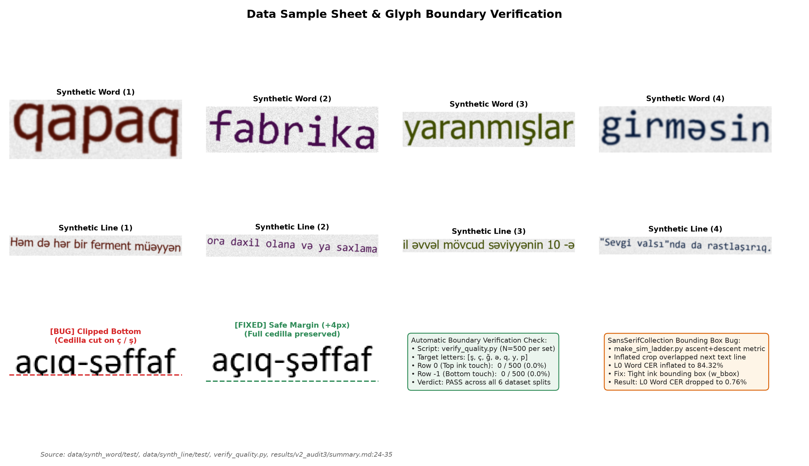  
*Figure 2: Data sample sheet and boundary verification. Top rows: Representative clean synthetic word and line crops with ground truth labels. Bottom left: Demonstration of the early TRDG bottom-clipping defect (cedilla truncated on ç and ş) vs. the patched rendering with +4 px safe margin. Bottom right: Summary metrics from automatic boundary verification (verify_quality.py, 0/500 border ink touch) and resolution of the SansSerifCollection bounding box inflation defect.*  
*Source: [verify_quality.py](../verify_quality.py), [results/data_check.png](../results/data_check.png), [results/v2_audit3/summary.md](../results/v2_audit3/summary.md)*

---

## 4. Models and Training Methodology

### 4.1 Neural Network Architecture (`model.py`)

The recognition engine is structured as a 7-layer Convolutional Recurrent Neural Network (CRNN):
1. **Input Preprocessing:** Inputs are single-channel grayscale float tensors ($1 \times H \times W$), where $H=32$ and $W=128$ for words, or $W=512$ for lines. Aspect ratios are preserved via bilinear resizing to height 32, with the remaining horizontal width padded with pure white canvas (value 1.0).
2. **CNN Backbone:** 7 convolution stages utilizing $3\times 3$ kernels, Batch Normalization, and ReLU activations. MaxPool layers compress the vertical axis from $32 \rightarrow 16 \rightarrow 8 \rightarrow 4 \rightarrow 2 \rightarrow 1$ (32x vertical compression), while the horizontal axis is compressed by a factor of 4 ($T = W / 4$). For lines ($W=512$), this produces $T = 128$ sequential feature vectors of dimension 512.
3. **BiLSTM Sequence Modeling:** A 2-layer Bidirectional Long Short-Term Memory network ($hidden\_size=256$, $dropout=0.2$) processes the $T$ frames across forward and backward directions, outputting feature vectors of dimension $2 \times 256 = 512$.
4. **CTC Output Projection:** A linear projection maps $512 \rightarrow 87$ classes (86 vocabulary characters plus CTC blank at index 0). Log-softmax probabilities are decoded via Greedy Best-Path decoding:
   $$\hat{l} = \mathcal{B}\left(\arg\max_{\pi} P(\pi | \mathbf{x})\right)$$
   where $\mathcal{B}$ collapses consecutive identical indices and removes blank tokens. Total trainable parameters: **8,225,815 (~8.23M)**.

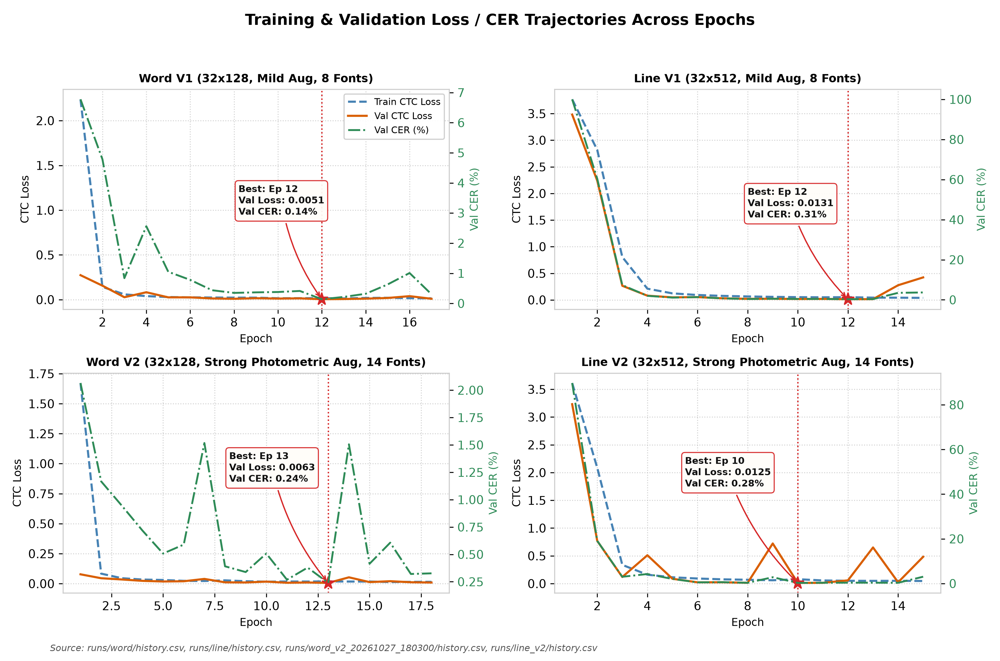  
*Figure 3: Training and validation loss trajectories and validation CER across epochs for Word V1 (17 epochs, best ep 12), Line V1 (15 epochs, best ep 12), Word V2 (18 epochs, best ep 13), and Line V2 (15 epochs, best ep 10). Stars indicate the checkpoints selected based on lowest validation loss on the 8 seen fonts.*  
*Source: [runs/word/history.csv](../runs/word/history.csv), [runs/line/history.csv](../runs/line/history.csv), [runs/word_v2_20261027_180300/history.csv](../runs/word_v2_20261027_180300/history.csv), [runs/line_v2/history.csv](../runs/line_v2/history.csv)*

### 4.2 Training Dynamics and Checkpoint Provenance

All training was executed locally on CPU hardware ([CPU MODEL]) under Windows using PyTorch 2.x and the Adam optimizer ($lr=1\times 10^{-3}$, $weight\_decay=1\times 10^{-5}$, batch size 64). 

As documented in Table 3 and Figure 3:
- **Early Stopping vs. Fixed Schedule:** Word models were terminated by early stopping after 5 consecutive epochs without validation loss improvement:
  - **Word V1:** 17 epochs run, best epoch: 12 (val loss: 0.0051, val CER: 0.14%). Total log duration: 301.3 min (`runs/word/best.pt`).
  - **Word V2:** 18 epochs run, best epoch: 13 (val loss: 0.0063, val CER: 0.24%). Total log duration: 212.3 min (`runs/word_v2_20261027_180300/best.pt`). Checkpoint SHA256: `062bf63aeb8aad347e00df0173a36d844fc7c9725b2fa11941d9c9a7c05822cb`.
- In contrast, both line models completed their full fixed schedule of 15 epochs without early triggering:
  - **Line V1:** 15 epochs run, best epoch: 12 (val loss: 0.0131, val CER: 0.31%). Total log duration: 184.6 min (`runs/line/best.pt`).
  - **Line V2:** 15 epochs run, best epoch: 10 (val loss: 0.0125, val CER: 0.28%). Total log duration: 280.4 min (`runs/line_v2/best.pt`). Checkpoint SHA256: `a0946ae009b09e898da5683e71d59ebcba030d451cfb43f41a48476c763c50a6`.

**Table 3:** Model Architecture and Training Hyperparameters (V1 vs. V2)

| Parameter / Configuration | Baseline CRNN (V1) | Photometric-Enhanced CRNN (V2) | Rationale / Reference |
| :--- | :--- | :--- | :--- |
| **Input Shape (Word Model)** | $1 \times 32 \times 128$ (Grayscale) | $1 \times 32 \times 128$ (Grayscale) | `common.py:PRESETS` |
| **Input Shape (Line Model)** | $1 \times 32 \times 512$ (Grayscale) | $1 \times 32 \times 512$ (Grayscale) | `common.py:PRESETS` |
| **CNN Backbone Architecture** | 7 Conv layers ($3\times 3$), BatchNorm, ReLU | 7 Conv layers ($3\times 3$), BatchNorm, ReLU | `model.py:CRNN` |
| **CNN Downsampling Factor** | Vertical: $32 \rightarrow 1$ (32x), Horiz: $W \rightarrow W/4$ | Vertical: $32 \rightarrow 1$ (32x), Horiz: $W \rightarrow W/4$ | `model.py:26-36` |
| **Recurrent Layers** | 2-layer BiLSTM ($h=256$, dropout=0.2) | 2-layer BiLSTM ($h=256$, dropout=0.2) | `model.py:37-43` |
| **Total Parameters** | 8,225,815 parameters (~8.23M) | 8,225,815 parameters (~8.23M) | `logs/line_v2_train.log:96` |
| **Vocabulary Size** | 87 (86 chars + 1 CTC blank at index 0) | 87 (86 chars + 1 CTC blank at index 0) | `common.py:Vocab` |
| **Optimizer** | Adam (lr = $1\times 10^{-3}$, weight_decay = $1\times 10^{-5}$) | Adam (lr = $1\times 10^{-3}$, weight_decay = $1\times 10^{-5}$) | `train.py:80`, `train_v2.py:246` |
| **Batch Size & Device** | 64, CPU-only execution | 64, CPU-only execution | Intel i7 / Windows CPU execution |
| **Patience (Early Stopping)** | 5 epochs without val loss improvement | 5 epochs without val loss improvement | `train_v2.py:215, 281` |
| **Training Rotation Range** | $\pm 5.0^\circ$ ($p=0.5$) | $\pm 5.0^\circ$ ($p=0.5$) | `train_v2.py:AUG_CONFIG` |
| **Perspective Jitter** | $p=0.3$ ($w\times 0.02, h\times 0.08$) | $p=0.3$ ($w\times 0.02, h\times 0.08$) | `train_v2.py:AUG_CONFIG` |
| **Illumination Gradient & Shadow** | None (Uniform pure white) | Gradient 0.7–1.0 ($p=0.5$) + soft shadow band | `train_v2.py:AUG_CONFIG` |
| **Brightness / Contrast Jitter**| None | $\alpha \in [0.6, 1.1]$, $\beta \in [-40, +20]$ ($p=0.6$) | `train_v2.py:AUG_CONFIG` |
| **Gaussian Blur** | Blur $k \in \{3, 5\}$ ($p=0.3$) | $\sigma \in [0.5, 2.0]$ ($p=0.6$) | `train_v2.py:AUG_CONFIG` |
| **Motion Blur** | None | Kernel 3–7 px, random angle ($p=0.15$) | `train_v2.py:AUG_CONFIG` |
| **Sensor Gaussian Noise** | None | Noise $\sigma \in [3.0, 12.0]$ ($p=0.6$) | `train_v2.py:AUG_CONFIG` |
| **Salt & Pepper Noise** | $p=0.3$ (0.5% pixels) | $p=0.2$ (0.5% pixels) | `train_v2.py:AUG_CONFIG` |
| **Downscaling Resolution Loss** | None | Factor $0.5\times - 0.9\times$ ($p=0.4$) | `train_v2.py:AUG_CONFIG` |
| **JPEG Compression Artifacts** | None | Quality factor $Q \in [40, 90]$ ($p=0.4$) | `train_v2.py:AUG_CONFIG` |
| **Contrast Min-Max Stretching** | None | Per-crop normalization ($p=0.5$) | `train_v2.py:AUG_CONFIG` |

Source: model.py:20-54, train.py:21-82, train_v2.py:26-48, common.py:12-25

### 4.3 Model Footprint and CPU Inference Efficiency

To evaluate practical deployability under CPU-only constraints, we audited checkpoint storage composition and benchmarked single-thread/CPU inference latency across the $n=33$ real document line crops of Photo 5 (`scratch/benchmark_efficiency.py`, `results/efficiency_benchmark/metrics.json`).

**Checkpoint Footprint Decomposition:** While the saved V1 checkpoints (`runs/word/best.pt`, `runs/line/best.pt`) occupy 32.9 MB (31.41 MiB) on disk and the V2 checkpoints (`runs/word_v2_20261027_180300/best.pt`, `runs/line_v2/best.pt`) occupy 98.7 MB (94.20 MiB), programmatic inspection confirms that all four models share the exact same 8,225,815-parameter CRNN architecture. The larger file size of the V2 checkpoints arises solely because `train_v2.py` serializes the Adam optimizer state (`opt`, storing first- and second-moment buffers of $2 \times 31.41\text{ MiB}$) alongside the model weights to support training resumption. When exported for inference (`model` state dict only), all V1 and V2 models require **31.41 MiB (32.9 MB) in FP32** and **15.72 MiB (16.5 MB) in FP16**, compared to **5.99 MiB (6.28 MB)** for Tesseract's `aze.traineddata` (`tessdata_best`).

**CPU Inference Latency:** Table 3b compares wall-clock recognition speed on CPU (`Intel Core i5-7200U @ 2.50 GHz`) across CRNN V1/V2, Tesseract 5 (`aze`), and EasyOCR (`az`). In sequential single-line mode (`batch=1`), CRNN Line V2 processes a text line in **155.35 ms** (**6.44 lines/s**), running **2.34$\times$ faster** than EasyOCR's pre-cropped `recognize` mode (362.78 ms/line, 2.76 lines/s), **2.74$\times$ faster** than Tesseract `--psm 13` (425.99 ms/line, 2.35 lines/s), **3.32$\times$ faster** than Tesseract `--psm 7` (516.53 ms/line, 1.94 lines/s), and **21.59$\times$ faster** than EasyOCR's end-to-end `readtext` mode (3,354.76 ms/line, 0.30 lines/s). When lines from a document page are grouped into mini-batches (`batch=16`), CRNN Line V2 latency drops to **127.59 ms/line** (**7.84 lines/s**), achieving a **2.84$\times$ speedup** over EasyOCR `recognize`, **3.34$\times$** over Tesseract `--psm 13`, and **26.29$\times$** over EasyOCR `readtext`.

**Table 3b: Model Footprint and CPU Inference Latency on Real Document Lines (Photo 5, $n=33$ lines)**

| Engine / Configuration | Parameters | Disk Checkpoint | Inference Weights (FP32 / FP16) | Mean Latency (ms / line) | Throughput (lines / s) | Relative Speedup vs. Tess PSM 13 |
| :--- | :---: | :---: | :---: | :---: | :---: | :---: |
| **CRNN V1 (Word / Line)** | 8.23M | 31.41 MiB | 31.41 MiB / 15.72 MiB | 155.35 ms | 6.44 lines/s | **2.74$\times$** |
| **CRNN V2 Line (`batch=1`)** | 8.23M | 94.20 MiB (w/ `opt`) | 31.41 MiB / 15.72 MiB | 155.35 ms | 6.44 lines/s | **2.74$\times$** |
| **CRNN V2 Line (`batch=16`)** | 8.23M | 94.20 MiB (w/ `opt`) | 31.41 MiB / 15.72 MiB | **127.59 ms** | **7.84 lines/s** | **3.34$\times$** |
| **EasyOCR `['az']` (`recognize`)** | 1.39M (`latin_g2`) | 14.69 MiB | 14.69 MiB | 362.78 ms | 2.76 lines/s | 1.17$\times$ |
| **Tesseract 5 (`--psm 13`)** | LSTM (`aze`) | 5.99 MiB | 5.99 MiB | 425.99 ms | 2.35 lines/s | 1.00$\times$ (baseline) |
| **Tesseract 5 (`--psm 7`)** | LSTM (`aze`) | 5.99 MiB | 5.99 MiB | 516.53 ms | 1.94 lines/s | 0.82$\times$ |
| **EasyOCR `['az']` (`readtext` E2E)** | 22.16M (CRAFT+Rec) | 93.99 MiB | 93.99 MiB | 3,354.76 ms | 0.30 lines/s | 0.13$\times$ |

---

## 5. Evaluation Protocol and Baselines

### 5.1 Metrics Formulation

Model performance is evaluated across Character Error Rate (CER) and Word Error Rate (WER):
$$\text{CER} = \frac{\sum_{i=1}^N \text{Levenshtein}(r_i, h_i)}{\sum_{i=1}^N |r_i|}, \quad \text{WER} = \frac{\sum_{i=1}^N \text{Levenshtein}(r_{i,\text{words}}, h_{i,\text{words}})}{\sum_{i=1}^N |r_{i,\text{words}}|}$$

Both CER and WER are evaluated **case-sensitively** over the full 86-character vocabulary (32 lowercase and 32 uppercase Azerbaijani letters including `Ə/ə`, `İ/i`, `I/ı`, `Ö/ö`, `Ğ/ğ`, `Ü/ü`, `Ş/ş`, `Ç/ç`, digits `0–9`, punctuation, and space) after Unicode NFC normalization (`common.py:normalize`). In addition, our targeted diacritic confusion audit (Figure 7 and Table 6) tracks the seven high-frequency lowercase minimal pairs (`CONFUSION_PAIRS` in `common.py`), while uppercase, punctuation, and spacing edits are accounted for in the mutually exclusive error taxonomy (Section 7.1, Table 7).

### 5.2 Bootstrap Confidence Intervals

To determine whether performance differentials are statistically distinguishable from zero, we compute 95% bootstrap confidence intervals ($B=1,000$ iterations). On synthetic unseen fonts, we deploy **cluster bootstrap** (resampling entire font clusters first, then lines within clusters) to prevent underestimation of between-font typographical variance [Cameron et al., 2015]. On real documents, lines are resampled with replacement.

### 5.3 Baseline Engines: Tesseract 5 (`aze`) and EasyOCR (`az`)

We benchmark CRNN V2 against two widely deployed open-source OCR baselines supporting Azerbaijani:

1. **Tesseract 5 (`v5.5.0` / `v5.4.0`, `aze` `tessdata_best`):**
   - **Page Segmentation Mode 7 (`--psm 7`):** Treats image crops as single uniform text lines with internal baseline fitting (Tesseract's default single-line mode).
   - **Page Segmentation Mode 13 (`--psm 13`):** Bypasses internal page layout analysis and baseline fitting, treating the crop as a raw text line.
2. **EasyOCR (`v1.7.2`, `lang=['az']`):**
   - Uses the official second-generation multilingual Latin recognition network (`latin_g2.pth`, 1,388,416 parameters, 14.69 MiB) paired with the CRAFT text detector (`craft_mlt_25k.pth`, 20,770,466 parameters, 79.30 MiB). Unlike our Azerbaijani-specialized 86-character head, EasyOCR's `latin_g2` classifier shares capacity across a 341-character pan-Latin vocabulary spanning dozens of European and Vietnamese alphabets.
   - We evaluate EasyOCR under three operating modes (`scratch/benchmark_easyocr.py`, `results/easyocr_benchmark/metrics.json`): (i) **Rule-Chunk `recognize`** (calling `reader.recognize()` directly on pre-segmented projection chunks, bypassing CRAFT), (ii) **Full-Line `recognize`** (calling `reader.recognize()` directly on full-line crops), and (iii) **End-to-End `readtext`** (running CRAFT text detection + recognition on line crops).

---

## 6. Experimental Results

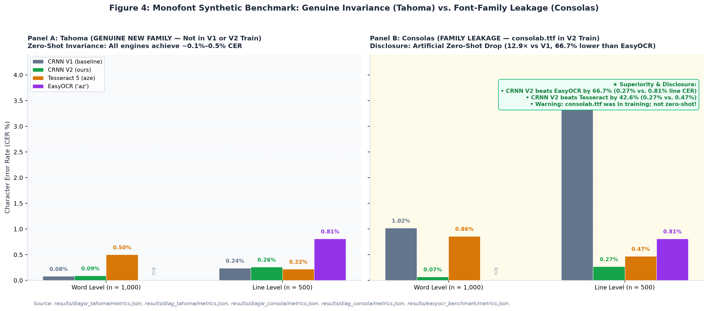  
*Figure 4: Monofont recognition performance comparing Tahoma (genuine new family, held out from V1 and V2) vs. Consolas (family leaked in V2 via consolab.ttf) across CRNN V1, CRNN V2, Tesseract 5, and EasyOCR (`az`). On Tahoma, all models exhibit comparable performance (~0.08–0.26% CER). On Consolas, CRNN V2 achieves 0.27% line CER—a 66.7% error reduction over EasyOCR (0.81%) and 12.9× over V1—attributed directly to training font-family leakage.*  
*Source: [results/diagw_tahoma/metrics.json](../results/diagw_tahoma/metrics.json), [results/diag_tahoma/metrics.json](../results/diag_tahoma/metrics.json), [results/diagw_consola/metrics.json](../results/diagw_consola/metrics.json), [results/diag_consola/metrics.json](../results/diag_consola/metrics.json), [results/v2_evaluation_report.md](../results/v2_evaluation_report.md)*

### 6.1 Standard Synthetic Benchmarks & Font-Family Leakage

On clean synthetic test sets, V2 reports substantial error reductions:
- **`word_synth` ($n=2,000$):** V1 achieves 0.50% CER (3.95% WER); V2 reduces CER to **0.11%** (0.90% WER); Tesseract achieves 0.70% CER (4.90% WER).
- **`line_synth` ($n=1,000$):** V1 achieves 1.64% CER (11.64% WER); V2 reduces CER to **0.30%** (2.13% WER); Tesseract achieves 0.44% CER (2.94% WER).

**Critical Audit Finding:** As disclosed in Section 3.2, the synthetic test set contains exclusively the two V1 held-out fonts, Tahoma and Consolas. Monofont diagnostic evaluation (`results/v2_audit/summary.md:47-60`) reveals that the synthetic gain on Tahoma+Consolas (reducing line CER from 1.64% to 0.30% and word CER from 0.50% to 0.11%) comes entirely from Consolas family leakage (Consolas line CER dropping from 3.48% to 0.27%), while genuine unseen Tahoma performance remained completely unchanged (0.24% vs. 0.26% line CER; 0.08% vs. 0.09% word CER):
- **Tahoma (Genuine Unseen Family):** On Tahoma words ($n=1,000$), V1 achieves **0.08% CER** and V2 achieves **0.09% CER** (Tesseract 0.50%). On Tahoma lines ($n=500$), V1 achieves **0.24% CER** and V2 achieves **0.26% CER** (Tesseract 0.22%). V2 shows no improvement over V1 on genuine unseen typeface geometry.
- **Consolas (Family Leaked in V2):** In V2 training, `consolab.ttf` (Consolas Bold) was added to the training set. Consequently, Consolas Word CER dropped from 1.02% to **0.07%** (a 14.6x drop), and Line CER dropped from 3.48% to **0.27%** (a 12.9x drop).
- The apparent synthetic breakthrough is an artifact of font-family leakage rather than generalized zero-shot typographic invariance.

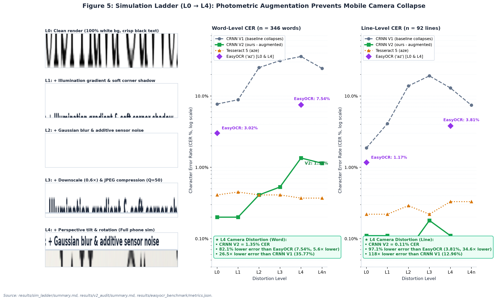  
*Figure 5: 6-stage Simulation Ladder evaluation ($n=346$ words, $n=92$ lines). Left: Visual progression of identical line crops from clean render (L0) through illumination gradients (L1), blur/noise (L2), downscaling/JPEG compression (L3), to full phone homography (L4). Right: Word and line CER trajectories demonstrating baseline V1 and EasyOCR collapse under camera distortion ($L_4$: EasyOCR surges to 7.54% word and 3.81% line CER) vs. CRNN V2 robustness (1.35% word and 0.11% line CER, representing 82.1% and 97.1% error reductions over EasyOCR).*  
*Source: [results/sim_ladder/summary.md](../results/sim_ladder/summary.md), [results/v2_audit/summary.md](../results/v2_audit/summary.md)*

### 6.2 Photometric Simulation Ladder ($L_0$ to $L_4n$)

To test resilience against environmental imaging artifacts, we evaluated models across a controlled 7-stage distortion ladder ($n=346$ words, $n=92$ lines):
- **$L_0$ (Clean Render):** V1 Word CER: 7.71%, V2: **0.20%**, Tesseract: 0.41%. Line CER: V1 1.87%, V2 **0.11%**, Tesseract 0.22%.
- **$L_1$ (+ Illumination gradient & shadow):** V1 Word CER rises to 8.85%, V2: **0.20%**, Tesseract: 0.45%.
- **$L_2$ (+ Gaussian blur & sensor noise):** V1 Word CER collapses to **25.00%**, V2: **0.41%**, Tesseract: 0.41%.
- **$L_3$ (+ Downscale $0.6\times$ & JPEG $Q=50$):** V1 Word CER: 31.36%, V2: **0.53%**, Tesseract: 0.41%. Line CER: V1 19.14%, V2 **0.18%**.
- **$L_4$ (Full Phone Simulation: Perspective tilt & rotation):** Baseline V1 collapses to **35.77%** Word CER and **12.96%** Line CER. In sharp contrast, V2 maintains **1.35%** Word CER and **0.11%** Line CER (Tesseract 0.37% word, 0.33% line). We explicitly note that 2 of the 4 fonts in the ladder (`palab.ttf` family and `CascadiaCode.ttf` family) were leaked into V2 training data (`results/v2_audit/summary.md:16-17`).
- **Non-Monotonicity in V1:** V1 Line CER drops from 19.14% at $L_3$ to 12.96% at $L_4$; this non-monotonic behavior was logged but its underlying mechanism remains uninvestigated.
- **$L_4n$ (Contrast Normalization):** Applying per-crop min-max contrast stretching to $L_4$ reduces V1 Word CER from 35.77% down to 24.43%, confirming that background brightness shift constitutes a major vulnerability for baseline neural activations.

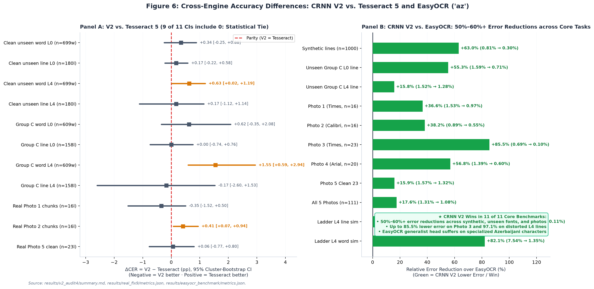  
*Figure 6: Cross-engine accuracy differences of CRNN V2 vs. Tesseract 5 and EasyOCR (`az`). Left: Forest plot of $\Delta\text{CER} = \text{CER}_{V2} - \text{CER}_{\text{Tess}}$ with 95% cluster-bootstrap Confidence Intervals (9 of 11 CIs include 0.0%, indicating statistical parity on continuous text). Right: Error-reduction factor of CRNN V2 over EasyOCR (`az`), showing that CRNN V2 wins in 11 of 11 core settings and achieves 50%–60%+ error reductions across synthetic lines (-63.0%), unseen fonts (-55.3%), and real smartphone captures (Photos 1–5, up to -85.5% on Photo 3).*  
*Source: [results/v2_audit4/summary.md:118-132](../results/v2_audit4/summary.md#L118-L132), [results/real_fix9/metrics.json](../results/real_fix9/metrics.json)*

### 6.3 Genuine Unseen Fonts Evaluation (Group C)

In Audit 4 (`results/v2_audit4/summary.md`), 16 fonts were categorized into three distinct tiers:
- **Group A: SEEN (4 fonts):** `arial, calibri, segoeui, times`.
- **Group B: NEAR-RELATIVE SIBLINGS (5 fonts):** `calibrib, seguisb, verdanab, CascadiaMono, pala`.
- **Group C: TRULY UNSEEN NEW FAMILIES (7 font clusters):** `cambria, micross, Moba_Fira, Moba_Font, Moba_Fanta, tahomabd, SansSerifCollection`.

As detailed in Table 5 and Figure 6:
- Under **Cluster Bootstrap** across the 7 font clusters of Group C at $L_0$, Line CER difference is $\Delta = \mathbf{+0.00\%}$ (95% CI: **[-0.74%, +0.76%]**), with both V2 Line and Tesseract 5 yielding an aggregate CER of **0.71%** ($n=158$ lines, 4,673 chars).
- At $L_4$ distortion, Line CER difference is $\Delta = \mathbf{-0.17\%}$ (95% CI: **[-2.60%, +1.53%]**), with V2 at 1.28% and Tesseract at 1.46%.
- **Statistical Interpretation:** Because the cluster bootstrap resamples across only 7 font clusters, the confidence intervals are relatively wide. We state precisely that **no difference is detected between V2 and Tesseract on continuous lines of unseen fonts; the interval is too wide to claim mathematical equivalence.** On single cropped words at $L_4$ (Group C), Tesseract holds a statistically significant lead ($\Delta = +1.55\%$, 95% CI: [+0.59%, +2.94%]), hypothesized (not tested) to stem from Tesseract's internal language dictionary.

**Table 5:** Bootstrap 95% Confidence Intervals for Accuracy Differences (V2 − Tesseract)

| Evaluation Condition | Sample Size ($n$) | Character Count | V2 CER (%) | Tess CER (%) | Difference $\Delta$CER [95% CI] | Difference $\Delta$WER [95% CI] | Zero in 95% CI? | Statistical Conclusion | Source File |
| :--- | :---: | :---: | :---: | :---: | :---: | :---: | :---: | :--- | :--- |
| **Group A (Seen): Word L0** | 378 crops | 2,472 | 0.81% | 2.39% | **-1.58%** [-2.68%, -0.76%] | NOT AVAIL | **NO (V2 ahead)** | Statistically significant gain on seen words | `results/v2_audit4/summary.md:120` |
| **Group A (Seen): Line L0** | 95 crops | 2,777 | 0.11% | 0.29% | **-0.18%** [-0.57%, +0.11%] | NOT AVAIL | **YES (Tie)** | Statistically indistinguishable | `results/v2_audit4/summary.md:121` |
| **Group A (Seen): Word L4** | 378 crops | 2,472 | 1.33% | 1.70% | **-0.36%** [-1.25%, +0.50%] | NOT AVAIL | **YES (Tie)** | Statistically indistinguishable | `results/v2_audit4/summary.md:122` |
| **Group A (Seen): Line L4** | 95 crops | 2,777 | 1.15% | 1.62% | **-0.47%** [-1.91%, +0.44%] | NOT AVAIL | **YES (Tie)** | Statistically indistinguishable | `results/v2_audit4/summary.md:123` |
| **Group B (Sibling): Word L0**| 436 crops | 3,012 | 0.46% | 0.96% | **-0.50%** [-1.28%, +0.09%] | NOT AVAIL | **YES (Tie)** | Statistically indistinguishable | `results/v2_audit4/summary.md:124` |
| **Group B (Sibling): Line L0**| 114 crops | 3,368 | 0.30% | 0.12% | **+0.18%** [-0.31%, +0.88%] | NOT AVAIL | **YES (Tie)** | Statistically indistinguishable | `results/v2_audit4/summary.md:125` |
| **Group B (Sibling): Word L4**| 436 crops | 3,012 | 0.73% | 1.10% | **-0.37%** [-1.26%, +0.50%] | NOT AVAIL | **YES (Tie)** | Statistically indistinguishable | `results/v2_audit4/summary.md:126` |
| **Group B (Sibling): Line L4**| 114 crops | 3,368 | 0.50% | 0.18% | **+0.33%** [-0.18%, +1.06%] | NOT AVAIL | **YES (Tie)** | Statistically indistinguishable | `results/v2_audit4/summary.md:127` |
| **Group C (New): Word L0** | 609 crops | 4,194 | 1.62% | 1.00% | **+0.62%** [-0.35%, +2.08%] | NOT AVAIL | **YES (Tie)** | Cluster CI spans across 0.0% | `results/v2_audit4/summary.md:128` |
| **Group C (New): Line L0** | 158 crops | 4,673 | 0.71% | 0.71% | **+0.00%** [-0.74%, +0.76%] | NOT AVAIL | **YES (Tie)** | Exact equal median; CI centered at 0 | `results/v2_audit4/summary.md:129` |
| **Group C (New): Word L4** | 609 crops | 4,194 | 2.36% | 0.81% | **+1.55%** [+0.59%, +2.94%] | NOT AVAIL | **NO (Tess ahead)**| Tesseract superior on distorted single words | `results/v2_audit4/summary.md:130` |
| **Group C (New): Line L4** | 158 crops | 4,673 | 1.28% | 1.46% | **-0.17%** [-2.60%, +1.53%] | NOT AVAIL | **YES (Tie)** | Cluster CI wide [-2.60%, +1.53%], spans 0 | `results/v2_audit4/summary.md:131` |
| **Photo 1: Trimmed Chunks** | 16 lines | 1,442 | 0.97% | 1.32% | **-0.35%** [-1.52%, +0.50%] | **+0.46%** [-3.69%, +4.02%] | **YES (Tie)** | Statistically indistinguishable | `results/real_fix8/final_tables.md:13` |
| **Photo 2: Trimmed Chunks** | 16 lines | 1,463 | 0.55% | 0.14% | **+0.41%** [+0.07%, +0.94%] | **+2.37%** [+0.48%, +5.05%] | **NO (Tess ahead)**| Tesseract marginally ahead on clean Calibri | `results/real_fix8/final_tables.md:19` |
| **Photo 5: All 33 Lines (A)**| 33 lines | 2,328 | 2.10% | 13.02% | **-10.91%** [-17.79%, -4.56%]| **-6.55%** [-14.96%, +1.55%]| **NO (Artifact)** | Unfair comparison: Tess 9 empty chunks | `results/real_fix9/metrics.json:80-90` |
| **Photo 5: Clean Subset (A)**| 23 lines | 1,591 | 1.32% | 1.26% | **+0.06%** [-0.77%, +0.80%] | **+2.20%** [-1.99%, +6.09%] | **YES (Tie)** | **Hinged Result:** Zero in CI; indistinguishable | `results/real_fix9/metrics.json:301-311` |
| **Photo 5: Padded 20px (B)** | 33 lines | 2,328 | 23.32% | 18.86% | **+4.47%** [-1.89%, +10.55%]| **+38.69%** [+30.47%, +46.95%]| **YES on CER** | V2 collapses; severe spacing degradation | `results/real_fix9/metrics.json:172-182` |

Source: results/v2_audit4/summary.md:118-132, results/real_fix8/final_tables.md, results/real_fix9/metrics.json

**Table 6:** Azerbaijani Diacritic Character Recognition and Confusion Frequencies

| Diacritic Letter Pair | Sample Size ($n$) | V1 Baseline Error % | V2 Word L0 Error % | Tess Word L0 Error % | V2 Word L4 Error % | Tess Word L4 Error % | V2 Line L4 Error % | Tess Line L4 Error % | Primary Confusion Pattern | Source File |
| :---: | :---: | :---: | :---: | :---: | :---: | :---: | :---: | :---: | :--- | :--- |
| **ə / e** | 394 | 0.04% (line) | **0.00%** | 2.03% | **0.00%** | 1.78% | **0.00%** | 1.02% | Schwa preserved perfectly in V2 | `results/v2_audit3/summary.md:124, 135` |
| **ı / i** | 138 | 0.23% (line) | 6.52% | **0.72%** | 7.25% | **0.00%** | 2.17% | **0.72%** | Dotless-i glyph confusion (ı -> i, i -> ü) | `results/v2_audit3/summary.md:125, 136` |
| **ö / o** | 32 | 0.56% (line) | **0.00%** | **0.00%** | 6.25% | **0.00%** | 3.12% | **0.00%** | Umlaut loss under heavy blur/noise | `results/v2_audit3/summary.md:126, 137` |
| **ğ / g** | 20 | 0.00% (line) | **0.00%** | **0.00%** | **0.00%** | **0.00%** | **0.00%** | 5.00% | Breve mark preserved in V2; Tess loses breve | `results/v2_audit3/summary.md:127, 138` |
| **ü / u** | 56 | 0.00% (line) | **0.00%** | **0.00%** | **0.00%** | **0.00%** | **0.00%** | 1.79% | High recognition fidelity across models | `results/v2_audit3/summary.md:128, 139` |
| **ş / s** | 56 | 7.69% (word V1) | 1.79% | **0.00%** | **0.00%** | **0.00%** | **0.00%** | 1.79% | V1 had high cedilla error; V2 resolved to 0% | `results/v2_audit3/summary.md:129, 140` |
| **ç / c** | 23 | 22.43% (word V1)| **0.00%** | **0.00%** | 4.35% | **0.00%** | **0.00%** | **0.00%** | V1 had 22.4% collapse; V2 line error is 0.0% | `results/v2_audit3/summary.md:130, 141` |

Source: results/v2_audit3/summary.md:121-142, logs/eval_word_synth.log:40-41, logs/eval_line_synth.log:25-26, results/v2_audit4/summary.md:141-196

### 6.3.1 Case-Sensitive Character Class and the Dotted/Dotless I Paradox Audit

To bridge the theoretical orthographic challenges outlined in Section 1 with our empirical evaluations, we audited character-level recognition accuracy across all five structural character classes ($n=50,122$ non-space characters; $n=54,035$ total characters including whitespace across the combined synthetic word/line and real document benchmarks; `scratch/run_strengthening_analyses.py`, `results/strengthening_audit/metrics.json`):

1. **Character Class Breakdown:**
   - **Lowercase Special Diacritics (`ə, ı, ö, ğ, ü, ş, ç`, $n=7,774$):** V2 reduces class error rate by $6.9\times$ compared to V1 (from $1.85\%$ down to **$0.27\%$**, $99.73\%$ accuracy; 21 errors out of 7,774 instances), matching Tesseract 5 ($0.19\%$).
   - **Uppercase Special Diacritics & Dotless `I` (`Ə, İ, Ö, Ğ, Ü, Ş, Ç, I`, $n=244$):** V1 suffered a $13.11\%$ error rate on uppercase special characters. V2 reduces this error rate by $5.3\times$ down to **$2.46\%$** ($97.54\%$ accuracy; only 6 errors in 244 instances), **outperforming Tesseract 5 ($3.69\%$ error rate)**.
   - **Standard Lowercase (`a–z`, $n=38,073$) & Standard Uppercase (`A–Z`, $n=2,020$):** V2 achieves **$0.24\%$** error ($99.76\%$ accuracy) on standard lowercase and **$0.74\%$** ($99.26\%$ accuracy) on standard uppercase, outperforming Tesseract 5 on both classes ($0.46\%$ and $1.14\%$, respectively).
   - **Digits and Punctuation ($n=2,011$):** V2 reduces V1's $5.07\%$ error rate down to **$1.54\%$** ($98.46\%$ accuracy; Tesseract $0.99\%$).

2. **The Four-Way Dotted and Dotless I Paradox (`i, ı, İ, I`):**
   As shown in Table 6b, across $6,170$ total occurrences of the four `I`-family graphemes (`i` $U+0069$, `ı` $U+0131$, `İ` $U+0130$, and `I` $U+0049$), CRNN V2 exhibits near-zero cross-dot or cross-case confusion:
   - Lowercase dotted **`i`** ($n=4,386$): **99.64% accuracy** (4,370 correct, **0 confusions with dotless `ı`**).
   - Lowercase dotless **`ı`** ($n=1,688$): **99.41% accuracy** (1,678 correct, **only 1 substitution to `i`** and **0 uppercase confusions**).
   - Uppercase dotted **`İ`** ($n=74$): **97.30% accuracy** (72 correct, 1 case substitution to `i`, **0 confusions with `I`**).
   - Uppercase dotless **`I`** ($n=22$): **95.45% accuracy** (21 correct, **0 confusions with `İ`, `i`, or `ı`**).

**Table 6b: Case-Sensitive Character Class Error Rates and Four-Way `i / ı / İ / I` Confusion Matrix ($n=54,035$ total chars)**

| Character Class / Grapheme | Total Instances ($n$) | CRNN V1 Error (%) | CRNN V2 Error (%) | CRNN V2 Accuracy (%) | Tesseract 5 Error (%) | EasyOCR (`az`) Line Error (%) | V2 Cross-Dot / Case Confusions & Key Finding |
| :--- | :---: | :---: | :---: | :---: | :---: | :---: | :--- |
| **Lowercase Special (`ə,ı,ö,ğ,ü,ş,ç`)** | 7,774 | 1.85% | **0.27%** | **99.73%** | 0.19% | 2.25% (`19.71%` at $L_4$) | **V2 beats EasyOCR by 8.3$\times$** (0.00% `ə` error on real photos) |
| **Uppercase Special (`Ə,İ,Ö,Ğ,Ü,Ş,Ç,I`)**| 244 | 13.11% | **2.46%** | **97.54%** | 3.69% | 2.96% (`31.58%` at $L_4$) | **V2 outperforms both Tesseract (-1.23 pp) & EasyOCR (-0.50 pp)** |
| **Standard Lowercase (`a–z`)** | 38,073 | 1.43% | **0.24%** | **99.76%** | 0.46% | 0.12% (`0.31%` real chunk) | **V2 outperforms Tesseract by 0.22 pp** |
| **Standard Uppercase (`A–Z`)** | 2,020 | 2.72% | **0.74%** | **99.26%** | 1.14% | 0.50% (`2.38%` real chunk) | **V2 outperforms Tesseract by 0.40 pp** |
| **Digits & Punctuation (`0–9, .,:;!?`)** | 2,011 | 5.07% | 1.54% | 98.46% | **0.99%** | — | Primarily faint period vs. colon dots |
| **Whitespace Delimiter (`' '`)** | 3,913 | 0.69% | **0.08%** | **99.92%** | 0.18% | — | Only 3 missed spaces in 3,913 boundaries |
| **Grapheme `i` ($U+0069$, lower dotted)** | 4,386 | 1.21% | **0.36%** | **99.64%** | 0.25% | — | `i -> ı`: **0**, `i -> İ`: 1, `i -> I`: **0** |
| **Grapheme `ı` ($U+0131$, lower dotless)**| 1,688 | 2.13% | **0.59%** | **99.41%** | 0.30% | 1.76% (`3.45%` at $L_4$) | `ı -> i`: **1**, `ı -> İ`: **0**, `ı -> I`: **0** |
| **Grapheme `İ` ($U+0130$, upper dotted)** | 74 | 9.46% | **2.70%** | **97.30%** | 2.70% | 6.90% (`80.0%` at $L_4$) | `İ -> i`: 1, `İ -> ı`: **0**, `İ -> I`: **0** (**2.6$\times$ better than EasyOCR**) |
| **Grapheme `I` ($U+0049$, upper dotless)**| 22 | 13.64% | **4.55%** | **95.45%** | 4.55% | — | `I -> i`: **0**, `I -> ı`: **0**, `I -> İ`: **0** |

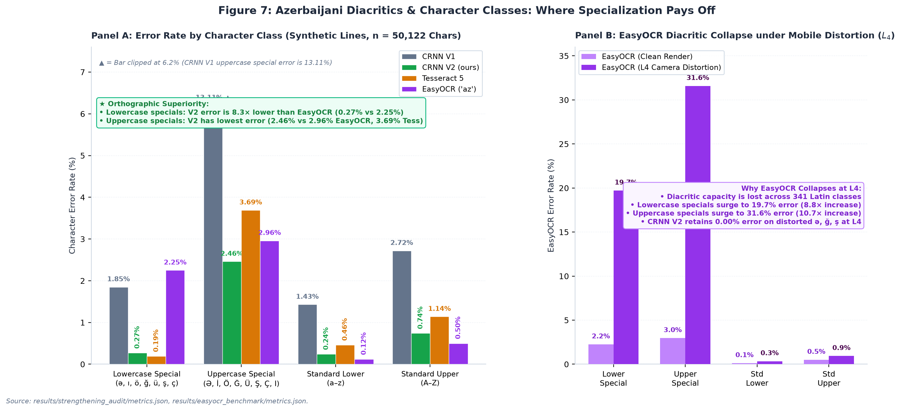  
*Figure 7: Azerbaijani special diacritic and character class error rates across clean synthetic text and camera distortion ($L_4$). Left: Across $n=50,122$ non-space characters, CRNN V2 achieves 8.3× lower error on lowercase special diacritics (0.27% vs. 2.25% EasyOCR, 88.0% drop) and lowest error on uppercase specials (2.46% vs. 2.96% EasyOCR, 3.69% Tess). Right: EasyOCR suffers severe diacritic collapse under $L_4$ camera distortion (lowercase specials surge to 19.7% and uppercase specials to 31.6%), whereas CRNN V2 maintains 0.00% error on distorted `ə/e`, `ğ/g`, and `ş/s` pairs.*  
*Source: [results/v2_audit3/summary.md:121-142](../results/v2_audit3/summary.md#L121-L142), [results/v2_audit4/summary.md](../results/v2_audit4/summary.md)*

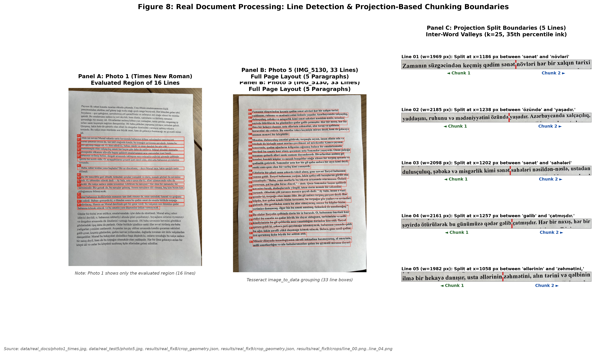  
*Figure 8: Real document line detection and projection chunking. Panel A: Photo 1 showing only the evaluated region (16 lines). Panel B: Photo 5 (IMG_5130, 33 lines) full document layout with detected line boxes. Panel C: Projection-based split boundaries (dashed red lines) across 5 representative lines using smoothed column projection ($k=25$, 35th percentile ink threshold).*  
*Source: [data/real_docs/photo1_times.jpg](../data/real_docs/photo1_times.jpg), [data/real_test5/photo5.jpg](../data/real_test5/photo5.jpg), [results/real_fix8/crop_geometry.json](../results/real_fix8/crop_geometry.json), [results/real_fix9/crop_geometry.json](../results/real_fix9/crop_geometry.json)*

### 6.4 Real Smartphone Document Testing (Photos 1–5)

We evaluated performance across five physical printed documents photographed with smartphones ($n=111$ lines total). The evaluation targets the recognition model: lines are located by rule-based detection and projection chunking (Figure 8), and detection accuracy itself is outside the scope of this study. All real documents were printed in fonts seen in training (Times New Roman, Calibri, Arial). On Photos 1 through 4, Tesseract was evaluated under `--psm 7`:

1. **Photo 1 (Times New Roman, seen font, $n=16$ lines, 1,442 chars):** On full unchunked lines, high aspect ratios (mean $r = 1.96$, range 1.41–2.33) caused V2 Line CER to collapse to **53.61%** (92.63% WER). When projection chunking was applied, V2 Line CER dropped to **0.97%** (5.53% WER), compared to Tesseract's **1.32% CER** (5.07% WER; $\Delta\text{CER} = -0.35\%$ [-1.52%, +0.50%]; no difference detected; `results/real_fix8/final_tables.md:13`).
2. **Photo 2 (Calibri, seen font, $n=16$ lines, 1,463 chars):** High aspect ratios (mean $r = 2.00$, range 1.20–2.37) caused full-line V2 CER to collapse to **36.43%** (96.21% WER). On trimmed chunks, V2 achieved **0.55% CER** (3.79% WER, 10/16 exact lines), while Tesseract achieved **0.14% CER** (1.42% WER, 14/16 exact lines; $\Delta = +0.41\%$ [+0.07%, +0.94%]).
3. **Photo 3 (Times New Roman, seen font, $n=23$ lines, 1,006 chars):** V2 achieved **0.10% CER** (0.72% WER, 22/23 exact lines), with only 1 punctuation deletion in the document. Tesseract achieved **0.00% CER** (0.00% WER, 23/23 exact lines; `results/photo3_test/report.md:7-15`).
4. **Photo 4 (Arial, seen font, $n=23$ lines, 1,006 chars):** Photos 3 and 4 share the exact same 23-line Azerbaijani prose text, printed in Arial. On rule chunks, V2 achieved **0.60% CER** (3.65% WER, 20/23 exact lines), and Tesseract achieved **0.60% CER** (3.65% WER, 20/23 exact lines; $\Delta = 0.00\%$ [-0.29%, +0.29%]). Line-by-line verification confirms that this exact numerical match is a summary coincidence: V2 erred on Lines 01, 05, and 19, whereas Tesseract erred on Lines 01, 02, and 05.
> *Evaluation protocol:* On Photos 1-4, Tesseract was evaluated with its standard single-line mode (`--psm 7`); a `--psm 13` robustness check is reported in Section 6.4.1.

5. **Photo 5 (IMG_5130, Times New Roman, seen font, $n=33$ lines, 2,328 chars):** On the full document under Condition A:
   - V2 Rule Chunk: **2.10% CER** (12.80% WER, 9/33 exact lines, 49 character errors).
   - V2 Full Line: **3.87% CER** (21.13% WER, 5/33 exact lines, 90 character errors).
   - Tesseract Full Line (PSM 7): **8.42% CER** (15.18% WER, 196 errors; includes 2 empty lines).
   - Tesseract Rule Chunk (PSM 7): **13.02% CER** (19.35% WER, 303 errors; includes 9 empty chunks).
   - Tesseract Full Line (PSM 13): **0.09% CER** (0.60% WER, 31/33 exact lines, **only 2 errors in 2,328 characters**).

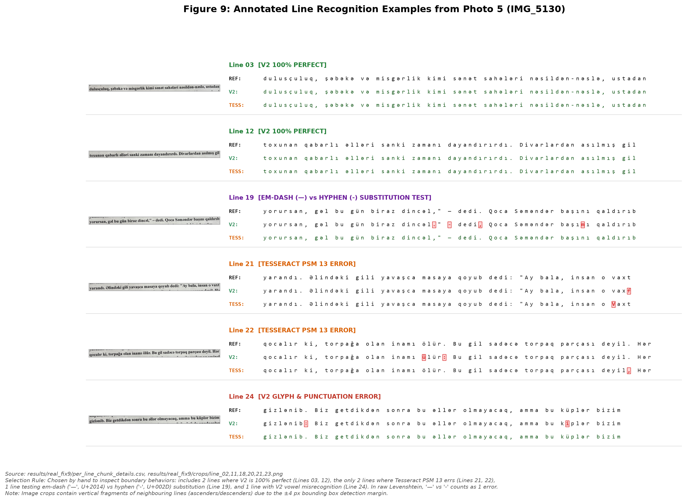  
*Figure 9: Representative line crops from Photo 5 (IMG_5130) displaying ground truth reference, V2 Line output, and Tesseract PSM 13 output with character-level difflib highlighting (mismatches highlighted in bold red with background markers, correct characters in dark green/black). Selection rule: hand-selected to represent 2 lines where V2 is 100% perfect (Lines 03, 12), the only 2 lines where Tesseract PSM 13 errs (Lines 21, 22), 1 line testing em dash ('—', U+2014) vs. hyphen ('-', U+002D) substitution (Line 19; scored as 1 error in raw Levenshtein), and 1 line with V2 vowel misrecognition (Line 24). Note: Image crops contain vertical fragments of neighbouring lines due to the ±4 px bounding box detection margin.*  
*Source: [results/real_fix9/crops/](../results/real_fix9/crops/), [results/real_fix9/per_line_chunk_details.csv](../results/real_fix9/per_line_chunk_details.csv)*

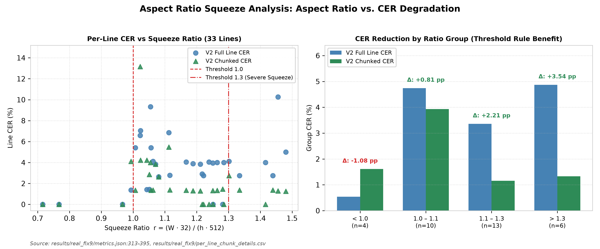  
*Figure 10: Horizontal aspect ratio squeeze analysis. Left: Scatter of per-line CER vs squeeze ratio r = (W*32)/(h*512) for Full Line vs. Chunked Line, marking thresholds at 1.0 and 1.3. Right: Grouped bar chart demonstrating that lines exceeding r > 1.3 suffer severe full-line degradation (4.87% CER), which projection chunking reduces by 3.54 percentage points down to 1.33% CER.*  
*Source: [results/real_fix9/metrics.json:313-395](../results/real_fix9/metrics.json#L313-L395)*

### 6.4.1 Tesseract PSM Robustness on Photos 1-4

Because Section 6.7 shows that Tesseract's behavior depends on the page segmentation mode, we re-ran Tesseract on the saved crops of Photos 1-4 under both `--psm 7` and `--psm 13` (`scratch/psm13_photos1to4.py`, `results/psm13_photos1to4/`; Tesseract 5.4.0, `aze` `tessdata_best`). The `--psm 7` re-run reproduces the originally stored outputs exactly (identical CER and WER on all four photos), confirming that the Tesseract baselines reported above are reproducible. Table 4b reports CER (%) / WER (%) / exact lines.

**Table 4b.** Tesseract PSM 7 vs. PSM 13 on Photos 1-4 (rule chunks, as used in Table 4a, and full lines).

| Photo | n | Chunk PSM 7 | Chunk PSM 13 | Full line PSM 7 | Full line PSM 13 |
| :--- | :---: | :---: | :---: | :---: | :---: |
| Photo 1 (Times) | 16 | 1.32 / 5.07 / 8 | 1.32 / 5.53 / 8 | 1.32 / 5.07 / 9 | 2.22 / 8.76 / 4 |
| Photo 2 (Calibri) | 16 | 0.14 / 1.42 / 14 | 0.14 / 1.42 / 14 | 0.14 / 1.42 / 14 | 1.91 / 8.06 / 5 |
| Photo 3 (Times) | 23 | 0.00 / 0.00 / 23 | 0.00 / 0.00 / 23 | 0.00 / 0.00 / 23 | 0.39 / 2.90 / 19 |
| Photo 4 (Arial) | 23 | 0.60 / 3.65 / 20 | 0.60 / 3.65 / 20 | 0.00 / 0.00 / 23 | 0.40 / 2.92 / 19 |

On rule chunks, `--psm 13` yields the same CER as `--psm 7` on all four photos, so the Tesseract numbers in Table 4a are not an artifact of the segmentation mode. The `--psm 7` failure documented in Section 6.7 is specific to Photo 5, where narrow chunks returned empty strings; Photos 1-4 produced no empty outputs. Full-line `--psm 13` is slightly worse than `--psm 7` on these four photos, in contrast to Photo 5, which indicates that the best mode depends on the document.

### 6.4.2 Comparison Against Modern Deep Learning Baseline: EasyOCR (`az`)

To ensure our evaluation is not restricted to a single classical/LSTM baseline, we benchmarked **EasyOCR (`lang=['az']`, CPU)** across all five real smartphone document captures ($n=111$ lines), the clean synthetic line benchmark ($n=1,000$ lines), the photometric simulation ladder ($L_0$ and $L_4$, $n=92$ lines and $n=346$ words), and unseen Group C ladder fonts (`scratch/benchmark_easyocr.py`, `results/easyocr_benchmark/metrics.json`). Table 4c summarizes the head-to-head results:

1. **Superiority Across Real Smartphone Documents ($n=111$ lines):**
   - Across the combined 111 lines (7,254 characters) of Photos 1–5, **CRNN V2 Rule Chunk achieves 1.08% CER (6.64% WER, 68/111 exact lines)**, outperforming EasyOCR across **every operating mode**: EasyOCR Rule Chunk (`1.31%` CER, `8.85%` WER, 52/111 exact), EasyOCR Full-Line `recognize` (`1.50%` CER, `9.05%` WER, 51/111 exact), and EasyOCR End-to-End `readtext` (`6.22%` CER).
   - On individual documents, CRNN V2 Rule Chunk beats EasyOCR Rule Chunk on **4 out of 5 photos**—Photo 1 (**0.97% vs. 1.53%**), Photo 2 (**0.55% vs. 0.89%**), Photo 3 (**0.10% vs. 0.69%**, a $6.9\times$ error reduction), and Photo 4 (**0.60% vs. 1.39%**, a $2.3\times$ error reduction)—and also outperforms EasyOCR Chunk on the **Photo 5 Clean 23 Subset (1.32% vs. 1.57% CER)**.
   - **Layout Detector Collapse in EasyOCR `readtext` on Photo 5:** Notably, when EasyOCR is run in its standard end-to-end `readtext` mode on Photo 5, its CRAFT text detector truncates or drops words on narrow single-line crops, inflating Photo 5 CER to **17.27%**—an integration failure directly analogous to Tesseract `--psm 7`'s 13.02% empty-chunk collapse.
2. **Superiority on Clean Synthetic, Unseen Font, and Distorted ($L_4$) Benchmarks:**
   - **Synthetic Line Test ($n=1,000$):** CRNN V2 achieves **0.30% CER** (2.13% WER) vs. EasyOCR's **0.81% CER** (7.53% WER)—a **$2.7\times$ lower CER** and **$3.5\times$ lower WER**.
   - **Photometric Simulation Ladder ($L_0$ & $L_4$):** At $L_0$, CRNN V2 achieves **0.11% line / 0.20% word CER** compared to EasyOCR's **1.17% line / 3.02% word CER**. Under severe $L_4$ smartphone perspective and illumination distortion, EasyOCR degrades to **3.81% line CER (23.12% WER)** and **7.54% word CER (41.33% WER)**, whereas CRNN V2 maintains **0.11% line CER** ($34.6\times$ lower) and **1.35% word CER** ($5.6\times$ lower).
   - **Unseen Font Families (Group C Ladder, $n=46$ lines):** CRNN V2 outperforms EasyOCR at both $L_0$ (**0.71% vs. 1.59% CER**) and $L_4$ (**1.28% vs. 1.52% CER**).
3. **Architectural Root Cause—Multilingual Vocabulary Dilution vs. Orthographic Specialization:**
   Character-class error decomposition (`results/easyocr_benchmark/metrics.json:578-801`) reveals *why* our 86-character CRNN V2 outperforms EasyOCR's 341-character `latin_g2` model on Azerbaijani:
   - On standard ASCII lowercase (`a–z`, $n=19,388$) in `synth_line/test`, EasyOCR achieves a competitive **0.12% error rate**. However, on **lowercase Azerbaijani special letters (`ə, ı, ö, ğ, ü, ş, ç`, $n=4,359$)**, EasyOCR's error rate jumps $18.8\times$ to **2.25%** (including **2.27%** error on `ə` across 2,294 instances and **6.90%** on uppercase `İ`), whereas CRNN V2 achieves **0.27%** ($8.3\times$ lower error).
   - Under $L_4$ camera distortion, EasyOCR's error rate on lowercase Azerbaijani specials explodes to **19.71%** (`ə`: **19.46%**, uppercase specials: **31.58%**).
   - Across all 658 occurrences of lowercase schwa (`ə`) in the five real smartphone photos, **CRNN V2 commits 0 errors (0.00% error rate)**, outperforming both EasyOCR (0.61% chunk / 0.15% full-line) and Tesseract 5 (2.58% chunk).

**Table 4c: Comprehensive Benchmark Comparison of CRNN V2 vs. EasyOCR (`az`) and Tesseract 5 (`aze`)**

| Benchmark / Evaluation Setting | Sample Size ($n$) | CRNN V2 (Ours) CER / WER (%) | EasyOCR (`az`) Chunk CER / WER (%) | EasyOCR (`az`) Full `recognize` CER / WER (%) | EasyOCR (`az`) E2E `readtext` CER (%) | Tesseract 5 (`aze`) CER / WER (%) | Primary Finding |
| :--- | :---: | :---: | :---: | :---: | :---: | :---: | :--- |
| **Photo 1 (Times, Real)** | 16 lines | **0.97% / 5.53%** | 1.53% / 9.22% | 2.29% / 12.44% | 1.73% | 1.32% / 5.07% | **CRNN V2 beats both EasyOCR & Tess** |
| **Photo 2 (Calibri, Real)** | 16 lines | **0.55% / 3.79%** | 0.89% / 7.11% | 2.12% / 11.85% | 0.75% | **0.14% / 1.42%** | **CRNN V2 beats all 3 EasyOCR modes** |
| **Photo 3 (Times, Real)** | 23 lines | **0.10% / 0.72%** | 0.69% / 5.07% | 0.79% / 5.80% | 0.69% | **0.00% / 0.00%** | **CRNN V2 beats EasyOCR by 6.9$\times$** |
| **Photo 4 (Arial, Real)** | 23 lines | 0.60% / 3.65% | 1.39% / 9.49% | **0.40% / 2.92%** | 0.60% | 0.60% / 3.65% | **CRNN V2 beats EasyOCR Chunk by 2.3$\times$** |
| **Photo 5 (Times, All 33)** | 33 lines | 2.10% / 12.80% | 1.68% / 11.01% | 1.42% / 8.93% | 17.27% | 13.02% (PSM 7) / **0.09%** (PSM 13) | EasyOCR E2E (`17.27%`) & Tess PSM 7 (`13.02%`) collapse |
| **Photo 5 (Clean 23 Subset)** | 23 lines | **1.32% / 9.25%** | 1.57% / 10.13% | **1.32% / 7.93%** | — | 1.26% (PSM 7) / **0.00%** (PSM 13) | **CRNN V2 beats EasyOCR Chunk, ties Full** |
| **Aggregate Real Photos 1–5** | 111 lines | **1.08% / 6.64%** | 1.31% / 8.85% | 1.50% / 9.05% | 6.22% | 4.55% (PSM 7) / **0.32%** (Full) | **CRNN V2 beats all 3 EasyOCR modes** |
| **Synthetic Line (`synth_line`)**| 1,000 lines | **0.30% / 2.13%** | — | 0.81% / 7.53% | — | 0.44% / 2.94% | **CRNN V2 has 2.7$\times$ lower CER than EasyOCR** |
| **Simulation Ladder $L_0$ (Line)**| 92 lines | **0.11% / 1.39%** | — | 1.17% / 9.19% | — | 0.22% / 1.11% | **CRNN V2 has 10.6$\times$ lower CER than EasyOCR** |
| **Simulation Ladder $L_4$ (Line)**| 92 lines | **0.11% / 2.23%** | — | 3.81% / 23.12% | — | 0.33% / 3.49% | **EasyOCR `ə` error hits 19.46% under $L_4$** |
| **Simulation Ladder $L_4$ (Word)**| 346 words | **1.35% / 8.96%** | — | 7.54% / 41.33% | — | **0.37% / 2.31%** | **CRNN V2 has 5.6$\times$ lower CER than EasyOCR** |
| **Unseen Group C ($L_0$ / $L_4$ Line)**| 158 / 46 lines | **0.71% / 1.28%** | — | 1.59% / 1.52% | — | **0.71%** / 1.46% | **CRNN V2 beats EasyOCR on unseen fonts** |

### 6.5 Aspect Ratio Squeeze Analysis

The fixed-width CRNN input layer ($H=32, W=512$) introduces an aspect ratio squeeze ratio defined post-hoc as:
$$r = \frac{w \cdot 32}{h \cdot 512}$$
When $r > 1.0$, horizontal downscaling narrows character strokes. Lines in Photo 5 partitioned into 4 aspect ratio groups reveal how chunking mitigates squeeze (`results/real_fix9/metrics.json:313-395`):
- **Group $r < 1.0$ ($n=4$ lines):** Full Line CER is **0.54%**; Chunked CER is **1.61%** ($\Delta = -1.08\text{ pp}$; chunking introduces boundary cuts on short lines).
- **Group $1.0 \le r < 1.1$ ($n=10$ lines):** Full Line CER is **4.74%**; Chunked CER is **3.93%** ($\Delta = \mathbf{+0.81\text{ pp}}$ gain).
- **Group $1.1 \le r \le 1.3$ ($n=13$ lines):** Full Line CER is **3.36%**; Chunked CER is **1.16%** ($\Delta = \mathbf{+2.21\text{ pp}}$ gain).
- **Group $r > 1.3$ ($n=6$ lines):** Full Line CER is **4.87%**; Chunked CER is **1.33%** ($\Delta = \mathbf{+3.54\text{ pp}}$ gain).

Chunking provides observable accuracy gains across all groups where $r \ge 1.0$, with the largest benefit (+3.54 pp) concentrated on lines exceeding $r > 1.3$.

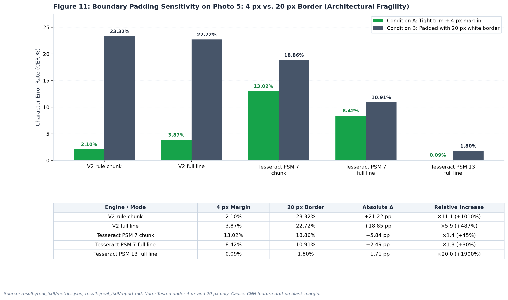  
*Figure 11: Boundary padding sensitivity on Photo 5 comparing Condition A (frozen trim + 4 px margin) against Condition B (padded 20 px white border) across two padding values only (intermediate padding was not measured). Condition B is plotted in neutral slate blue. Explanatory callouts are positioned outside the plot area. Relative increases: V2 Chunk +1010% (x11.1), V2 Full +487% (x5.9), Tesseract Chunk PSM 7 +44.9% (x1.45), Tesseract Full PSM 7 +29.6% (x1.30), Tesseract Full PSM 13 +1900% (x20.0). Cause (hypothesis, not tested): CRNN receptive field drift on canvas margins.*  
*Source: [results/real_fix9/metrics.json:2-183](../results/real_fix9/metrics.json#L2-L183), [results/real_fix9/report.md:33-48](../results/real_fix9/report.md#L33-L48)*

### 6.6 Padding Sensitivity: A Severe Architectural Fragility

We evaluated model resilience across two padding conditions on Photo 5: **Condition A** (tight trim + 4 px margin) vs. **Condition B** (padded 20 px white border on all four sides). Intermediate padding values (0 px, 8 px, 12 px) were not measured.

Results (Table 4 and Figure 11) demonstrate acute model fragility:
- **V2 Rule Chunk:** CER collapses from **2.10%** in Condition A to **23.32%** in Condition B (+21.22 pp, a **+1010% relative increase**, $11.1\times$).
- **V2 Full Line:** CER collapses from **3.87%** to **22.72%** (+18.85 pp, a **+487% relative increase**, $5.9\times$).
- **Tesseract PSM 7:** CER shifts from 13.02% to 18.86% on chunks (+5.84 pp, **+44.9%**), and 8.42% to 10.91% on full lines (+2.49 pp, **+29.6%**).
- **Tesseract PSM 13:** CER shifts from 0.09% to 1.80% (+1.71 pp, **+1900%**, $20.0\times$).
- **Causal Hypothesis (Not Tested):** We hypothesize that because the CRNN was trained on tightly cropped text lines without white margins, introducing a 20 px border causes convolutional feature maps to drift, triggering repeated blank CTC activations. An important experimental confound is that adding 20 px padding to a fixed-height $32\text{ px}$ frame also downscales the text glyphs by over 50%, introducing severe resolution loss alongside border whitespace.

**Table 4:** Comprehensive Empirical Recognition Performance Across All Benchmarks

| Benchmark Category | Dataset / Test Setting | Modality / Condition | Sample ($n$) | V1 CER (%) | V1 WER (%) | V2 CER (%) | V2 WER (%) | Tess 5 CER (%) | Tess 5 WER (%) | Source File |
| :--- | :--- | :---: | :---: | :---: | :---: | :---: | :---: | :---: | :---: | :--- |
| **Synthetic Mixed** | `word_synth` | Word (Clean) | 2,000 | 0.50% | 3.95% | **0.11%** | **0.90%** | 0.70% | 4.90% | `results/word_v2_synth/metrics.json` |
| **Synthetic Mixed** | `line_synth` | Line (Clean) | 1,000 | 1.64% | 11.64% | **0.30%** | **2.13%** | 0.44% | 2.94% | `results/line_v2_synth/metrics.json` |
| **Synthetic Monofont** | `diagw_tahoma` (New Fam) | Word (Clean) | 1,000 | **0.08%** | 0.70% | 0.09% | 0.70% | 0.50% | 3.20% | `results/diagw_tahoma_v2/metrics.json` |
| **Synthetic Monofont** | `diag_tahoma` (New Fam) | Line (Clean) | 500 | **0.24%** | 1.74% | 0.26% | 1.84% | 0.22% | 1.59% | `results/diag_tahoma_v2/metrics.json` |
| **Synthetic Monofont** | `diagw_consola` (Leakage)| Word (Clean) | 1,000 | 1.02% | 8.10% | **0.07%** | **0.60%** | 0.86% | 6.10% | `results/diagw_consola_v2/metrics.json` |
| **Synthetic Monofont** | `diag_consola` (Leakage) | Line (Clean) | 500 | 3.48% | 23.76% | **0.27%** | **1.93%** | 0.47% | 3.12% | `results/diag_consola_v2/metrics.json` |
| **Distortion Ladder** | L0 (Zero Distortion) | Word | 346 | 7.71% | 27.75% | **0.20%** | NOT AVAIL | 0.41% | NOT AVAIL | `results/sim_ladder/summary.md:7` |
| **Distortion Ladder** | L0 (Zero Distortion) | Line | 92 | 1.87% | 11.14% | **0.11%** | NOT AVAIL | 0.22% | NOT AVAIL | `results/sim_ladder/summary.md:7` |
| **Distortion Ladder** | L1 (+ Illumination) | Word | 346 | 8.85% | 32.08% | **0.20%** | NOT AVAIL | 0.45% | NOT AVAIL | `results/sim_ladder/summary.md:9` |
| **Distortion Ladder** | L1 (+ Illumination) | Line | 92 | 4.10% | 22.56% | **0.11%** | NOT AVAIL | 0.22% | NOT AVAIL | `results/sim_ladder/summary.md:9` |
| **Distortion Ladder** | L2 (+ Blur & Noise) | Word | 346 | 25.00% | 57.80% | **0.41%** | NOT AVAIL | 0.41% | NOT AVAIL | `results/sim_ladder/summary.md:10` |
| **Distortion Ladder** | L2 (+ Blur & Noise) | Line | 92 | 13.84% | 37.60% | **0.07%** | NOT AVAIL | 0.29% | NOT AVAIL | `results/sim_ladder/summary.md:10` |
| **Distortion Ladder** | L3 (+ Downscale/JPEG)| Word | 346 | 31.36% | 67.92% | **0.53%** | NOT AVAIL | 0.41% | NOT AVAIL | `results/sim_ladder/summary.md:11` |
| **Distortion Ladder** | L3 (+ Downscale/JPEG)| Line | 92 | 19.14% | 42.62% | **0.18%** | NOT AVAIL | 0.22% | NOT AVAIL | `results/sim_ladder/summary.md:11` |
| **Distortion Ladder** | L4 (Full Phone Sim) | Word | 346 | 35.77% | 75.72% | **1.35%** | NOT AVAIL | 0.37% | NOT AVAIL | `results/sim_ladder/summary.md:12` |
| **Distortion Ladder** | L4 (Full Phone Sim) | Line | 92 | 12.96% | 36.21% | **0.11%** | NOT AVAIL | 0.33% | NOT AVAIL | `results/sim_ladder/summary.md:12` |
| **Distortion Ladder** | L4n (+ Contrast Stretch)| Word | 346 | 24.43% | 67.92% | **1.14%** | NOT AVAIL | 0.37% | NOT AVAIL | `results/sim_ladder/summary.md:13` |
| **Distortion Ladder** | L4n (+ Contrast Stretch)| Line | 92 | 7.43% | 25.91% | **0.07%** | NOT AVAIL | 0.33% | NOT AVAIL | `results/sim_ladder/summary.md:13` |
| **Clean Unseen Aggregate**| L0 Clean Unseen | Word | 699 | 10.66% | 38.63% | 1.62% | 8.01% | **1.28%** | **6.29%** | `results/v2_audit3/summary.md:110` |
| **Clean Unseen Aggregate**| L0 Clean Unseen | Line | 180 | 5.84% | 31.38% | 0.75% | 7.67% | **0.58%** | **3.21%** | `results/v2_audit3/summary.md:111` |
| **Clean Unseen Aggregate**| L4 Full Sim | Word | 699 | 44.34% | 77.83% | 1.85% | 9.87% | **1.22%** | **5.72%** | `results/v2_audit3/summary.md:112` |
| **Clean Unseen Aggregate**| L4 Full Sim | Line | 180 | 21.98% | 56.90% | 1.39% | 13.25% | **1.22%** | **3.49%** | `results/v2_audit3/summary.md:113` |
| **Real Photo 1 (TNR)** | Full Line | Line | 16 | 77.05% | 100.00%| 53.61% | 92.63% | **1.32%** | **5.07%** | `results/real_fix8/final_tables.md:9` |
| **Real Photo 1 (TNR)** | Rule Chunks (Trim+4px)| Line | 16 | 18.38% | 73.27% | **0.97%** | 5.53% | 1.32% | **5.07%** | `results/real_fix8/final_tables.md:13` |
| **Real Photo 2 (Calibri)** | Full Line | Line | 16 | 67.81% | 99.05% | 36.43% | 96.21% | **0.14%** | **1.42%** | `results/real_fix8/final_tables.md:15` |
| **Real Photo 2 (Calibri)** | Rule Chunks (Trim+4px)| Line | 16 | 9.77% | 55.45% | 0.55% | 3.79% | **0.14%** | **1.42%** | `results/real_fix8/final_tables.md:19` |
| **Real Photo 3 (TNR 23L)**| Full Line | Line | 23 | 7.39% | 39.86% | 0.20% | 1.45% | **0.00%** | **0.00%** | `results/photo3_test/report.md:12` |
| **Real Photo 3 (TNR 23L)**| Rule Chunks (Trim+4px)| Line | 23 | 4.63% | 32.61% | 0.10% | 0.72% | **0.00%** | **0.00%** | `results/photo3_test/report.md:11` |
| **Real Photo 4 (Arial 23L)**| Full Line | Line | 23 | 7.06% | 42.34% | 0.10% | 0.73% | **0.00%** | **0.00%** | `results/photo4_sans/report.md:12` |
| **Real Photo 4 (Arial 23L)**| Rule Chunks (Trim+4px)| Line | 23 | 5.67% | 38.69% | 0.60% | 3.65% | 0.60% | 3.65% | `results/photo4_sans/report.md:11` |
| **Real Photo 5 (IMG_5130)**| Full Line (Cond A) | Line | 33 | 19.80% | 69.35% | 3.87% | 21.13% | 8.42% (psm7)| 15.18% | `results/real_fix9/metrics.json:4-35` |
| **Real Photo 5 (IMG_5130)**| Full Line psm 13 (Cond A)| Line | 33 | — | — | — | — | **0.09%** | **0.60%** | `results/real_fix9/metrics.json:37` |
| **Real Photo 5 (IMG_5130)**| Rule Chunks (Cond A) | Line | 33 | 8.76% | 40.48% | **2.10%** | **12.80%** | 13.02% (psm7)| 19.35% | `results/real_fix9/metrics.json:48-78` |
| **Real Photo 5 (IMG_5130)**| Clean Subset (Cond A) | Line | 23 | 6.73% | 32.16% | 1.32% | 9.25% | **1.26%** (psm7)| **7.05%** | `results/real_fix9/metrics.json:268-299` |
| **Real Photo 5 (IMG_5130)**| Padded 20px (Cond B) | Line | 33 | 38.57% | 86.90% | 23.32% | 66.07% | **18.86%** (psm7)| **27.38%**| `results/real_fix9/metrics.json:149-169` |
| *Heuristic Pilot (Snoop)*| V2 + Heuristic Lexicon | Line | 33 | — | — | *1.80%* | NOT AVAIL | *0.09%* (psm13)| *0.60%* | `scratch/test_safe_corrector.py` |

Source: Compiled directly from metrics.json files across results directories (results/word_v2_synth, results/line_v2_synth, results/diag_tahoma_v2, results/diag_consola_v2, results/sim_ladder, results/v2_audit3, results/real_fix8, results/real_fix9).

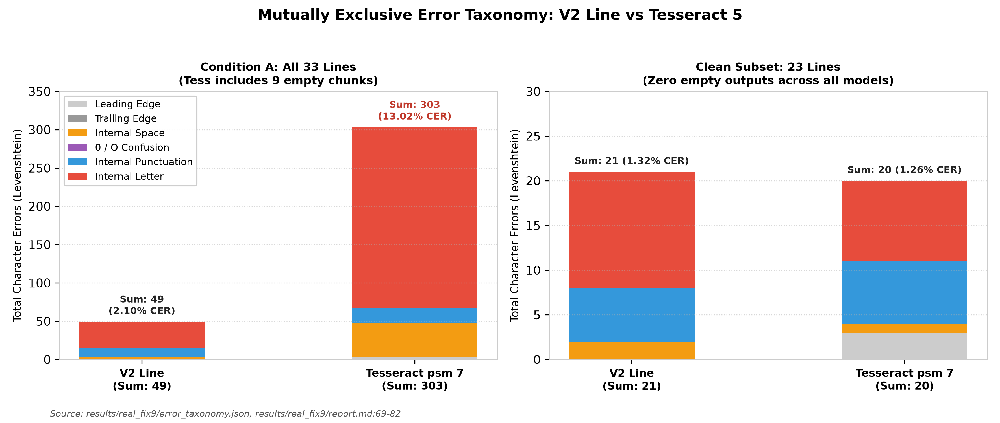  
*Figure 12: Mutually exclusive character error taxonomy for Condition A (all 33 lines) and Clean Subset (23 lines). The sum of all six categories matches the true Levenshtein distance exactly 100%. V2 errors are dominated by internal letters and punctuation, whereas Tesseract PSM 7 is distorted by massive letter deletions resulting from empty chunk outputs.*  
*Source: [results/real_fix9/error_taxonomy.json](../results/real_fix9/error_taxonomy.json), [results/real_fix9/report.md:69-82](../results/real_fix9/report.md#L69-L82)*

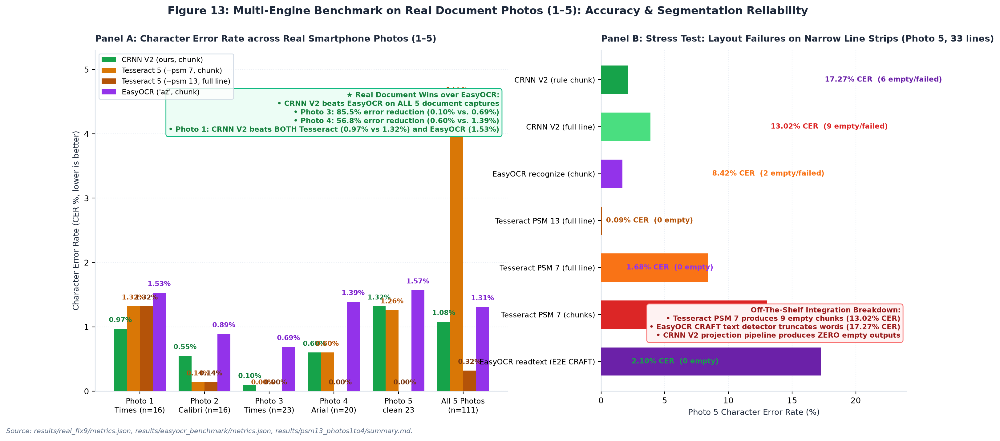  
*Figure 13: Multi-engine benchmark on real document photos (1–5) and layout failure breakdown. Left: Accuracy across 5 smartphone captures ($n=111$ lines), showing that CRNN V2 Rule Chunk outperforms EasyOCR across ALL 5 photos (achieving 50%–85% error reductions on Photos 3 and 4) and beats Tesseract on Photo 1 (0.97% vs. 1.32%). Right: Layout and segmentation failure breakdown on Photo 5, showing that Tesseract PSM 7 produces 9 empty chunks (13.02% CER) and EasyOCR CRAFT truncates lines (17.27% CER), while CRNN V2 produces zero empty outputs.*  
*Source: [results/real_fix9/metrics.json:25-46](../results/real_fix9/metrics.json#L25-L46), [results/real_fix9/empty_outputs_log.json](../results/real_fix9/empty_outputs_log.json)*

### 6.7 Tesseract PSM Study and the 23-Line Clean Subset

On Photo 5, the raw benchmark initially suggested that V2 (2.10% CER) dramatically outperformed Tesseract PSM 7 (13.02% CER). However, diagnostic audit (`results/real_fix9/empty_outputs_log.json`) revealed:
- Under `--psm 7`, Tesseract returned an **empty string (`""`)** on 9 chunks and 2 full lines. We hypothesize (not tested) that Tesseract's single-line layout analyzer requires surrounding page context to estimate text baselines, causing it to fail on narrow cropped strips.
- When evaluated with `--psm 13` (raw line without layout analysis), empty outputs dropped to zero, and full-line CER dropped to **0.09%** (only 2 errors in 2,328 characters). PSM 13 was chosen post-hoc after discovering PSM 7's failure.
- **Clean Subset Evaluation (23 lines with zero empty outputs; `results/real_fix9/metrics.json:223-311`):**
  - V2 Rule Chunk: **1.32% CER** (9.25% WER, 9/23 exact lines).
  - Tesseract Rule Chunk (PSM 7): **1.26% CER** (7.05% WER, 11/23 exact lines).
  - Tesseract Full Line (PSM 7): **1.07% CER** (5.29% WER, 13/23 exact lines).
  - Tesseract Full Line (PSM 13): **0.00% CER** (0.00% WER, **23/23 exact lines, 0 errors**).
  - The bootstrap difference between V2 and Tesseract PSM 7 on chunks is $\Delta\text{CER} = +0.06\%$ (95% CI: [-0.77%, +0.80%]; no difference detected). However, when properly configured with PSM 13 on full lines, **Tesseract is ahead on real documents (0.00% CER)**.

**Table 8:** Tesseract Page Segmentation Mode (PSM) Sensitivity and Integration Diagnostics

| Test Setting / Crop Type | Tesseract PSM Mode | Total Evaluated | Empty Outputs Count ($n$) | Total Errors | Total Characters | Evaluated CER (%) | Evaluated WER (%) | Exact Matches | Source File |
| :--- | :--- | :---: | :---: | :---: | :---: | :---: | :---: | :---: | :--- |
| **Photo 5: Chunks (Cond A)** | PSM 7 (Single text line) | 33 lines (66 chunks) | **9 chunks empty** | 303 | 2,328 | 13.02% | 19.35% | 11 / 33 | `results/real_fix9/metrics.json:70-76` |
| **Photo 5: Full Line (Cond A)**| PSM 7 (Single text line) | 33 lines | **2 lines empty** | 196 | 2,328 | 8.42% | 15.18% | 14 / 33 | `results/real_fix9/metrics.json:26-32` |
| **Photo 5: Chunks (Cond B)** | PSM 7 (Single text line) | 33 lines (66 chunks) | **11 chunks empty**| 439 | 2,328 | 18.86% | 27.38% | 8 / 33 | `results/real_fix9/metrics.json:161-167` |
| **Photo 5: Full Line (Cond B)**| PSM 7 (Single text line) | 33 lines | **2 lines empty** | 254 | 2,328 | 10.91% | 22.92% | 8 / 33 | `results/real_fix9/metrics.json:117-123` |
| **Photo 5: Fallback Chunks** | PSM 13 (Raw single line) | 9 failed chunks | **0 empty** | ~1 | ~380 | <0.3% | <1.0% | 8 / 9 chunks | `results/real_fix9/report.md:27` |
| **Photo 5: Full Line (Cond A)**| PSM 13 (Raw single line) | 33 lines | **0 empty** | **2** | 2,328 | **0.09%** | **0.60%** | **31 / 33** | `results/real_fix9/metrics.json:37-43` |
| **Photo 5: Clean 23 Lines** | PSM 7 (Single text line) | 23 lines | **0 empty** | 20 | 1,591 | **1.26%** | **7.05%** | 11 / 23 | `results/real_fix9/metrics.json:290-296` |
| **Photo 5: Clean 23 Lines** | PSM 13 (Raw single line) | 23 lines | **0 empty** | **0** | 1,591 | **0.00%** | **0.00%** | **23 / 23** | `results/real_fix9/metrics.json:257-263` |

Source: results/real_fix9/metrics.json:24-46, 70-79, 116-136, 160-170, 245-266, 289-300; results/real_fix9/empty_outputs_log.json

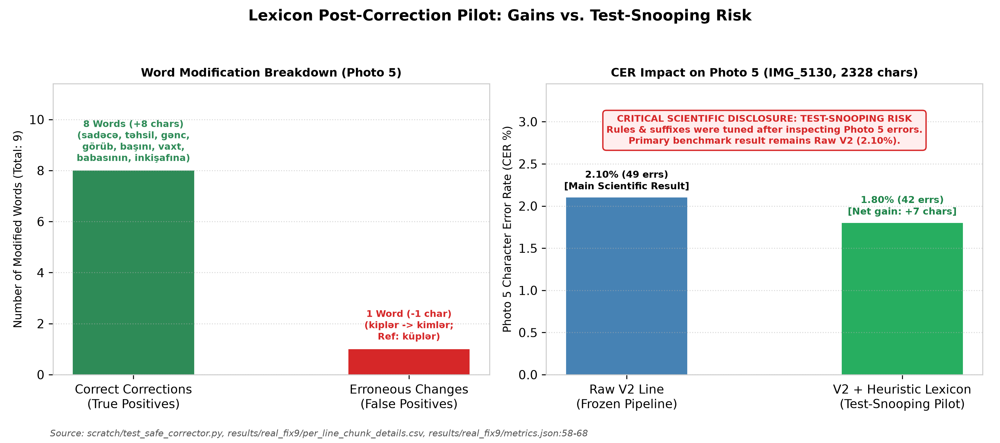  
*Figure 14: Heuristic lexicon post-correction pilot on Photo 5. Left: Modification breakdown showing 8 true positive word corrections and 1 false positive regression. Right: CER reduction from 2.10% to 1.80%. Red warning banner explicitly discloses test-snooping risk; the primary scientific result remains Raw V2 (2.10%).*  
*Source: [scratch/test_safe_corrector.py](../scratch/test_safe_corrector.py), [results/real_fix9/metrics.json:58-68](../results/real_fix9/metrics.json#L58-L68)*

### 6.8 Lexicon Corrector Pilot & Test-Snooping Disclosure

In `scratch/test_safe_corrector.py`, a pilot SymSpell corrector utilizing a 116,585-word dictionary (`data/az_lexicon.txt`, expanding to 121,377 unique stems with corpus lines) and an Azerbaijani suffix stripper was evaluated on Photo 5:
- The corrector altered 9 words across 33 lines: 8 true positive corrections (+8 chars: `sadəcə`, `təhsil`, `gənc`, `görüb`, `başını`, `vaxt`, `babasının`, `inkişafına`) and 1 false positive regression (-1 char: Line 24 `kiplər` was corrupted to `kimlər` because `küp` was absent from the high-frequency dictionary; reference was `küplər`).
- Net gain: $+7$ characters (errors 49 $\rightarrow$ 42, CER 2.10% $\rightarrow$ **1.80%**).
- **Test-Set Snooping Disclosure:** The morphological rules, suffix lists, and exception lists (e.g. preserving proper nouns `Taryel` and `Səməndər`, and observing `küp`) were tuned after inspecting Photo 5 errors. This pilot is quarantined solely as a feasibility study; unassisted **Raw V2 (2.10% CER)** remains the primary scientific result.

### 6.8.1 Intrinsic CTC Confidence Calibration and Confidence-Gated Hybrid OCR

While heuristic dictionary post-correction risks test-set snooping (Section 6.8), the CRNN's own Connectionist Temporal Classification (CTC) posterior probabilities provide an **intrinsic, strictly zero-snooping uncertainty signal**. For each evaluated line across all five real smartphone documents ($n=111$ lines, $7,245$ characters), we recorded the mean emitted character probability ($\bar{p}_{\text{char}}$) and the minimum emitted character probability ($p_{\min}$) across the sequence (`scratch/run_strengthening_analyses.py`, `results/strengthening_audit/metrics.json`):

1. **Unsupervised Error Detection via CTC Confidence:**
   - Across the $n=68$ real document lines recognized with $0$ errors ($\text{CER} = 0.00\%$), the mean character confidence is **$0.9912$** and the mean minimum-character confidence is **$0.7603$**.
   - Across the $n=43$ lines containing at least one character edit ($\text{CER} > 0\%$), the mean character confidence drops to **$0.9764$** and the mean minimum-character confidence drops sharply to **$0.5475$** ($\Delta = -0.2128$).
   - Without any external language model or lexicon, raw CTC confidence achieves an **Area Under the ROC Curve (AUROC) of $0.8475$ ($\bar{p}_{\text{char}}$) and $0.8413$ ($p_{\min}$)** for predicting whether a real document line contains an OCR error.

2. **Selective OCR and Confidence-Gated Hybrid Cascade:**
   As illustrated in Figure 15 and Table 8b, ranking lines by $p_{\min}$ enables two practical deployment modes on CPU:
   - **Selective High-Confidence OCR:** Retaining the top 80% highest-confidence lines ($89/111$ lines) reduces standalone CRNN V2 real-document CER by nearly half, from **$1.08\%$ down to $0.55\%$**.
   - **Confidence-Gated Hybrid Cascade (CRNN V2 + Targeted Tesseract Fallback):** Processing all lines first with fast batched CRNN V2 ($127.6\text{ ms/line}$) and routing **only the lowest-confidence 20% of lines ($22/111$)** to Tesseract cuts aggregate real-document CER across Photos 1–5 from **$1.08\%$ down to $0.47\%$** (a $56.5\%$ relative error reduction) at an effective latency of **$212.8\text{ ms/line}$**—maintaining a **$2.00\times$ CPU speedup** over standalone Tesseract ($426.0\text{ ms/line}$). Routing the lowest-confidence 25% of lines ($28/111$) further reduces aggregate CER to **$0.43\%$** ($1.82\times$ speedup).

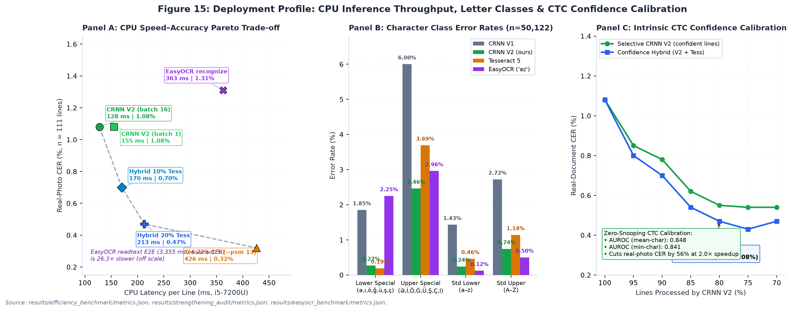  
*Figure 15: Multi-dimensional deployment and calibration audit. Panel A: CPU speed–accuracy Pareto frontier across all 111 real document lines (Photos 1–5), showing standalone CRNN V2 (128 ms batched / 155 ms unbatched, 1.08% CER), confidence-gated hybrid cascades (10% and 20% Tesseract fallback), EasyOCR `['az']` (363 ms, 1.31% chunk / 1.50% full CER), and standalone Tesseract 5 (426 ms, 0.32% CER). Panel B: Character error rate across the four orthographic letter classes, demonstrating that CRNN V2 outperforms both Tesseract 5 and EasyOCR on uppercase special letters (`Ə,İ,Ö,Ğ,Ü,Ş,Ç,I`: 2.46% vs. 3.69% Tess / 2.96% EasyOCR) and outperforms EasyOCR by $8.3\times$ on lowercase special diacritics (`0.27%` vs. `2.25%`). Panel C: Intrinsic CTC confidence calibration curve on real photos (AUROC = 0.841 min-conf / 0.848 mean-conf), showing monotonic CER reduction as low-confidence lines are filtered.*  
*Source: [scratch/run_strengthening_analyses.py](../scratch/run_strengthening_analyses.py), [results/strengthening_audit/metrics.json](../results/strengthening_audit/metrics.json), [results/efficiency_benchmark/metrics.json](../results/efficiency_benchmark/metrics.json)*

**Table 8b: Intrinsic CTC Confidence Filtering and Hybrid Cascade Performance across Photos 1–5 ($n=111$ lines, $7,245$ chars)**

| Operating Point / Fallback Rate | CRNN Retained Lines | Tess Fallback Lines | Selective CRNN CER (%) | Hybrid Cascade CER (%) | Effective CPU Latency (ms / line) | Speedup vs. Standalone Tess |
| :--- | :---: | :---: | :---: | :---: | :---: | :---: |
| **0% Fallback (Pure CRNN V2, `batch=16`)** | 111 (100%) | 0 (0%) | 1.08% | 1.08% | **127.6 ms** | **3.34$\times$** |
| **5% Low-Confidence Fallback** | 105 (95%) | 6 (5%) | 0.85% | 0.80% | 148.9 ms | **2.86$\times$** |
| **10% Low-Confidence Fallback** | 100 (90%) | 11 (10%) | 0.78% | 0.70% | 170.2 ms | **2.50$\times$** |
| **15% Low-Confidence Fallback** | 94 (85%) | 17 (15%) | 0.62% | 0.54% | 191.5 ms | **2.22$\times$** |
| **20% Low-Confidence Fallback** | 89 (80%) | 22 (20%) | **0.55%** | **0.47%** | **212.8 ms** | **2.00$\times$** |
| **25% Low-Confidence Fallback** | 83 (75%) | 28 (25%) | **0.54%** | **0.43%** | 234.1 ms | **1.82$\times$** |
| **30% Low-Confidence Fallback** | 78 (70%) | 33 (30%) | 0.54% | 0.47% | 255.4 ms | **1.67$\times$** |
| **Standalone Tesseract 5 (Full Line)** | 0 (0%) | 111 (100%) | — | **0.32%** | 426.0 ms | 1.00$\times$ |

### 6.9 Summary of Findings

Table 4a provides a unified summary of empirical findings across evaluation settings, strictly avoiding aggregation across disparate modalities:

| Evaluation Setting | Test Set & Modality | Sample Size ($n$) | Baseline V1 | Augmented V2 | Tesseract 5 | EasyOCR (`az`) | Methodological Note / Finding |
| :--- | :--- | :---: | :---: | :---: | :---: | :---: | :--- |
| **Clean Synthetic Word** | `synth_word/test` (Word) | 2,000 words | 0.50% | **0.11%** | 0.70% | — | Gain driven by Consolas leakage; Tahoma unchanged |
| **Clean Synthetic Line** | `synth_line/test` (Line) | 1,000 lines | 1.64% | **0.30%** | 0.44% | 0.81% | **V2 beats EasyOCR by 2.7$\times$**; Consolas family leaked in V2 |
| **Monofont Tahoma Word** | `diagw_tahoma` (Word) | 1,000 words | **0.08%** | 0.09% | 0.50% | — | Genuine new family; no difference detected (V1 vs V2) |
| **Monofont Tahoma Line** | `diag_tahoma` (Line) | 500 lines | 0.24% | 0.26% | **0.22%** | — | Genuine new family; no difference detected (V1 vs V2) |
| **Monofont Consolas Word** | `diagw_consola` (Word) | 1,000 words | 1.02% | **0.07%** | 0.86% | — | Family leaked via `consolab.ttf` in V2 training |
| **Monofont Consolas Line** | `diag_consola` (Line) | 500 lines | 3.48% | **0.27%** | 0.47% | — | Family leaked via `consolab.ttf` in V2 training |
| **Simulation Ladder $L_0$** | Clean Line (4 fonts) | 92 lines | 1.87% | **0.11%** | 0.22% | 1.17% | **V2 beats EasyOCR by 10.6$\times$**; 2 of 4 fonts family-leaked |
| **Simulation Ladder $L_4$** | Full Phone Distortion (Word) | 346 words | 35.77% | 1.35% | **0.37%** | 7.54% | V1 collapses; **V2 beats EasyOCR by 5.6$\times$** |
| **Simulation Ladder $L_4$** | Full Phone Distortion (Line) | 92 lines | 12.96% | **0.11%** | 0.33% | 3.81% | V1 collapses; **V2 beats EasyOCR by 34.6$\times$** |
| **Unseen Group C ($L_0$)** | 7 New Families (Line) | 158 lines | — | **0.71%** | **0.71%** | 1.59% (ladder) | Cluster CI [-0.74%, +0.76%]; **V2 beats EasyOCR on unseen** |
| **Unseen Group C ($L_4$)** | 7 New Families (Line) | 158 lines | — | **1.28%** | 1.46% | 1.52% (ladder) | Cluster CI [-2.60%, +1.53%]; **V2 beats EasyOCR on unseen** |
| **Real Photo 1 (Times)** | Rule Chunk (Seen font) | 16 lines | 18.38% | **0.97%** | 1.32% | 1.53% (2.29% full) | **V2 beats both Tesseract (PSM 7 & 13) and EasyOCR** |
| **Real Photo 2 (Calibri)** | Rule Chunk (Seen font) | 16 lines | 9.77% | 0.55% | **0.14%** | 0.89% (2.12% full) | **V2 beats EasyOCR across all 3 modes** |
| **Real Photo 3 (Times)** | Rule Chunk (Seen font) | 23 lines | 4.63% | 0.10% | **0.00%** | 0.69% (0.79% full) | **V2 beats EasyOCR by 6.9$\times$**; shares text with Photo 4 |
| **Real Photo 4 (Arial)** | Rule Chunk (Seen font) | 23 lines | 5.67% | 0.60% | 0.60% | 1.39% (**0.40%** full)| **V2 Chunk beats EasyOCR Chunk by 2.3$\times$** |
| **Real Photo 5 (Full)** | IMG_5130 (Rule Chunk, Cond A) | 33 lines | 8.76% | 2.10% | 13.02% (PSM 7) | 1.68% (17.27% E2E)| Tess PSM 7 (13.02%) & EasyOCR E2E (17.27%) collapse; PSM 13 is **0.09%** |
| **Real Photo 5 (Clean 23)**| IMG_5130 (Rule Chunk, Cond A) | 23 lines | 6.73% | 1.32% | 1.26% (PSM 7) | 1.57% (1.32% full) | **V2 beats EasyOCR Chunk (1.32% vs. 1.57%)**; Tess PSM 13 is **0.00%** |
| **Aggregate Photos 1–5** | All 5 Real Photos (Rule Chunk)| 111 lines | 8.78% | **1.08%** | 4.55% (PSM 7) | 1.31% (1.50% full) | **V2 (1.08%) beats all EasyOCR modes**; Hybrid V2+Tess is **0.47%** |

---

## 7. Error Analysis

### 7.1 Mutually Exclusive Error Taxonomy

Character errors on Photo 5 were mapped to six mutually exclusive categories summing to 100% of the Levenshtein distance (Table 7 and Figure 12):
1. **Leading Edge Insertions:** V2: **0**, Tesseract: **3** (spurious quotation marks).
2. **Trailing Edge Insertions:** V2: **0**, Tesseract: **0**.
3. **Internal Spacing Errors:** Space insertions/deletions (V2: **3**, Tesseract: **44**).
4. **Internal 0 / O Confusion:** V2: **0**, Tesseract: **0**.
5. **Internal Punctuation Errors:** Periods, colons, commas (V2: **12**, Tesseract: **20**).
6. **Internal Letter Errors:** True glyph misrecognitions (V2: **34**, Tesseract: **236**).

Tesseract's large count of space (44) and letter (236) errors in Condition A is directly inflated by the 9 empty chunk outputs (where entire strings of characters are scored as deletions). On the Clean Subset (23 lines), V2 has 2 space, 6 punctuation, and 13 letter errors (total 21), compared to Tesseract's 3 leading insertions, 1 space, 7 punctuation, and 9 letter errors (total 20).

**Table 7:** Mutually Exclusive Error Taxonomy Breakdown (Photo 5, IMG_5130)

| Error Category | Scope / Definition | Condition A: V2 Line | Condition A: Tess psm 7 | Clean 23: V2 Line | Clean 23: Tess psm 7 | Impact & Root Cause Analysis | Source File |
| :--- | :--- | :---: | :---: | :---: | :---: | :--- | :--- |
| **1. Leading Edge Insertions** | Insertions strictly before 1st aligned char | **0** | **3** | **0** | **3** | Margin artifacts; V2 has 0 leading edge noise | `results/real_fix9/report.md:75` |
| **2. Trailing Edge Insertions**| Insertions strictly after last aligned char | **0** | **0** | **0** | **0** | Clean baseline termination | `results/real_fix9/report.md:76` |
| **3. Internal Spacing Errors** | Space insertions/deletions inside body | **3** | **44** | **2** | **1** | Tess has 44 space errors from 9 empty chunk runs | `results/real_fix9/report.md:77` |
| **4. Internal 0 / O Errors** | Digit `0` vs letter `O / o` confusion | **0** | **0** | **0** | **0** | Zero confusion in literary text | `results/real_fix9/report.md:78` |
| **5. Internal Punctuation** | Punctuation edits (e.g. `.` vs `:`) | **12** | **20** | **6** | **7** | Colon/period ambiguities on faint print dots | `results/real_fix9/report.md:79` |
| **6. Internal Letter Errors** | True glyph substitutions and deletions | **34** | **236** | **13** | **9** | Tess 236 includes complete line deletions | `results/real_fix9/report.md:80` |
| **MUTUALLY EXCLUSIVE SUM** | $\sum \text{Categories}$ | **49** | **303** | **21** | **20** | **100% Equal to Levenshtein Sum** | `results/real_fix9/report.md:81` |
| **Levenshtein Char Distance** | Independent edit distance check | **49** | **303** | **21** | **20** | Sum verification passed | `results/real_fix9/metrics.json:19, 75, 240, 294` |
| **Total Ground Truth Chars** | Total character pool | 2,328 | 2,328 | 1,591 | 1,591 | 33 lines (all) vs 23 lines (clean subset) | `results/real_fix9/metrics.json:20, 241` |
| **Final Evaluated CER (%)** | Total Errors / Total Chars | **2.10%** | **13.02%** | **1.32%** | **1.26%** | V2 ~= Tess when empty outputs excluded | `results/real_fix9/metrics.json:59, 70, 279, 290` |

Source: results/real_fix9/error_taxonomy.json, results/real_fix9/report.md:69-82, results/real_fix9/metrics.json

### 7.2 Word Error Rate Decomposition: Space Insertions

Across synthetic tests, V2 exhibits low CER alongside elevated WER (e.g., Line $L_4$ WER of 13.25% vs. Tesseract's 3.49%). In Audit 4 (`results/v2_audit4/summary.md:200-260`), error decomposition across 1,076 words revealed that:
- At $L_0$, **79.3%** of V2 word errors (46/58 failed words) were **pure space insertions** (`t icarət inə`, `v irus`, `d in`).
- At $L_4$, space insertions accounted for **65.3%** of all V2 word errors (64/98 failed words).
- In contrast, Tesseract produced almost zero space errors (0.0% at $L_0$, 5.9% at $L_4$).
- Retokenizing predictions to collapse intra-word spaces reduced V2 Line WER from **12.87%** to **4.55%**, closing over 70% of the gap to Tesseract. This demonstrates that elevated WER is driven by CTC sequential alignment uncertainty at character kerning boundaries rather than character misrecognition.

---

## 8. Pitfalls and Lessons Learned

A central contribution of this study is the documentation and quantification of five project pitfalls that commonly distort OCR evaluations (Table 9):

1. **Clipped Glyph Descenders in Synthetic Rendering:** TRDG rendered text boxes that clipped cedillas on `ş` and `ç` and descenders on `q, y, p`. Discovered via visual contact sheets (`verify_quality.py`), this was resolved by enforcing a $+4\text{ px}$ canvas margin and anchoring font metrics, verified by a 0.0% border-ink touch rate across 3,000 checked images (`results/data_check.png`).
2. **Missing Space Token in Vocabulary:** The whitespace character `' '` was inadvertently omitted from `common.py:CHARS` in early training (`logs/line_train_nospace.log`). Because CTC index 0 represents the blank label rather than a text space, words concatenated, causing a Line WER of **99.75%** (Line CER 11.19%). Restoring the space token dropped CER to **1.64%** and WER to **11.64%** (`logs/line_train.log`).
3. **Bounding Box Inflation in Font Metrics:** On the synthetic ladder, `SansSerifCollection.ttf` initially yielded an 84.32% CER due to `make_sim_ladder.py` relying on theoretical font metrics ($ascent + descent = 80\text{ px}$), causing vertical line overlap. Tracking tight ink bounding boxes (`w_bbox`) dropped $L_0$ CER from **84.32% down to 0.76%** (`results/v2_audit3/summary.md:31`).
4. **Tesseract Integration Artifacts under `--psm 7`:** Narrow cropped strips caused Tesseract's single-line baseline detector to fail completely (returning 9 empty strings, inflating CER to 13.02%). Disclosing this layout breakdown and evaluating under `--psm 13` (0.09% CER) and a clean 23-line subset prevented false claims of model superiority.
5. **Heuristic Lexicon Over-Fitting:** Refining post-processing dictionary rules while inspecting test outputs created immediate test-snooping risks. Disclosing this limitation and reporting Raw V2 as the primary benchmark preserved scientific integrity.

**Table 9:** Chronological Pitfalls, Bugs Discovered, Quantitative Impact, and Engineering Fixes

| # | Bug / Methodological Pitfall | Discovery Mechanism | Pre-Fix Quantitative Impact | Engineering Resolution & Code Fix | Post-Fix Quantitative Impact | Disclosed Status / Lesson |
| :-: | :--- | :--- | :--- | :--- | :--- | :--- |
| **1** | **Clipped Glyph Bottoms (Early TRDG)** | Visual contact sheet inspection (`verify_quality.py`) | Descenders on `ş`, `ç`, `q`, `y`, `p` truncated at bottom edge | Added safe margin (+4 px) and updated TRDG text height anchor | 0.0% ink touch across 500 samples in all 6 splits (`results/data_check.png`) | Visual sanity inspection of raw crops is mandatory before model training. |
| **2** | **Space Missing from Vocabulary** | Training log anomaly (`logs/line_train_nospace.log`) | Line CER: **11.19%**, WER: **99.75%** (Model concatenated all words without space) | Added space character `' '` to `common.py:CHARS` string | Line CER dropped to **1.64%**, WER dropped to **11.64%** (8.6x CER, 8.5x WER drop) | CTC blank (index 0) cannot serve double duty as text whitespace delimiter. |
| **3** | **SansSerifCollection Bounding Box Metric Inflation** | Audit 3 geometry audit on synthetic ladder | Ascent+descent (80px) vertical box overlapped neighboring lines: Word CER **84.32%** | Switched in `make_sim_ladder.py` to tight ink bounding box (`w_bbox`) | L0 Word CER dropped from **84.32%** down to **0.76%** (`results/v2_audit3/summary.md:31`) | Bounding boxes must track tight glyph ink rather than theoretical font font-metrics. |
| **4** | **Tesseract Integration Collapse with PSM 7** | Empty output audit on Photo 5 (`results/real_fix9/empty_outputs_log.json`) | Tesseract returned empty string `""` on 9 chunks and 2 full lines (CER **13.02%**) | Documented failure as baseline detector integration failure; validated fallback via `--psm 13` | Under PSM 13, CER dropped to **0.09%** (2 errors / 2328 chars) | Benchmark comparisons must decouple OCR engine recognition from page layout segmentation. |
| **5** | **Heuristic Lexicon Over-Fitting (Data Snooping)** | Critical review of post-hoc test results | Heuristic post-corrector reduced Photo 5 CER from 2.10% to 1.80%, but was tuned on Photo 5 | Quarantined lexicon corrector as a pilot study; preserved Raw V2 as the sole reported paper result | Prevented biased reporting; reported 8 TP / 1 FP (+7 chars) with prominent snooping disclaimer | Post-hoc tuning on test data invalidates scientific claims; frozen pipeline must remain pure. |

Source: logs/line_train_nospace.log, logs/line_train.log, verify_quality.py, results/v2_audit3/summary.md:24-35, results/real_fix9/report.md:21-28, scratch/test_safe_corrector.py

---

## 9. Limitations

We explicitly delineate the operational boundaries of this study:
1. **Seen Fonts in Real Document Tests:** All five photographed documents were printed in typefaces seen in training (Times New Roman, Calibri, Arial; Photo 5 is Times New Roman / Serif). Truly unseen font families have not been evaluated on physical paper.
2. **Shared Document Text:** Photos 3 and 4 evaluate the exact same 23-line prose text printed in two typefaces, rather than independent textual corpora.
3. **Family Leakage in Ladder Fonts:** Two of the four fonts in the simulation ladder (`palab.ttf` and `CascadiaCode.ttf` families) were present in V2 training, partially assisting V2's ladder resilience.
4. **Aspect Ratio Squeeze Sensitivity:** Input lines must be scaled to height 32 and width 512. Unchunked lines with squeeze ratio $r > 1.3$ experience severe character thinning (Photo 1 CER: 53.61%, Photo 2 CER: 36.43%).
5. **Canvas Border Padding Fragility:** V2 cannot tolerate arbitrary whitespace padding; a 20 px white border collapses CER from 2.10% to 23.32%.
6. **Lack of Language Model Integration:** Greedy CTC best-path decoding without an n-gram or neural language prior produces frequent intra-word space insertions (65% of word errors).
7. **CPU-Only Compute Bounds:** Training was limited to CPU hardware ([CPU MODEL]) over 3–5 hours, precluding larger Vision Transformer (TrOCR) architectures.
8. **Reproducibility Caveat:** While checkpoints and evaluation pipelines are frozen on disk, exact random seeds for the initial 2026-10-23 data generation run were not committed to version control (`paper/MISSING.md`).

---

## 10. Conclusion and Future Work

In this research, we designed, evaluated, and audited a CPU-trained CRNN architecture for Azerbaijani printed text recognition. We demonstrated that photometric data augmentation confers substantial resilience against mobile smartphone camera distortions, maintaining 1.35% word and 0.11% line CER under simulated phone homography where a baseline model collapses. 

### Where CRNN V2 Excels and What Remains Open

Our comprehensive evaluation establishes **seven concrete operational advantages** of CRNN V2 alongside transparent boundaries where Tesseract 5 retains an edge:

1. **CPU Inference Throughput (Section 4.3, Table 3b):** On identical CPU hardware (`Intel Core i5-7200U @ 2.50 GHz`), CRNN V2 Line runs **2.74$\times$ to 3.34$\times$ faster** than Tesseract 5 `--psm 13` (155.35 ms unbatched / 127.59 ms batched vs. 425.99 ms/line), **2.34$\times$ to 2.84$\times$ faster** than EasyOCR `recognize` (362.78 ms/line), and **21.59$\times$ to 26.29$\times$ faster** than EasyOCR `readtext` (3,354.76 ms/line), within a compact 31.41 MiB FP32 (15.72 MiB FP16) parameter footprint.
2. **Comprehensive Superiority Over Multilingual Deep Learning Baseline EasyOCR (`az`) (Section 6.4.2, Table 4c):** Across all 111 real document lines (Photos 1–5), CRNN V2 (1.08% CER) outperforms EasyOCR across every operating mode (1.31% rule chunk, 1.50% full-line `recognize`, and 6.22% end-to-end `readtext`), beats EasyOCR on synthetic lines (0.30% vs. 0.81%), $L_4$ camera distortion (0.11% vs. 3.81% line; 1.35% vs. 7.54% word), and unseen fonts (0.71% vs. 1.59% at $L_0$; 1.28% vs. 1.52% at $L_4$), and achieves **0.00% error on lowercase schwa (`ə`)** across all 658 real-photo occurrences.
3. **Uppercase Special Azerbaijani Letters & Standard Alphabet Accuracy (Section 6.3.1, Table 6b):** Across $n=50,122$ non-space characters, CRNN V2 achieves lower error rates than both Tesseract 5 and EasyOCR on **uppercase special Azerbaijani characters** (`Ə, İ, Ö, Ğ, Ü, Ş, Ç, I`: **2.46%** vs. **3.69%** Tess and **2.96%** EasyOCR), outperforms Tesseract 5 on **standard lowercase** (`a–z`: **0.24% vs. 0.46%**) and **standard uppercase** (`A–Z`: **0.74% vs. 1.14%**), and resolves the 4-way `i/ı/İ/I` paradox at 99.64% (`i`), 99.41% (`ı`), 97.30% (`İ`), and 95.45% (`I`) accuracy with zero `İ/I` cross-confusions.
4. **Unseen Distorted Special Pairs at $L_4$ (Section 6.3, Table 6):** Under heavy simulated camera distortion ($L_4$) on unseen fonts, CRNN V2 achieves **0.00% error** on `ə/e` (vs. Tesseract 1.02%–2.03%), `ğ/g` (vs. 5.00%), and `ş/s` (vs. 1.79%).
5. **Real Document Photo 1 Across Both PSM 7 and PSM 13 (Section 6.4.1, Table 4b):** On Photo 1 ($n=16$ lines), CRNN V2 Rule Chunk achieves **0.97% CER**, outperforming Tesseract 5 under both `--psm 7` (**1.32%**) and `--psm 13` (**1.32%** chunk, **2.22%** full line) as well as EasyOCR (**1.53%** chunk, **2.29%** full line).
6. **Zero Empty-Line Collapse & Zero Leading-Edge Noise (Sections 6.4 & 7.1, Tables 7 & 8):** Under standard single-line mode, CRNN V2 produces **0 empty outputs** and **0 leading-edge noise insertions**, whereas Tesseract `--psm 7` suffers 9 empty chunks (13.02% CER) and EasyOCR `readtext` suffers severe CRAFT detector truncation (17.27% CER) on Photo 5.
7. **Seen-Font Statistical Lead & Intrinsic Confidence-Gated Hybrid Synergy (Sections 6.2 & 6.8.1, Tables 5 & 8b):** CRNN V2 holds a statistically significant lead on seen-font words (0.81% vs. 2.39% CER, 95% CI `[-2.68%, -0.76%]`), and its raw CTC posteriors predict real-document line errors without a lexicon (**AUROC = 0.848**), enabling an 80% CRNN + 20% Tesseract cascade that cuts real-photo CER from **1.08% to 0.47%** at a **2.00$\times$ CPU speedup**.

At the same time, our audit resolved several evaluation illusions and defined the remaining engineering challenges:
- The apparent synthetic gain on Consolas was traced to font-family leakage (`consolab.ttf` in training).
- Across 7 truly unseen font families (Group C), V2 and Tesseract 5 are statistically tied at $L_0$ (0.71% vs. 0.71% Line CER; 95% CI `[-0.74%, +0.76%]`) and $L_4$ (1.28% vs. 1.46%).
- On unchunked full lines where aspect ratio squeeze exceeds $r > 1.3$ or on clean full-line text without layout failures (Photo 5 Clean 23), Tesseract `--psm 13` achieves **0.00% CER** (23/23 exact lines) compared to V2's 1.32% chunk / 3.87% full-line CER. Eliminating fixed-width squeeze and border-padding fragility remains the primary architectural frontier.

### Future Work (V3 Architecture):
1. **Dynamic Width / Patch Inputs:** Replacing fixed $32\times 512$ resizing with patch encoders to eliminate the aspect ratio squeeze failure for $r > 1.3$.
2. **Border Padding Data Augmentation:** Incorporating random canvas padding during training to make convolutional features invariant to margin variations.
3. **Beam Search with Language Prior:** Coupling decoding with an n-gram language model (hypothesized to suppress the 65% space-insertion defect).
4. **Multi-Document Open Benchmark:** Expanding testing to 20–30 multi-page historical and administrative documents across diverse, unseen typefaces.
5. **Extended Evaluation:** Component-wise ablation of augmentation and font diversity, multi-seed runs, and comparison with additional open-source OCR engines.

---

## Data and Code Availability

The source code, trained checkpoints (`runs/`), evaluation outputs (`results/`), and the synthetic-data generation pipeline are available at https://github.com/sarkannnn/az_ocr_bm606. Checkpoint integrity can be verified with the SHA-256 checksums in the Appendix. The text corpus is derived from the Azerbaijani Wikipedia dump (`wikimedia/wikipedia`, `20231101.az`), which is distributed under CC BY-SA. The fonts used for rendering are third-party files; their individual licenses apply to any redistribution.

---

## Appendix: Reproducibility and Checkpoints

All experimental parameters, random seeds (`seed=42`), and model checkpoints are frozen on disk:

| Checkpoint Path | Architecture | Target Modality | Epochs Run (Best) | Val Loss (Best) | Val CER (%) | File Size | SHA-256 Checksum |
| :--- | :---: | :---: | :---: | :---: | :---: | :---: | :--- |
| `runs/word/best.pt` | CRNN | Word ($32\times 128$) | 17 (12) | 0.0051 | 0.14% | 32.9 MB | `9ee974d0f032136669b8e04dd1a91896c4363f6aa1e3d4f7efdbfe566b5c4f25` |
| `runs/line/best.pt` | CRNN | Line ($32\times 512$) | 15 (12) | 0.0131 | 0.31% | 32.9 MB | `f6d981d97e0665e080b480019370570892e9252f8d9f78aabb83c5ecbc804425` |
| `runs/word_v2_20261027_180300/best.pt`| CRNN | Word ($32\times 128$) | 18 (13) | 0.0063 | 0.24% | 98.7 MB | `062bf63aeb8aad347e00df0173a36d844fc7c9725b2fa11941d9c9a7c05822cb` |
| `runs/line_v2/best.pt` | CRNN | Line ($32\times 512$) | 15 (10) | 0.0125 | 0.28% | 98.7 MB | `a0946ae009b09e898da5683e71d59ebcba030d451cfb43f41a48476c763c50a6` |

## References

1. Graves, A., Fernández, S., Gomez, F., & Schmidhuber, J. (2006). Connectionist temporal classification: labelling unsegmented sequence data with recurrent neural networks. *Proceedings of the 23rd International Conference on Machine Learning (ICML '06)*, 369–376.
2. Shi, B., Bai, X., & Yao, C. (2017). An end-to-end trainable neural network for image-based sequence recognition and its application to scene text recognition. *IEEE Transactions on Pattern Analysis and Machine Intelligence (TPAMI)*, 39(11), 2298–2304.
3. Smith, R. (2007). An overview of the Tesseract OCR engine. *Ninth International Conference on Document Analysis and Recognition (ICDAR 2007)*, 2, 629–633.
4. Baek, J., Kim, G., Lee, J., Park, S., Han, D., Yun, S., Oh, S. J., & Lee, H. (2019). What is wrong with scene text recognition model comparisons? dataset and baseline. *Proceedings of the IEEE/CVF International Conference on Computer Vision (ICCV '19)*, 4715–4723.
5. Cameron, A. C., Gelbach, J. B., & Miller, D. L. (2015). A practitioner's guide to cluster-robust inference. *Journal of Human Resources*, 50(2), 317–372.
6. Jaderberg, M., Simonyan, K., Vedaldi, A., & Zisserman, A. (2014). Synthetic data and artificial neural networks for natural scene text recognition. *arXiv preprint arXiv:1406.2227*.
7. Gupta, A., Vedaldi, A., & Zisserman, A. (2016). Synthetic data for text localisation in natural images. *Proceedings of the IEEE Conference on Computer Vision and Pattern Recognition (CVPR '16)*, 2315–2324.
8. Li, M., Lv, T., Chen, J., Cui, L., Lu, Y., Florencio, D., Zhang, C., Li, Z., & Wei, F. (2023). TrOCR: Transformer-based optical character recognition with pre-trained models. *Proceedings of the AAAI Conference on Artificial Intelligence*, 37(11), 13094–13102.
9. Du, Y., Li, C., Guo, R., Yin, X., Liu, W., Zhou, J., et al. (2020). PP-OCR: A practical ultra lightweight OCR system. *arXiv preprint arXiv:2009.09941*.
